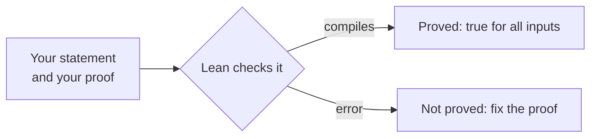

# Chapter 0 — Setup and a tour of Lean

:::tip[TL;DR]
**In short.** Install Lean and VS Code, then learn the four ideas the whole course relies on: programs you can run, structures that group data, theorems that the compiler checks, and generic code that works for any kind of number.

**New words, in simple terms:**

- **Lean**: A programming language that can also check mathematical proofs. If your proof compiles, it is correct.
- **Type**: The kind of thing a value is (a number, a list, a vector of length 3). Lean refuses to mix incompatible types.
- **Structure**: A labelled box of values, like a form with named fields.
- **Theorem**: A statement together with its proof. In Lean the proof is a program whose type is the statement.
- **Proof versus test**: A proof is certain for every possible input; a test only tells you about the cases you tried. This course does both and says which is which.
- **Tactic**: A command that builds a proof step by step. `grind` and `omega` are tactics that do a lot of routine reasoning for you.
- **Generic code (type class)**: Code written once for any kind of number. Brackets like `[Add α]` tell Lean which operations are needed, and it finds them for you.
- **Float**: The computer’s decimal numbers. They round off, so we run models on Floats but state proofs about exact numbers.
:::


## Installing

1. Install [VS Code](https://code.visualstudio.com/) and the **Lean 4** extension.
2. The extension installs `elan`, the Lean version manager. Check it from a terminal:

```bash
lean --version
lake --version
```

3. Clone this repository and build the course library:

```bash
cd lean
lake build
```

The toolchain version is pinned in `lean/lean-toolchain`, so everybody uses the same Lean.

## Programs

Lean is a functional programming language. `#eval` runs an expression and shows the result in the editor.

```lean file=Ch00/Tour.lean#hello
```

## Structures

A `structure` groups named fields. Our neurons in the next chapter are structures.

```lean file=Ch00/Tour.lean#structure
```

## Theorems

In Lean, a theorem is a program whose *type* is the statement. If the file compiles, the proof is correct. Tactics such as `omega` (linear integer arithmetic) and `grind` (a general-purpose automatic prover) build proofs for you.



*How Lean treats a theorem: if the file compiles, the statement is proved.*


```lean file=Ch00/Tour.lean#theorem
```

## Generic code

The deep learning code of this course is written once for every scalar type `α`. The brackets `[Add α]` are **type class** arguments: the compiler finds the right `+` for you.

```lean file=Ch00/Tour.lean#generic
```

:::tip[Lean Corner]
Three kinds of brackets appear everywhere: `(x : α)` explicit argument, `{α : Type}` implicit argument (inferred), `[Add α]` instance argument (found by type class resolution).
:::

## References

- Lean 4 and the Lean Community, *Theorem Proving in Lean 4* and *Metaprogramming in Lean 4* — https://leanprover.github.io/theorem_proving_in_lean4/ (the language and tactic vocabulary this course uses).
- Lean 4 standard library sources — https://github.com/leanprover-community/lean4lib (`Rat`, `Fin`, `Array` semantics).

## Exercises

1. Write `triple` and prove `triple (a + b) = triple a + triple b`.
2. Write `sumSq` for `Array α` instead of `List α`.
