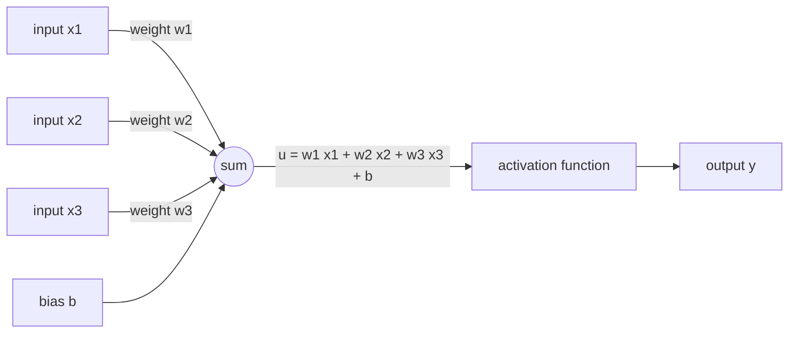

# Chapter 1 — The single neuron

:::tip[TL;DR]
**In short.** A neuron multiplies its inputs by weights, adds them up with a bias, and squashes the result with an activation function. We build it in Lean, run it, and prove that it can compute AND, OR and NAND.

**New words, in simple terms:**

- **Neuron**: A tiny calculator: multiply each input by a weight, add everything up, add a bias, then squash the result with an activation function.
- **Weight**: A number saying how much one input matters. Learning means adjusting weights.
- **Bias**: A number added at the end. It shifts the point at which the neuron switches on.
- **Activation function**: The squashing step after the sum (step, sigmoid, tanh, ReLU). Without it, stacking neurons would add nothing.
- **Sigmoid**: A smooth S-shaped curve that turns any number into a value between 0 and 1.
- **ReLU**: Keeps positive numbers as they are and turns negative numbers into 0.
- **tanh**: Like the sigmoid, but its output is between -1 and 1.
- **Vector**: An ordered list of numbers. In Lean its length is part of its type.
- **Dot product**: Multiply two lists position by position and add up the results. It is the weighted sum of a neuron.
- **Logic gate**: A tiny rule on true/false values (AND, OR, NAND). One neuron can do AND and OR.
- **Linear**: Behaving like only scaling and adding: double the input and the output doubles; add two inputs and the outputs add.
:::


<Video youtube="aircAruvnKk" title="But what is a neural network? (3Blue1Brown)" />

A **neuron** takes $n$ numbers $x_1,\dots,x_n$, computes a weighted sum plus a bias, and passes the result through an **activation function** $\varphi$:

$$ y = \varphi\Big(\sum_{i=1}^{n} w_i x_i + b\Big) = \varphi(w \cdot x + b). $$

## Vectors whose length is in the type

We represent a vector of length $n$ as a function `Fin n → α`. The length is part of the type, so adding a 2-vector to a 3-vector is a *type error*, not a runtime bug.

```lean file=Core/Vec.lean#vec
```

The dot product is defined by recursion on the length:

```lean file=Core/Vec.lean#dot
```

:::tip[Lean Corner: `structure`, implicit arguments, `Fin n`]
`Fin n` is the type of numbers `0, …, n-1`. A function `Fin n → α` therefore has exactly `n` values. Curly braces `{n : Nat}` declare an argument that Lean infers from the other arguments.
:::

## Activation functions

<Figure src="activations.svg" alt="Plot of the step, sigmoid, tanh and ReLU functions" caption="The four activation functions, drawn by Lean (lake exe figures). The step is all-or-nothing; sigmoid and tanh are smooth versions of it; ReLU keeps positive values." />


```lean file=Ch01/Neuron.lean#activations
```

They are written for any scalar type: the step uses `≤`, sigmoid and tanh use an exponential `HasExp.exp`. With `α := Float`, `HasExp.exp` is `Float.exp`.

## The neuron



*A neuron: a weighted sum of the inputs plus a bias, then an activation function.*


```lean file=Ch01/Neuron.lean#neuron
```

Run it (`lake exe ch01`) on `Float` numbers:

```text
preact  = 0.250000
step    = 1.000000
sigmoid = 0.562177
relu    = 0.250000
tanh    = 0.244919
```

## Logic gates, proved

With the step activation, a neuron computes AND, OR and NAND. The theorem is stated for **all** Boolean inputs and checked by `decide`, which evaluates the four cases.

```lean file=Ch01/Neuron.lean#gates
```

:::tip[Lean Corner: `cases` and `decide`]
`cases a` splits a `Bool` into `false` and `true`. `<;>` runs the next tactic on all resulting goals. `decide` proves a closed statement by computing it.
:::

## Linearity before the activation

Before the activation, a neuron without bias is a linear map. The proof uses the laws of the dot product (`Vec.dot_add_right`, …) which hold in any commutative ring.

```lean file=Ch01/Neuron.lean#linear
```

## A property of the sigmoid

We never use real analysis. We only assume that `exp` satisfies $e^{x+y}=e^x e^y$ and $e^0=1$ (the class `LawfulExp`), and `grind` does the field algebra:

```lean file=Ch01/Neuron.lean#sigmoid_sym
```

## Exercises

1. Build a neuron computing NOR and prove it for all inputs.
2. Prove `relu` is idempotent: `relu (relu x) = relu x` over `Int`.
3. Prove $\tanh(-x) = -\tanh(x)$ from the laws of `exp`.
