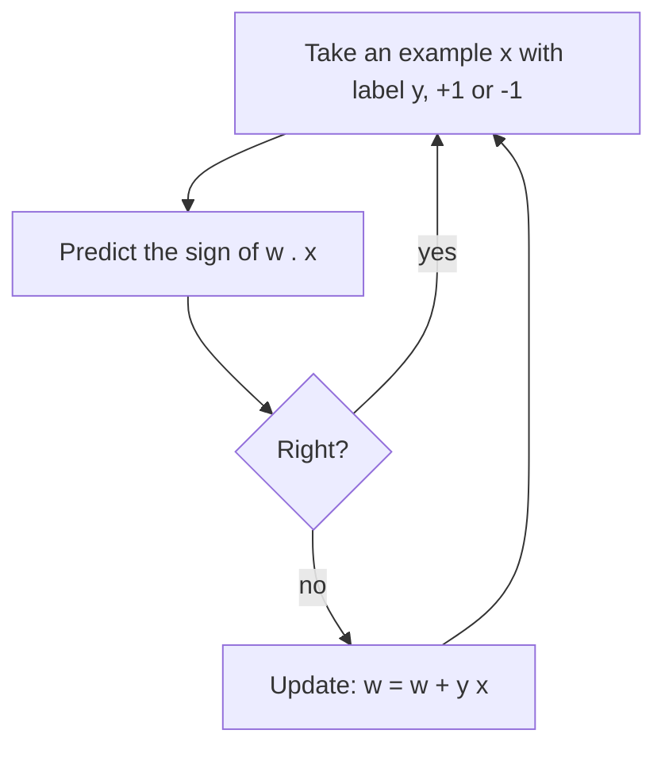

# Chapter 2 — The perceptron, XOR and the first AI winter

:::tip[TL;DR]
**In short.** One neuron draws one straight line, so it cannot compute XOR. We prove that, prove that the perceptron learning rule always stops on separable data, and see why this led to the first AI winter.

**New words, in simple terms:**

- **Perceptron**: A neuron with a hard on/off output, plus a rule for learning from its mistakes.
- **Linearly separable**: Data that one straight line (or flat plane) can split into two groups.
- **XOR**: True when exactly one of two inputs is on. No single straight line separates its two answers.
- **Perceptron learning rule**: When the answer is wrong, nudge the weights toward the right answer: add the example if it should have said yes, subtract it if no.
- **Margin**: The safety gap between the two groups of data. A bigger gap means fewer mistakes.
- **Convergence theorem (Novikoff)**: A proof that on separable data the perceptron makes a limited number of mistakes and then stops forever.
- **Cauchy–Schwarz inequality**: The dot product of two vectors is never bigger than the product of their lengths.
- **AI winter**: A period when money and interest in AI collapsed because promises were not kept. The first one began in the 1970s.
:::


## History in one paragraph

In 1958 Frank Rosenblatt introduced the **perceptron**: a threshold neuron together with a learning rule. In 1969 Marvin Minsky and Seymour Papert published *Perceptrons*, which analysed exactly what single-layer perceptrons can and cannot compute. The simplest example of what they cannot compute is **XOR**. Together with the disappointing results of other AI programmes (for example the 1973 Lighthill report in the UK), this contributed to the funding collapse of the mid-1970s known as the **first AI winter**. Historians agree the causes were several; the mathematical fact below is the technical core of the neural-network part of the story.

<Figure src="xor.svg" alt="The four XOR points in the plane" caption="No straight line separates the two blue points from the two red points." />

<Figure src="xor_points.svg" alt="Four XOR points: +1 at (0,0) and (1,1), -1 at (0,1) and (1,0), no straight line separates the colors" caption="The picture of Theorem 1: a single neuron draws one line, and the XOR points cannot be split by any line - the two positive corners sit on opposite sides of every line that separates the two negative ones. One hidden layer is not a luxury, it is the minimum." />

## Theorem 1 — no neuron computes XOR

We first state what it means for a neuron to compute XOR, for any scalar type that has `0`, `1`, `+`, `*` and a decidable `≤`:

```lean file=Ch02/Xor.lean#xor_def
```

The statement is then proved for **every linearly ordered commutative ring** `α`, hence for `Int`, `Rat`, and the real numbers. Writing the four constraints gives, with a weight vector $(w_1,w_2)$ and bias $b$:

$$ b < 0,\quad w_1 + b \ge 0,\quad w_2 + b \ge 0,\quad w_1 + w_2 + b < 0. $$

Adding the two middle inequalities gives $w_1 + w_2 + 2b \ge 0$, so $w_1+w_2+b \ge -b > 0$, contradicting the last one. The proof in Lean is the same argument, delegated to `grind`:

```lean file=Ch02/Xor.lean#xor_impossible
```

:::tip[Lean Corner: abstract algebra with `grind`]
The hypotheses `[CommRing α] [LE α] [LT α] [Std.IsLinearOrder α] …` say "α behaves like the integers or the reals". `grind` knows how to combine such hypotheses (ring identities, linear inequalities). The same statement therefore holds for all of them at once.
:::

## The learning rule

A perceptron predicts the sign of $w\cdot x$ (the bias is folded into $w$ by adding a constant coordinate `1` to every input). On an example $(x,y)$ with label $y=\pm 1$ that it gets wrong, i.e. $y\,(w\cdot x)\le 0$, it updates $w \leftarrow w + y\,x$.



*The perceptron learning loop: weights change only when the prediction is wrong.*


```lean file=Ch02/Perceptron.lean#update
```

```lean file=Ch02/Train.lean#train
```

Run it with `lake exe ch02`. AND and OR converge; XOR makes 4 mistakes in every epoch, forever:

```text
AND: mistakes per epoch = [2, 3, 3, 2, 2, 3, 2, 1, 0]
OR: mistakes per epoch = [3, 1, 2, 2, 1, 0]
XOR: mistakes per epoch = [4, 4, 4, 4, 4, ...]
```

<Figure src="perceptron_bound.svg" alt="The mistake bound R^2/gamma^2 against the margin: a hyperbolic blow-up as gamma shrinks" caption="Novikoff's bound, drawn: with R = 1, a separator at margin gamma costs at most 1/gamma^2 mistakes. A fat margin (gamma = 1) learns in one update; a razor-thin margin (gamma = 0.1) needs a hundred. The perceptron never learns faster than the geometry of the data allows." />

## Theorem 2 — Novikoff's convergence theorem

If the data *is* linearly separable with a margin, the perceptron stops. Precisely: assume a vector $w^*$ with $y_t\,(w^*\cdot x_t) \ge \gamma > 0$ for all examples and $\|x_t\|^2 \le R^2$. Then any run of $k$ mistake-driven updates starting from $w=0$ satisfies

$$ k\,\gamma^2 \;\le\; \|w^*\|^2 R^2 . $$

The classical proof has three ingredients, each a Lean lemma:

1. `alignment_grows`: after $k$ updates, $w^*\cdot w_k \ge k\gamma$.
2. `norm_grows`: after $k$ updates, $\|w_k\|^2 \le k R^2$, because each update was a mistake.
3. `cauchy_schwarz`: $(a\cdot b)^2 \le (a\cdot a)(b\cdot b)$. We prove it from scratch, without square roots, by studying the quadratic $\|s a + t b\|^2 \ge 0$.

```lean file=Ch02/Perceptron.lean#cauchy_schwarz
```

```lean file=Ch02/Perceptron.lean#novikoff
```

The theorem is stated about *any* sequence of mistake-driven updates, so it applies to the training loop above. It is proved over `Rat` (exact arithmetic).

## What this shows about XOR

Putting the two theorems side by side: on separable data the perceptron makes a bounded number of mistakes; on XOR no weight vector makes zero mistakes, so the number of mistakes can never be bounded. The cure, in the next chapter, is to stack neurons.

<Figure src="perceptron_mistakes.svg" alt="Mistakes per epoch for AND, OR and XOR" caption="Mistakes per epoch (the numbers printed by lake exe ch02). AND and OR reach zero mistakes and stop for ever; XOR makes 4 mistakes in every epoch." />


## Exercises

1. Show that no neuron computes XNOR either (`exercise_xnor` in `LeanDL/Ch02/Exercises.lean`).
2. State Novikoff's theorem for the bias-augmented inputs `Vec.cons1 x` and explain the role of the bias.

**Exercises in Lean.** The file `lean/LeanDL/Ch02/Exercises.lean` contains the statements below, with `sorry` for you to replace. The proved solutions are in `Solutions.lean` next to it: try first.

```lean file=Ch02/Exercises.lean#ex1
```

<details>
<summary>Hint 1</summary>

Write the four constraints (`b ≥ 0`, `w₁ + b < 0`, `w₂ + b < 0`, `w₁ + w₂ + b ≥ 0`) by specialising the hypothesis to the four inputs, simplify with `simp`, and finish with `grind` (linear arithmetic).

</details>

<details>
<summary>Solution 1</summary>

```lean file=Ch02/Solutions.lean#sol1
```

</details>
