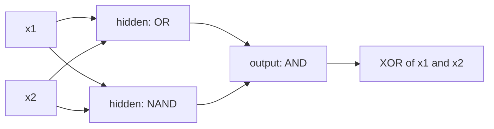

# Chapter 3 — The multi-layer perceptron

:::tip[TL;DR]
**In short.** Stack neurons into layers and XOR becomes easy. We prove that one hidden layer can compute any true/false function, then let a small network learn XOR by gradient descent.

**New words, in simple terms:**

- **Layer**: A row of neurons that all read the same inputs.
- **Hidden layer**: A layer between the input and the output. The network invents its own useful intermediate features there.
- **MLP (multi-layer perceptron)**: Several layers stacked: the outputs of each layer are the inputs of the next.
- **Shape-checked network**: A network whose layer sizes appear in its type, so a network with mismatched layers does not compile.
- **Universality**: With enough neurons, one hidden layer can compute any true/false function.
- **Loss**: One number saying how wrong the network is. Learning means making it smaller.
- **Gradient descent**: Learning by small steps: measure how the loss changes with each weight, then move every weight a little downhill.
- **Learning rate**: The size of each gradient-descent step. Too big and you overshoot; too small and you crawl.
- **Chain rule**: To get the effect of a first change on a last result, multiply the effects of every step in between.
- **Error signal (delta)**: How much a neuron is responsible for the final error. It is passed backwards from layer to layer.
:::


Chapter 2 ended with a wall: one neuron cannot compute XOR. The way around it is to **stack** neurons into layers.

## Layers and shapes

A layer with `nin` inputs and `nout` neurons holds one weight row and one bias per neuron. Its weights are a matrix `Mat α nout nin`; the shapes appear in the type, so a layer cannot be fed a vector of the wrong size.

```lean file=Core/Mat.lean#mat
```

```lean file=Ch03/Mlp.lean#layer
```

The last theorem says a layer is nothing new: it is `nout` neurons of Chapter 1 sharing one input. It is proved by `rfl`: both sides are the same computation.

## A network whose shapes are checked

```lean file=Ch03/Mlp.lean#mlp
```

:::tip[Lean Corner: indexed inductive types]
`MLP α n m` is a family of types indexed by the input size `n` and the output size `m`. The constructor `cons` only accepts a layer `n → h` followed by a network `h → m`, so the sizes of consecutive layers *must* match. A network with mismatched layers is not a runtime error: it is a program that does not type-check.
:::

## XOR, solved

XOR is `AND (OR x₁ x₂) (NAND x₁ x₂)`: the hidden layer computes OR and NAND, the output neuron is an AND. The theorem is checked on all four inputs by `decide`.



*XOR with one hidden layer: XOR = AND(OR, NAND). Each box is one neuron of Chapter 1.*


```lean file=Ch03/Mlp.lean#xornet
```

Compare with Chapter 2: the same neurons and the same step activation, but two layers instead of one.

## Theorem — every Boolean function is a one-hidden-layer network

XOR is not a one-off. For any Boolean function `f` of `n` inputs:

1. For each input pattern `c` where `f c = true`, build a hidden neuron with weights $+1$ where $c_i$ is true and $-1$ elsewhere, and bias $-k$, where $k$ is the number of true entries of $c$. Its pre-activation is $\sum_i s_i x_i - k$, which is $\le 0$ for every 0/1 input and equals $0$ exactly when $x = c$. It therefore fires exactly on $c$.
2. The output neuron fires when at least one hidden neuron fires (an OR).

The key lemma, proved by induction on $n$:

```lean file=Ch03/Universal.lean#detector_spec
```

and the correctness of the whole construction:

```lean file=Ch03/Universal.lean#net_correct
```

```lean file=Ch03/Universal.lean#universal
```

The hidden layer has one neuron per true input pattern, so up to $2^n$ neurons. Depth buys exponentially fewer neurons for many functions, but that is a different theorem. The real-valued universal approximation theorem (Cybenko, Hornik) is *not* proved here: it needs real analysis.

## Learning XOR

Having shown that a network *exists*, we now let one **learn** it. We use sigmoid neurons (differentiable, unlike the step) and minimise the squared error $\tfrac12(\hat y - y)^2$ by gradient descent. The chain rule, applied once by hand:

<Figure src="gradient_descent.svg" alt="Gradient descent trajectories for four learning rates" caption="Gradient descent on L(w) = w², starting at w = 1. A small rate is slow but steady; 0.9 oscillates while shrinking; 1.05 overshoots more each time and diverges." />


$$ \delta_2 = (\hat y - y)\,\hat y(1-\hat y), \qquad \delta_{1,j} = \delta_2\, w_{2,j}\, a_j(1-a_j), $$

and every parameter moves by $-\eta\,\delta\cdot(\text{its input})$.

```lean file=Ch03/Train.lean#net2
```

```lean file=Ch03/Train.lean#sgd
```

Run `lake exe ch03`: the loss falls from 0.51 to 0.0003 and the network outputs about 0.01 on $(0,0)$ and $(1,1)$ and about 0.99 on $(0,1)$ and $(1,0)$.

:::warning Lean Corner: a pitfall with functions as vectors
`Vec` is a function. A parameter updated as `fun i => old i - …` keeps a reference to the previous version, which keeps a reference to the one before, and so on: after a few dozen steps, evaluating one weight takes exponential time. The executable network therefore stores plain arrays:

```lean file=Ch03/Train.lean#net2a
```

`Net2A.toNet2` converts back to the `Vec` specification, and the demo prints both predictions: they agree.
:::

## Exercises

1. Build a 2-layer network for XNOR and prove it correct by `decide`.
2. Using `universal`, show that for $n = 3$ the parity function is computed by a network with one hidden layer. How many hidden neurons does the construction use?
3. Change the number of hidden units in `Demos/Ch03.lean` from 3 to 2. Does training still succeed from every initialisation?

Next chapter: instead of deriving gradients by hand, we let the computer do it.

**Exercises in Lean.** The file `lean/LeanDL/Ch03/Exercises.lean` contains the statements below, with `sorry` for you to replace. The proved solutions are in `Solutions.lean` next to it: try first.

```lean file=Ch03/Exercises.lean#ex1
```
