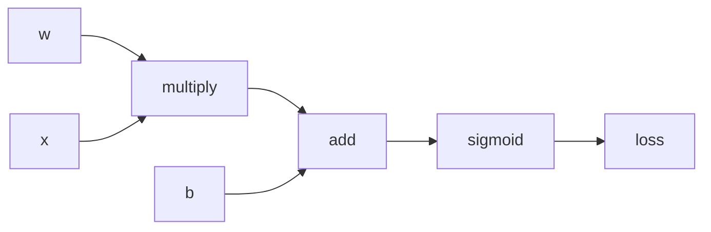
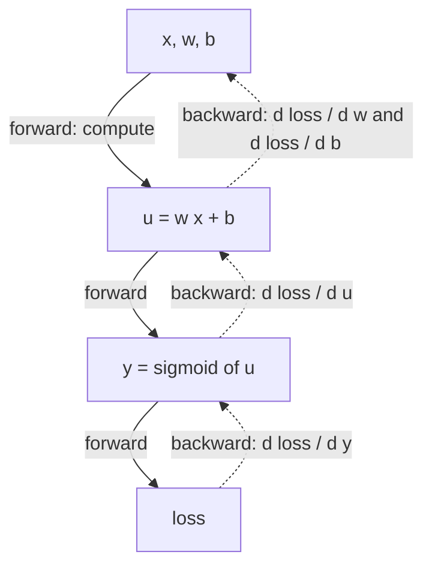

# Chapter 4 — Deep networks and automatic differentiation

:::tip[TL;DR]
**In short.** Instead of deriving gradients by hand, a program computes them. We build forward-mode and reverse-mode automatic differentiation (backpropagation) in Lean and prove both correct.

**New words, in simple terms:**

- **Derivative**: How fast an output changes when you nudge one input.
- **Gradient**: The list of all derivatives with respect to all weights. It points uphill, so we step the opposite way.
- **Automatic differentiation (autodiff)**: A program that computes exact derivatives of any computation by applying the chain rule mechanically.
- **Expression tree**: A computation written as a tree of small operations (add, multiply, sigmoid…). Autodiff walks over this tree.
- **Forward mode**: Carry a derivative along while computing the value. One pass gives the effect of one chosen direction.
- **Backpropagation (reverse mode)**: Compute forward, then sweep backwards once to get the derivative for all weights at the same time.
- **Adjoint**: The running message in the backward sweep: how much the final result changes per unit change of this node.
- **Gradient check**: Verify a gradient by nudging a weight a tiny bit and seeing how the loss really moves (finite differences).
- **Proof by induction**: Prove a statement for the smallest case, then show that if it holds for the smaller pieces it holds for the bigger one.
:::


In Chapter 3 we derived the gradient of a 2-layer network by hand. For ten layers, or a Transformer, nobody does that: the computer applies the chain rule mechanically. This is **automatic differentiation** (autodiff), and it is the engine of every deep learning framework. In this chapter we build one in Lean, **and prove it correct**.

## Expressions

We describe a computation as an expression tree over $n$ input variables (the parameters).



*A computation as an expression tree (here, the loss of one sigmoid neuron). Autodiff walks over this tree.*


```lean file=Ch04/Autodiff.lean#expr
```

:::tip[Lean Corner: inductive types and structural recursion]
`Expr` is an `inductive` type: a value is built by one of the constructors. A function defined by pattern matching on every constructor, calling itself only on sub-expressions (like `eval`), is *structurally recursive*: Lean checks that it terminates, and proofs about it go by `induction`.
:::

## What is "the derivative"?

We define the **formal partial derivative** $\partial_j e$ of an expression with respect to the variable $j$, as another expression: the sum rule, the product rule, and the chain rule for each non-linearity ($\exp' = \exp$, $\sigma' = \sigma(1-\sigma)$, $\tanh' = 1-\tanh^2$, $\log' = 1/x$, $(1/x)' = -1/x^2$, $\sqrt{x}' = 1/(2\sqrt{x})$, and $\mathrm{relu}' = \mathrm{step}$). These primitives are all we need for the rest of the course: softmax, normalization, attention.

```lean file=Ch04/Autodiff.lean#deriv
```

This is the specification. It is slow (the derivative expression can be much bigger than the original), but obviously right. The two algorithms below must agree with it.

## Forward mode

Carry a *tangent* next to each value: the derivative along a chosen direction `dx`.

```lean file=Ch04/Autodiff.lean#fwd
```

One forward pass gives one directional derivative. For the full gradient of a function of $n$ parameters you need $n$ passes.

## Reverse mode (backpropagation)

Run the computation forward, then sweep backwards from the output carrying the **adjoint** $s$ = the derivative of the final output with respect to the value of the current node. Each node multiplies $s$ by its local derivative and passes it to its children. At a variable, the adjoint is added to that variable's gradient entry.



*Reverse mode: one forward pass computes the values (solid arrows), one backward sweep pushes the derivative back to every weight (dashed arrows).*


```lean file=Ch04/Autodiff.lean#back
```

One backward sweep gives **all** $n$ partial derivatives, at a cost comparable to one forward pass. That is why training networks with millions of parameters is feasible.

## Both modes are correct

First, forward mode computes the value and the directional derivative $\sum_i dx_i\,\partial_i e$:

```lean file=Ch04/Correct.lean#fwd_correct
```

Then the key theorem: the backward sweep adds exactly $s \cdot \partial_j e$ to coordinate $j$. The proof is an induction over the expression, and each case is a ring identity discharged by `grind`.

```lean file=Ch04/Correct.lean#back_correct
```

The last theorem is the precise sense in which **reverse mode is the transpose of forward mode**: the directional derivative equals $dx \cdot \nabla e$.

:::info What is proved, and what is not
The theorems hold in any commutative ring with an `exp`, a `sigmoid` and a `tanh`; the derivative table is the *definition* of `deriv`. That the table is the true derivative of the real functions is the standard calculus theorem, which we do not re-prove (it would need real analysis). Floating-point rounding is not modelled either. As a safety net the demo performs a **gradient check** against finite differences.
:::

## Back to the neuron

With the machinery in place, the delta rule of Chapter 3 is a corollary: backpropagation through one sigmoid neuron with squared error returns $\partial L/\partial w_0 = 2(\sigma(u)-y)\,\sigma(u)(1-\sigma(u))\,x_0$.

```lean file=Ch04/Network.lean#delta_rule
```

<Figure src="chain_stack.svg" alt="Log gradient through a stack of sigmoid layers falls linearly in L: (1/4)^L worst case, (0.5)^L typical" caption="Why depth is a multiplication: each sigmoid layer is a factor at most 1/4, so the end-to-end gradient falls in a straight line on the log axis. This is the vanishing-gradient theorem in one picture - and the reason ReLU (local slope 1) took over." />

<Figure src="relu_dead.svg" alt="Two curves: the alive ReLU y = max(0,x) rising from the origin, and the dead ReLU flat at zero across the whole axis" caption="The dead ReLU, drawn: a unit whose weights pushed its input always negative outputs exactly 0 everywhere - the ReLU gradient is 0 on that whole half-line, so no loss gradient flows and the unit never recovers (relu_grad, Ch04). Initialization is not cosmetic: it decides how many units stay alive." />

## Networks of any depth

A dense layer and a whole multi-layer perceptron are just functions that build expressions. Nothing in the autodiff code knows about layers.

```lean file=Ch04/Network.lean#builders
```

## Run it

`lake exe ch04` trains a **2-3-3-1** network (25 parameters, two hidden layers) on XOR. The gradient is never written by hand.

```text
parameters: 25
max |backprop - finite difference| over 25 parameters = 0.000000
after 0 steps: loss = 1.014810
after 1000 steps: loss = 0.000666
...
(0.000000, 1.000000) -> 0.995773   target 1.000000
(1.000000, 1.000000) -> 0.005598   target 0.000000
```

The random initial parameters come from a deterministic generator written in Lean (`Core/Rng.lean`), so every run is reproducible.

## Exercises

1. Add a `softplus` constructor ($\log(1+e^x)$, derivative $\sigma$) and extend the proofs.
2. `relu` has no derivative at 0; the table above uses `step` (which is 0 at 0). What would change if `step 0 = 1`? Do the theorems still hold?
3. State and prove the delta rule for $\partial L / \partial b$.
4. Why is `back` quadratic in the depth of the expression? How would memoising `eval` fix it?

**Exercises in Lean.** The file `lean/LeanDL/Ch04/Exercises.lean` contains the statements below, with `sorry` for you to replace. The proved solutions are in `Solutions.lean` next to it: try first.

```lean file=Ch04/Exercises.lean#ex1
```

```lean file=Ch04/Exercises.lean#ex2
```

<details>
<summary>Hint 1</summary>

Use `backprop_correct` for coordinate 2 to replace `backprop` by the formal derivative, unfold `neuronLoss`, `sqErr`, `Expr.deriv` and `Expr.eval`, then close the ring identity with `grind`.

</details>

<details>
<summary>Solution 1</summary>

```lean file=Ch04/Solutions.lean#sol1
```

</details>

<details>
<summary>Hint 2</summary>

Same method with coordinate 0: the derivative of `x₀ * x₁` with respect to `x₀` is `1 * x₁ + x₀ * 0`.

</details>

<details>
<summary>Solution 2</summary>

```lean file=Ch04/Solutions.lean#sol2
```

</details>