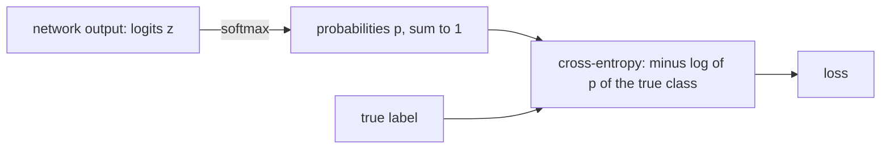

# Chapter 5 — Losses, optimizers, regularisation and MNIST

:::tip[TL;DR]
**In short.** Everything needed to really train a network: a loss for classification (softmax and cross-entropy), tools against over-fitting, optimizers (SGD, momentum, Adam), and a first real dataset, MNIST handwritten digits.

**New words, in simple terms:**

- **Softmax**: Turns a list of scores into probabilities: all positive, adding up to 1.
- **Logits**: The raw scores a network outputs, before the softmax.
- **Cross-entropy**: The loss for classification: large when the network gives a low probability to the true class.
- **Overfitting**: Learning the training examples by heart instead of the general rule, so that new data fails.
- **Regularisation (weight decay)**: A gentle pull that keeps weights small to discourage over-fitting.
- **Normalisation**: Re-centre and rescale numbers inside the network so they stay in a comfortable range.
- **Optimizer**: The rule that turns a gradient into a weight update.
- **SGD**: Stochastic gradient descent: gradient descent where every step uses only a small random batch of examples.
- **Momentum**: Keep a bit of the previous step’s direction, like a rolling ball.
- **Adam**: An optimizer that adapts the step size of every weight using running averages of past gradients.
- **Mini-batch and epoch**: A mini-batch is a small group of examples used for one step. An epoch is one pass over all the training data.
- **Test set**: Examples never used for training, kept to measure real performance.
- **MNIST**: A famous dataset of 70 000 handwritten digits.
:::


Chapter 4 gave us gradients. This chapter turns them into *learning*: which function to minimise (the **loss**), how to follow the gradient (the **optimizer**), how to keep the model from over-fitting (**regularisation**), and a first real dataset, **MNIST** handwritten digits.

## Cross-entropy and softmax

For classification, the network outputs $m$ numbers $z$ (the *logits*). The softmax turns them into probabilities $p_k = e^{z_k} / \sum_i e^{z_i}$, and the loss for true class $y$ is $-\log p_y = \log\sum_i e^{z_i} - z_y$. As an expression:



*From raw scores to a loss: softmax makes probabilities, cross-entropy punishes a low probability on the true class.*


```lean file=Ch05/Loss.lean#softmax_loss
```

The theorem is the classical (and slightly magical) fact: **the gradient of cross-entropy with respect to the logits is $p - \text{onehot}(y)$**. Notice what it does *not* contain: no derivative of a logarithm, no division by a probability.

:::tip[Lean Corner: lists and `Fin`]
The sum over classes is a sum over `List.finRange m`. The proof needs one small lemma about lists: summing $f(i)\cdot[i=k]$ over a list without duplicates that contains $k$ gives $f(k)$ (`sumL_indicator`). The hypotheses `Nodup` and `k ∈ l` are exactly what is needed; Lean does not let you forget them.
:::

:::info Numerical stability
Computing $e^{z}$ overflows for large $z$. Implementations subtract $\max_i z_i$ first (the MNIST code below does). This does not change the softmax, which is why it is allowed. We do not prove that identity formally here, because it needs a law relating `exp`, `inv` and products; it is a good exercise in a field.
:::

## L2 regularisation (weight decay)

Adding $c\sum_i w_i^2$ to the loss penalises large weights. Its gradient is $2c\,w_k$, so each gradient step also shrinks the weights, which is why it is called *weight decay*.

```lean file=Ch05/Loss.lean#l2
```

## Normalisation

Layer normalisation starts by *centring* the activations. Here is the part that can be proved without a square root: the centred entries sum to zero.

```lean file=Ch05/Norm.lean#centering
```

The full layer norm (dividing by the standard deviation, with learnable scale and shift) comes with the Transformer in Chapter 9.

## Optimizers

Plain gradient descent updates $w \leftarrow w - \eta\,\nabla L(w)$. Two refinements dominate practice: **momentum** (average the gradients over time) and **Adam** (also rescale each coordinate by the size of its recent gradients). All three are small pure functions on arrays:


*The training loop that every chapter after this one reuses.*


```lean file=Ch05/Optim.lean#exec
```

What can we *prove* about them? First, **gradient descent on a quadratic** $f(w) = \tfrac a2 w^2$: the iteration is $w \leftarrow (1-\eta a)\,w$, so $w_t = (1-\eta a)^t w_0$. It converges iff $|1-\eta a|<1$ and diverges when the step $\eta$ is too large.

```lean file=Ch05/Optim.lean#sgd_quadratic
```

Second, **Adam's bias correction**. Adam keeps exponential moving averages, started at $0$. With a constant gradient $g$ the average after $t$ steps is $(1-\beta^t)\,g$: biased towards $0$ at the start.

```lean file=Ch05/Optim.lean#ema
```

```lean file=Ch05/Optim.lean#ema_laws
```

Dividing by $1-\beta^t$, which is exactly what Adam does, removes the bias:

```lean file=Ch05/Optim.lean#bias_correction
```

Third, **what SGD is guaranteed to do** — the optimiser's specification, over exact `Rat`. Write the quadratic step as $w' = (1-\eta a)\,w$: when the step size is in the stable range $0 < \eta a < 2$, the factor $1 - \eta a$ lies in $[-1,1]$, so it can never amplify the iterate. One step never increases the loss, *every* iterate stays below the initial loss, and at the critical step $\eta = 1/a$ the run lands on the minimiser in exactly one move. The divergence curve in the demo (a step too big) is the negation of this condition — a proven fact, not a curiosity.

```lean file=Ch05/Optim.lean#sgd_spec
```

Fourth, **the bridge to floating point.** The demos run `Float`, Lean's machine arithmetic, which has no exact laws. The bridge is a *budget*: run the iteration with a per-step perturbation $e_t$ of size at most $\varepsilon$ — which is all rounding does, among other perturburations — and the drift theorem (`Core/Algebra.lean`, `drift_bound`) proves by induction that while the exact dynamics are stable ($|c| \le 1$), the perturbed run never drifts more than $t\varepsilon$ from the exact run after $t$ steps: the error grows **linearly, never exponentially**. `sgd_rounding_drift` instantiates this for SGD in the stable range. A Float curve that tracks the exact curve to within a hair is now a theorem-backed expectation, not a hope.

### Comparing them

`lake exe ch05` trains the 2-3-3-1 network of Chapter 4 from the same initial parameters with the three optimizers. The training loss after $t$ steps:

| steps | 50 | 100 | 200 | 400 | 800 | 1600 |
|-------|----|-----|-----|-----|-----|------|
| SGD (η = 0.3) | 0.992 | 0.821 | 0.674 | 0.0124 | 0.00198 | 0.00070 |
| Momentum (η = 0.05, μ = 0.9) | 0.989 | 0.739 | 0.641 | 0.0057 | 0.00119 | 0.00043 |
| Adam (η = 0.05) | 0.659 | 0.0107 | 0.0029 | 0.0010 | 0.00034 | 0.00011 |

Adam gets below 0.011 after 100 steps; plain SGD needs about 400. This is a single small experiment, not a benchmark: the learning rates were not tuned.

## MNIST

MNIST is 60 000 training and 10 000 test images of handwritten digits, $28\times 28$ pixels. We read the standard IDX files with a parser written in Lean:

```lean file=Ch05/Mnist.lean#idx
```

The network has one hidden layer of 64 ReLU units. For speed it works on unboxed `FloatArray`s with hand-coded backpropagation (the generic `Expr` of Chapter 4 would build a graph with millions of nodes per image).

```lean file=Ch05/Mnist.lean#net
```

```lean file=Ch05/Mnist.lean#sgd
```

The output-layer error `p - onehot y` is exactly the theorem `ceLoss_grad`. The hidden layer is back-propagated through $W_2$ and the ReLU derivative, as in Chapter 3.

Download the data once, then train:

```bash
pwsh scripts/get-mnist.ps1     # or: sh scripts/get-mnist.sh
cd lean && lake exe mnist 60000 10000 3
```

```text
epoch 1: test accuracy = 0.957100
epoch 2: test accuracy = 0.965700
epoch 3: test accuracy = 0.963500
```

About one minute on a laptop CPU, with the full training set, three passes, plain SGD with learning rate 0.01 and no tuning: **96.4 % test accuracy**.

:::warning What the hand-coded training is not
The MNIST code is not proved correct: only the formula for its output-layer gradient is. To gain confidence, Chapter 4's recipe applies: compare with finite differences on a tiny instance.
:::

<Figure src="lr_stability.svg" alt="SGD absolute w after 600 steps on a quadratic: decays to zero for small rates, explodes past the cliff near eta = 1" caption="The optimizer's cliff, measured. On L(w) = w² with curvature 2, SGD is a contraction exactly while the rate sits under the cliff (eta < 1); past it, every theorem about descent stops applying and |w| explodes. The same picture underlies the step-size analysis of Chapter 5 - and every training run that diverges at epoch 3." />

## Certified intervals: bounding a Float run

The demos run on `Float`, and `Float` promises nothing: rounding is not in the type. The honest bridge is a **rational interval** — bounds `lo` and `hi` in `Rat`, the exact scalar of the proofs — with a theorem per operation stating the true value lies inside:

```lean file=Core/Interval.lean#interval
```

Every operation carries its enclosure theorem, proved by `grind` from nothing but the two inequalities: `add_spec`, `neg_spec`, `sub_spec`. Multiplication is the hard one — multiplying an inequality by a negative number flips it — so the enclosure is the **four-corner rule**:

```lean file=Core/Interval.lean#mul
```

The rule is an inclusion, not an equality: with dependent inputs (`x * x`) not every corner is reachable — interval arithmetic's classic over-estimation, witnessed in the file by the two examples on `sub` of a wide interval by itself. Inverse demands a positivity hypothesis (`invPos`, `divPos`): an interval containing 0 has no finite enclosure, and the typechecker forces you to say why that cannot happen.

What a certified demo publishes is then a closed rational fact — `(mul (point (1/2)) (point (1/2))).lo = 1/4` — checked by `grind`, the same tactic that checks the proofs. A Float run gives the witness; the interval gives the guarantee.

<Figure src="float_drift.svg" alt="Accumulated drift of the Float sum of ten thousand 0.1s against the exact rational answer, oscillating and growing with the exponent of the running sum" caption="The price of Float, measured: adding 0.1 one thousand times. The exact answer is the integer 1000 - a Rat certificate - but 0.1 is not a binary fraction, so every addition rounds. The drift oscillates with the exponent of the running sum and grows: exactly the gap Core/Interval.lean is built to bound." />

## Exercises

1. Prove `softmax` entries are non-negative and sum to one over `Rat`, with the usual `exp` laws.
2. Show that the shift $z \mapsto z - c$ does not change `softmax` in a field.
3. Implement *dropout* with `Rng`: zero each hidden unit with probability $q$ during training and rescale by $1/(1-q)$. Measure the effect on test accuracy.
4. Add an L2 penalty to `Net.sgdStep`. For which values does test accuracy improve?

**Exercises in Lean.** The file `lean/LeanDL/Ch05/Exercises.lean` contains the statements below, with `sorry` for you to replace. The proved solutions are in `Solutions.lean` next to it: try first.

```lean file=Ch05/Exercises.lean#ex1
```

```lean file=Ch05/Exercises.lean#ex2
```

<details>
<summary>Hint 1</summary>

Rewrite with `sgdQuad_closed` for `t = 2`, unfold `powN`, and close the ring identity with `grind`.

</details>

<details>
<summary>Solution 1</summary>

```lean file=Ch05/Solutions.lean#sol1
```

</details>

<details>
<summary>Hint 2</summary>

Unfold `ema`: `ema β g 0 = 0`, so the value after one step is `β * 0 + (1 - β) * g`.

</details>

<details>
<summary>Solution 2</summary>

```lean file=Ch05/Solutions.lean#sol2
```

</details>
