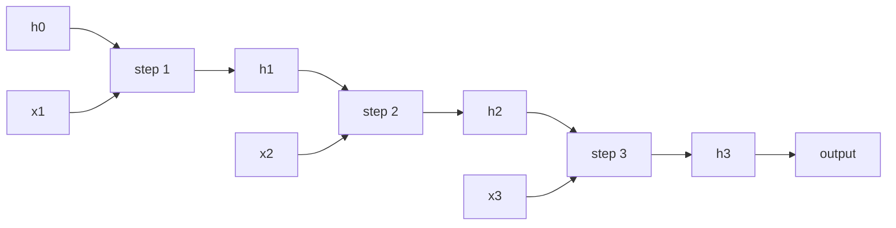

# Chapter 7 — Recurrent networks

:::tip[TL;DR]
**In short.** A recurrent network reads a sequence step by step and keeps a memory. We prove why its gradient vanishes or explodes on long sequences, and watch it fail on a memory task.

**New words, in simple terms:**

- **Recurrent neural network (RNN)**: A network that reads a sequence one element at a time and carries a memory forward.
- **Hidden state**: The network’s memory: a vector updated at every step.
- **Unrolling**: Writing the loop out as many copies of the same network, one per time step.
- **Backpropagation through time (BPTT)**: Backpropagation on the unrolled network.
- **Vanishing gradient**: The learning signal shrinks at every step backwards until nothing is left, so distant causes are not learned.
- **Exploding gradient**: The opposite: the signal grows at every step until it is huge and unstable.
- **Gradient clipping**: Cap the size of the gradient to tame explosions.
:::


Images have a fixed size; sentences, audio and sensor streams do not. A **recurrent neural network** (RNN) reads its input one element at a time and carries a **state** $h_t$ from step to step:

$$ h_t = \tanh(W_h\,h_{t-1} + W_x\,x_t + b), \qquad \hat y = \sigma(w_o\cdot h_T + b_o). $$

The *same* weights are used at every step (the temporal analogue of the weight sharing of Chapter 6). To train it we **unroll** it: a recurrence of length $T$ is a feed-forward network of depth $T$ whose layers share their weights. Backpropagation on the unrolled network is called **backpropagation through time** (BPTT).

## The state of a recurrent network is a product

Let us understand the gradient with the simplest possible network: one unit, $h_{t+1} = \tanh(w\,h_t + c_t)$, with the input folded into $c_t$. We build the unrolled network as an `Expr` in the single variable $h_0$:



*An RNN unrolled over three steps. Every step uses the same weights; the state h is the memory.*


```lean file=Ch07/Gradient.lean#unroll
```

Chapter 4's machinery applies directly. The formal derivative with respect to $h_0$ obeys a simple recurrence, and `backprop` on the unrolled network returns exactly that product:

```lean file=Ch07/Gradient.lean#bptt
```

In words:

$$ \frac{\partial h_T}{\partial h_0} \;=\; \prod_{s=1}^{T} \bigl(1-h_s^2\bigr)\,w . $$

BPTT multiplies $T$ factors. Whether the product shrinks, stays or grows is the whole story of training RNNs.

<Figure src="rnn_chain.svg" alt="log10 of the gradient through T unrolled time steps: 0.5^T typical and 0.25^T worst fall as straight lines" caption="Unrolling an RNN turns backprop into the Ch03 depth product, with time in place of layers: log10 falls linearly, -0.3 per step typical, -0.6 worst. Ten steps back is already a thousandth of the signal - the formal vanishing the LSTM highway (Ch08) is built to escape." />

## Vanishing gradients

Each factor $1 - h_s^2$ lies between $0$ and $1$ (because $|\tanh|\le 1$). So if $|w| < 1$ the product is at most $|w|^T$: it **decays exponentially with the length of the sequence**. The theorem below states this for squares, which avoids absolute values; it is proved over `Rat`, with exact arithmetic.

<Figure src="vanishing.svg" alt="Gradient size against the number of steps for four recurrent weights" caption="Size of the gradient after T steps for a recurrent weight w (log scale, the theorem of this section). Below 1 it vanishes, above 1 it explodes, and only w = 1 is stable." />


```lean file=Ch07/Gradient.lean#vanishing
```

:::info What "tanh² ≤ 1" is
In the theorem `tanh_jacobian_sq_le` it is a hypothesis `hb` about the activation, which holds for the real hyperbolic tangent. Our `HasAct` class only says *that* a function called `tanh` exists, so the bound has to be assumed.
:::

## Exploding gradients

Without a saturating activation there is nothing to cap the factors. For the linear recurrence $h_{t+1} = w\,h_t + c_t$ the gradient is exactly $w^T$:

```lean file=Ch07/Gradient.lean#exploding
```

With $w=2$ the gradient is multiplied by a million in 20 steps; with $|w|<1$ it dies. Training a long RNN is therefore walking a tightrope, and no value of $w$ is comfortable. (Practitioners clip gradients against the explosion; the vanishing is the harder problem, and motivates the LSTM of the next chapter.)

## An RNN with $n$ units, in Lean

For real vectors we use arrays. (The tree-shaped `Expr` of Chapter 4 would copy the whole history every time a unit reads the previous state, which is exponential in $T$.) The forward pass keeps all the hidden states:

```lean file=Ch07/Rnn.lean#forward
```

BPTT then walks backwards from the last step. Notice the line that pushes the error to the previous state: it is multiplication by $W_h^\top$ and by $(1-h_t^2)$, exactly the factors of the theorem, now as matrices.

```lean file=Ch07/Rnn.lean#bptt
```

`lossGrad` also returns $\|\partial L/\partial h_t\|$ at every step, so we can watch the vanishing happen.

:::warning What is proved, and what is checked
The theorems are about the one-unit network. The $n$-unit code is not proved; the demo compares its gradient with central finite differences.
:::

## Run it

```bash
cd lean && lake exe rnn
```

```text
BPTT gradient check over 89 parameters: max error = 0.000000
‖∂L/∂h_t‖ for t = 30, 25, 20, 15, 10, 5, 1:
  0.347510, 0.069822, 0.006518, 0.000685, 0.000059, 0.000006, 0.000001
```

The gradient arriving at the last state has size $0.35$; five steps further back it is $0.07$, and by the first step it is $10^{-6}$: a loss of more than **five orders of magnitude** in 29 steps, a factor of roughly 1.5 per step, as the theory predicts for small weights.

### Can it remember?

The *memory task*: the label is the **first** bit of a random bit sequence, so the information has to survive $T-1$ steps. Eight units, Adam, 800 steps, 32 training sequences, 300 fresh test sequences:

| $T$ | train loss | train accuracy | test accuracy |
|-----|-----------|----------------|---------------|
| 3 | 0.00005 | 100 % | 100 % |
| 20 | 0.00013 | 100 % | 100 % |
| 60 | 0.0022 | 100 % | **49.7 %** |
| 120 | 0.12 | 96.9 % | **45.0 %** |

For $T\le 20$ the network learns the rule. For $T\ge 60$ it fits the 32 training sequences (it *memorises* them) but is at chance level on new ones: the gradient from the label never reached the first input, so it could not discover the rule. This is a single seed and a single configuration, so the exact cut-off is not meaningful; the *shape* of the result is. (Adam and 8 units are good enough to delay the failure far beyond what plain gradient descent achieves.)

## Exercises

1. In `jacRec_sq_le`, what happens if some factor $g_s$ is allowed to exceed 1? Find the smallest counter-example.
2. Prove `deriv_hE` for $h_{t+1} = \tanh(w\,h_t + c_t)$ when $w$ is itself a variable. What is $\partial h_T/\partial w$?
3. Add gradient clipping (rescale the gradient if its norm exceeds a threshold) to the training loop. Does it help on the memory task at $T = 60$?
4. Replace the 32 training sequences by a fresh batch at every step. Does the network still memorise at $T = 60$?

**Exercises in Lean.** The file `lean/LeanDL/Ch07/Exercises.lean` contains the statements below, with `sorry` for you to replace. The proved solutions are in `Solutions.lean` next to it: try first.

```lean file=Ch07/Exercises.lean#ex1
```

```lean file=Ch07/Exercises.lean#ex2
```

<details>
<summary>Hint 1</summary>

Unfold `jacRec` once: the new factor contains `w * jacRec w g t` with `w = 0`. `grind` finishes.

</details>

<details>
<summary>Solution 1</summary>

```lean file=Ch07/Solutions.lean#sol1
```

</details>

<details>
<summary>Hint 2</summary>

Induction on `t`. In the step, `simp only [jacRec, ih]` leaves `1 * (1 * 1) = 1`, which `grind` closes.

</details>

<details>
<summary>Solution 2</summary>

```lean file=Ch07/Solutions.lean#sol2
```

</details>
