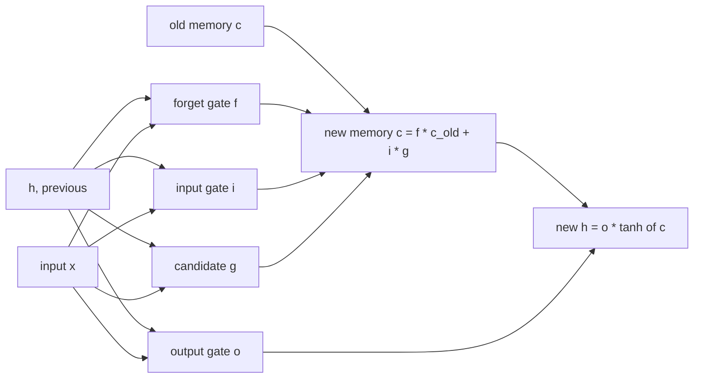

# Chapter 8 — LSTM and gated memory

:::tip[TL;DR]
**In short.** The LSTM adds gates and a memory cell so that the gradient can travel far back. We prove the gradient highway, and honestly report that on our small task it did not beat the plain RNN.

**New words, in simple terms:**

- **LSTM**: An RNN with gates and a separate memory cell, designed so that the learning signal can travel far back.
- **Gate**: A number between 0 and 1 that decides how much of something passes: 0 closes, 1 opens.
- **Cell state**: The LSTM’s long-term memory line, updated by scaling and adding.
- **Forget gate**: Decides how much of the old memory to keep.
- **Constant error carousel**: The path where the memory is kept with factor 1, so the gradient neither shrinks nor grows.
- **GRU**: A lighter gated unit with one gate that mixes the old state and the new candidate.
- **Curriculum learning**: Train on easy versions of the task first (short sequences), then make it harder.
:::


Chapter 7 ended with a diagnosis: in a plain RNN the gradient is a product of $T$ factors $(1-h_s^2)\,w$, each of which is typically smaller than 1. The **Long Short-Term Memory** network (Hochreiter and Schmidhuber, 1997) changes the architecture so that the gradient has a path whose factors the network itself can set close to $1$.

## The LSTM

Besides the hidden state $h_t$ the LSTM carries a **cell state** $c_t$. Four small neural layers (the *gates*) read $h_{t-1}$ and $x_t$:



*One LSTM step. The new memory is the old memory scaled by the forget gate plus what the input gate lets in.*


$$
\begin{aligned}
f_t &= \sigma(W_f[h_{t-1},x_t]+b_f) & &\text{forget gate}\\
i_t &= \sigma(W_i[h_{t-1},x_t]+b_i) & &\text{input gate}\\
g_t &= \tanh(W_g[h_{t-1},x_t]+b_g) & &\text{candidate}\\
o_t &= \sigma(W_o[h_{t-1},x_t]+b_o) & &\text{output gate}
\end{aligned}
\qquad
\begin{aligned}
c_t &= f_t\odot c_{t-1} + i_t\odot g_t\\
h_t &= o_t\odot \tanh(c_t)
\end{aligned}
$$

The line that matters is $c_t = f_t\odot c_{t-1} + i_t\odot g_t$: the memory is updated by *scaling and adding*, not by squashing everything through a weight matrix and a $\tanh$.

```lean file=Ch08/Lstm.lean#forward
```

## The gradient has a highway

Isolate the cell path: $c_{t+1} = f_t\,c_t + u_t$, where the forget gate $f_t$ and the update $u_t = i_t g_t$ are regarded as given. Unrolled as an `Expr` in $c_0$:

<Figure src="highway.svg" alt="Gradient along the memory path for forget gates and for a plain RNN" caption="The gradient along the memory path is a product of forget gates. With gates near 1 it survives 100 steps; with a plain-RNN factor of 0.5 it is down to 10^-30." />


```lean file=Ch08/CellPath.lean#cell
```

```lean file=Ch08/CellPath.lean#path
```

The gradient along the cell path is $\prod_s f_s$: **only forget gates**. There is no weight matrix and no $1-\tanh^2$ factor. If the network learns $f\approx 1$, the gradient survives; with $f\equiv 1$ it is exactly $1$ for any sequence length (the *constant error carousel*).

Gates in $[0,1]$ also keep this product *bounded*, so the highway neither vanishes at an exponential rate (if $f\ge a$) nor explodes:

```lean file=Ch08/CellPath.lean#bounds
```

For instance with $f\ge 0.99$ the gradient is still at least $0.99^{100}\approx 0.37$ after 100 steps. In Chapter 7 a factor of $|w|\le 1/2$ meant $(1/2)^{100}\approx 10^{-30}$.

:::warning Scope of the theorems
The theorems describe the *direct* cell path. The full gradient of an LSTM is the sum of this path and of paths through the gates (which depend on $h_{t-1}$); those paths can still shrink. The point is that the network has a path it can keep open, not that every gradient is preserved.
:::

## Backpropagation through time

The hand-written backward pass follows the equations step by step. The line `dcPrev := dcj * f` is the cell path of the theorem.

```lean file=Ch08/Lstm.lean#bptt
```

Parameters are initialised with every forget-gate bias equal to $1$, so the gates start open (a standard trick).

## What we measured

`lake exe lstm` first checks the gradient of all 329 parameters against central finite differences (maximum error below $10^{-6}$, printed as 0.000000). Then it prints the size of the gradient reaching earlier steps of a 30-step sequence, with random weights:

```text
t = 30, 25, 20, 15, 10, 5, 1
  ‖∂L/∂h_t‖: 0.369405, 0.009537, 0.001595, 0.000542, 0.000253, 0.000144, 0.000111
  ‖∂L/∂c_t‖: 0.143721, 0.022238, 0.004261, 0.001125, 0.000462, 0.000261, 0.000211
```

Compare with the RNN of Chapter 7, which went from $0.35$ to $10^{-6}$. Here the gradient at the first step is about 100 times larger. (Different random weights and a single sequence: indicative, not a statistical comparison.)

### Does it learn the memory task better?

The same task as in Chapter 7: the label is the first bit of a random bit sequence of length $T$. Eight units, Adam, a **fresh** batch of 32 sequences at every step so that nothing can be memorised, learning rate $0.005$, 2500 steps, 300 test sequences (chance is 50 %, with about $\pm 3\%$ of noise):

| $T$ | RNN | LSTM |
|-----|-----|------|
| 20 | 100 % | 100 % |
| 60 | 46.3 % | 44.7 % |
| 120 | 48.3 % | 46.7 % |

**Both models learn $T=20$ and neither learns $T\ge 60$.** The LSTM has no advantage here, in spite of the better gradient flow. Two further observations:

- **Hyper-parameters matter.** With the learning rate $0.02$ used in Chapter 7, the LSTM did *not* learn $T=20$ (45.7 % after 800 steps, 54.3 % after 4000) while the RNN did. A lower learning rate fixed it.
- **A curriculum helps both equally.** Start with $T=10$ and increase the length by 10 every 1500 steps, keeping the parameters: *both* networks reach 100 % test accuracy at every stage up to $T=60$ (`lake exe lstm curr rnn`, `lake exe lstm curr lstm`).

What should we conclude? That better gradient flow is **not the only obstacle** in this task: finding the rule from scratch in a noisy long sequence is a hard optimisation problem even when the gradient reaches the first step, and a small curriculum solves it for both architectures. Everything here is a toy: 8 units, one seed, small budgets. The LSTM's advantage on real tasks (language, speech, long-range dependencies with structure) is well documented in the literature, but this tutorial's experiment does not demonstrate it, and we prefer to say so.

## The GRU, implemented

The **gated recurrent unit** (Cho et al., 2014) merges the cell and the hidden state: there is
no separate memory line, the state itself is updated as a *convex mix* of the old state and a
new candidate, gated by an update gate $z_t$ and a reset gate $r_t$ on the candidate:

$$
\begin{aligned}
r_t &= \sigma(W_r[h_{t-1},x_t]+b_r) & &\text{reset gate}\\
z_t &= \sigma(W_z[h_{t-1},x_t]+b_z) & &\text{update gate}
\end{aligned}
\qquad
\begin{aligned}
n_t &= \tanh(b_n + r_t \odot W_n h_{t-1} + W_x x_t) & &\text{candidate}\\
h_t &= (1-z_t)\odot n_t + z_t \odot h_{t-1} & &\text{state}
\end{aligned}
$$

Two gates per unit instead of four, about a quarter fewer parameters than the LSTM for the
same width — and the same trick. The direct path from $h_{t-1}$ to $h_t$ has factor $z_t$:
the state update is *exactly* the additive recurrence $c_{t+1} = f_t c_t + u_t$ of the theorem,
with $f_t := z_t$ and $u_t := (1-z_t)\,n_t$. The highway is a **product of update gates**:

```lean file=Ch08/CellPath.lean#gru
```

The implementation follows the equations on flat arrays, like the LSTM's, and the backward
pass is hand-written gate by gate; `lake exe gru` checks all of its partial derivatives
against central finite differences (maximum error printed as 0.000000 over
`nParams nh` = 329 parameters at `nh = 8`):

```lean file=Ch08/Gru.lean#forward
```

```lean file=Ch08/Gru.lean#bptt
```

The update-gate bias starts at $0.5$ (the analogue of the LSTM's forget bias $=1$): the
state path starts mostly open.

### The gate is a theorem

The GRU's defining equation is a **convex combination**: $h_t = z_t\,h_{t-1} + (1-z_t)\,n_t$
with $z_t \in [0,1]$ — a weighted average of the old state and the candidate. That is not
a detail, it is a guarantee, and it is proved over exact $\mathbb{Q}$:

```lean file=Ch08/Gru.lean#gru_bound
```

If the old state and the candidate live in $[-M, M]$, the new state stays in $[-M, M]$ —
and by induction, **every hidden state of every sequence** carries the bound. The
hypotheses are exactly what the cell computes: $\tanh$ is bounded by 1, the sigmoid is a
probability. This is the exact-mathematics certificate behind the demo observation that
hidden activations never blow up — and combined with `drift_bound_seq` (Core), a `Float`
GRU run, where every update carries a rounding perturbation, tracks the exact dynamics
within $T\varepsilon$ after $T$ steps.

### What it measures

`lake exe gru` first checks every partial derivative of the 329-parameter BPTT against
central finite differences: **maximum error $2\cdot 10^{-8}$** (printed as 0.000000) — the
hand-written backward pass is right. Then, on the gradient sizes (30 steps, random weights),
`‖∂L/∂h_t‖` decays slowly along the state path instead of collapsing like the plain RNN of
Chapter 7 — the carousel at work.

On the **memory task** (the label is the first bit of a random sequence), the same curriculum
protocol as the LSTM (`lake exe gru exp`: 8 units, Adam, learning rate $0.005$, 1500 steps
per stage, fresh batches of 32, stages $T = 10, 20, 30, 40$, 300 test sequences):

| $T$ | 10 | 20 | 30 | 40 |
|-----|----|----|----|----|
| GRU (curriculum) | 100 % | 100 % | 100 % | 100 % |
| LSTM (curriculum, `lake exe lstm curr`) | 100 % | 100 % | 100 % | 100 % |

**The GRU solves the task at every stage with half the gates** — matching the LSTM, at
about a quarter fewer parameters per unit. Without the curriculum (plain training at a
fixed $T$) the GRU stays near chance at $T \ge 20$, exactly like the LSTM and the RNN:
on this task the curriculum, not the gate count, is what makes the difference. Everything
is a toy: 8 units, one seed, small budgets.

## Exercises

1. Implement the GRU on arrays and check its gradient with finite differences. (Done: it is in `lean/LeanDL/Ch08/Gru.lean`.)
2. Prove `prodF_ge` and `prodF_le_one` for an arbitrary ordered field instead of `Rat` (hint: the proof only uses a few order lemmas).
3. Make the LSTM's forget-gate bias initial value a parameter. For $T=60$ with plain training, does $b_f = 2$ or $b_f = 0$ change the outcome?
4. Combine the cell-path theorem with the gate dependence: write the full $\partial c_T/\partial c_0$ for a 2-step LSTM and identify the extra terms.

**Exercises in Lean.** The file `lean/LeanDL/Ch08/Exercises.lean` contains the statements below, with `sorry` for you to replace. The proved solutions are in `Solutions.lean` next to it: try first.

```lean file=Ch08/Exercises.lean#ex1
```

```lean file=Ch08/Exercises.lean#ex2
```

```lean file=Ch08/Exercises.lean#ex3
```

<details>
<summary>Hint 1</summary>

Unfold `prodF` three times; the ring is commutative, so `grind` closes the goal.

</details>

<details>
<summary>Solution 1</summary>

```lean file=Ch08/Solutions.lean#sol1
```

</details>

<details>
<summary>Hint 2</summary>

Recursion on `t`: the base case is `0 ≤ 1`; the step is `Rat.mul_nonneg` applied to the hypothesis and the induction hypothesis.

</details>

<details>
<summary>Solution 2</summary>

```lean file=Ch08/Solutions.lean#sol2
```

</details>

<details>
<summary>Hint 3</summary>

Recursion on `t`: at `0` both sides are `1`; at `t+1` both sides are `w * (… t)`, so rewrite with the induction hypothesis.

</details>

<details>
<summary>Solution 3</summary>

```lean file=Ch08/Solutions.lean#sol3
```

</details>
