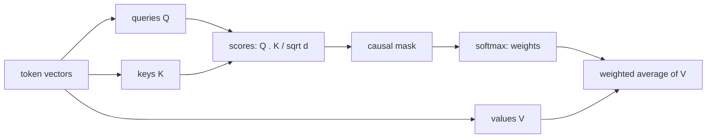
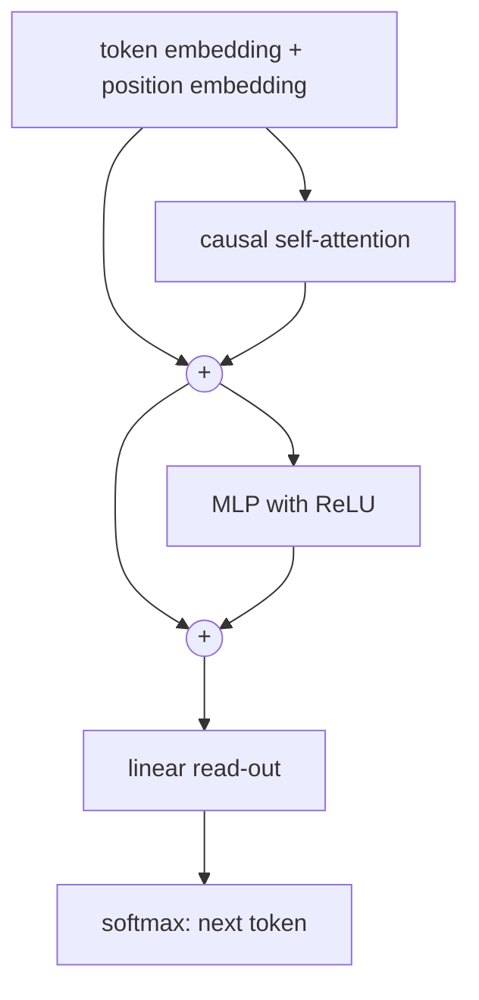

# Chapter 9 — Attention and the Transformer

:::tip[TL;DR]
**In short.** Attention lets every position look directly at all the others. We prove four properties (softmax weights, blindness to order, the causal mask, layer-norm shift invariance) and train a tiny Transformer.

**New words, in simple terms:**

- **Token and embedding**: A token is a piece of text (here, a character). An embedding is the list of numbers that represents it.
- **Attention**: Each position looks at all the others, scores how relevant each one is, and takes a weighted average of what they carry.
- **Query, key, value**: The query is what I look for, the key is what each item offers, the value is what it hands over if chosen.
- **Transformer**: A network built from attention and small MLP blocks, with no recurrence.
- **Residual connection**: Add a block’s input to its output, so that information and gradients have a shortcut.
- **Positional encoding**: Extra numbers that tell the model where each token sits, because attention alone ignores order.
- **Causal mask**: Forbid looking at future positions, so a language model cannot cheat.
- **Layer normalisation**: Re-centre and rescale the numbers of one position. Adding the same constant to all of them changes nothing.
- **Language model**: A model that predicts the next token.
:::


Recurrent networks read a sequence one step at a time, so information from far back must survive many steps. The **Transformer** (Vaswani et al., 2017) drops the recurrence: every position can look directly at every other position, through **attention**.

## Scaled dot-product attention

Each position $t$ has a *query* $q_t$, a *key* $k_t$ and a *value* $v_t$ (three linear maps of its representation $x_t$). Position $t$ compares its query with all keys, turns the scores into weights with a softmax, and takes the weighted average of the values:



*Attention: each token compares its query with every key, turns the scores into weights, and averages the values.*


$$
a_{t,j} = \frac{\exp(q_t\cdot k_j/\sqrt d)}{\sum_{j'}\exp(q_t\cdot k_{j'}/\sqrt d)},\qquad o_t = \sum_j a_{t,j}\,v_j .
$$

A Transformer block adds this to its input (a **residual connection**) and then applies a small MLP, again with a residual connection. Real models stack many blocks, use several attention "heads" in parallel, and normalise activations with layer norm.

## Four facts, proved

### 1. The weights are a distribution, and the softmax is shift-invariant

```lean file=Ch09/Attention.lean#weights
```

The second theorem is the justification of the *stability trick* we used in Chapter 5: subtracting the maximum score before exponentiating does not change the result. (It was an exercise there; it is proved here.) Both theorems hold in any field with an `exp` satisfying $e^{x+y}=e^xe^y$ and $e^0=1$. The hypothesis "the normaliser is non-zero" is automatic for the real exponential, which is positive.

### 2. Attention does not see order

Attention treats its inputs as a *set*: reordering the items does not change the output.

```lean file=Ch09/Attention.lean#perm
```

This is why Transformers need **positional encodings**: without them, "dog bites man" and "man bites dog" look the same. We add a position vector to each token embedding (learned in our code; the original paper uses sines and cosines).

### 3. A causal mask really prevents leakage

A language model that predicts the next token must not look at it. The *causal mask* gives weight $0$ to positions $j>t$. We prove that the output at position $t$ cannot depend on anything after $t$:

<Figure src="causal_mask.svg" alt="Heat map of causal attention weights with equal scores" caption="The causal mask: position t may only look at positions 0 to t. With equal scores each row is a plain average of the visible values." />


```lean file=Ch09/Attention.lean#mask
```

### 4. Layer normalisation ignores a constant shift

Layer norm centres its input, divides by the standard deviation, and then applies a learned scale and shift. The theorem says adding the same constant to every entry changes nothing:

```lean file=Ch09/Attention.lean#layernorm
```

(The centring identity $\sum_i (x_i - \bar x) = 0$ is the Chapter 5 theorem `centered_sum_zero`.)

## A small causal Transformer in Lean

Our network is one block: token and position embeddings, causal self-attention with one head and a residual connection, a ReLU MLP with a residual connection, a linear read-out and a softmax. Layer norm is proved above but left out of the running code, since at this size the model trains without it.



*The Transformer block of this chapter. The two circled plus signs are the residual connections.*


```lean file=Ch09/Gpt.lean#forward
```

The backward pass is written by hand. Its stages mirror the forward pass in reverse: the read-out gives `probs - onehot` (Chapter 5), the MLP is a dense layer (Chapter 3), the softmax's Jacobian turns $dA$ into $dS$, and the gradient flows into the three projections and the embeddings.

```lean file=Ch09/Gpt.lean#backward
```

## Experiments

`lake exe gpt` first checks the gradient of all 171 parameters of a tiny model against central finite differences (maximum error below $10^{-6}$, printed as 0.000000).

### Can attention find a token at a given distance?

The *delay task*: random tokens from an alphabet of 8, and the target at position $t$ is the token **two positions earlier**. To solve it the model's attention at position $t$ must point at position $t-2$. Adam, a fresh batch of 16 sequences at each step, 1500 steps, 200 test sequences:

| model | test accuracy |
|-------|---------------|
| with position embeddings | **100 %** |
| without position embeddings | 36.2 % |

Chance is $12.5\%$. With positions the attention learns to look exactly two steps back. Without them the model cannot do it reliably, which agrees with theorem 2. But it is *better than chance*, and the reason is instructive: theorem 2 is about attention over a set, whereas a **causal** model sees different prefixes at different positions, so the *number* of visible tokens leaks some information about position (for instance, the very first positions can be told apart). Causal models can partly recover position without being told; the delay task shows it is not enough. One seed, one configuration.

### A tiny language model

`lake exe gpt lm` trains a character-level model with 5415 parameters on a 360-character corpus (four copies of four short sentences about a cat and a dog). The loss falls from $2.70$ to about $0.17$ in 1500 steps, and sampling from the model gives:

```text
the mat. the dog sat on the log the cat saw the dog. the dog saw the dog the dog. sa
```

The text has the right words, spaces and punctuation, and sentence shapes from the corpus, but it is **not** clean: it repeats and mixes sentences. With 360 characters, the model mostly memorises; this is a demonstration that the machinery works, not a language model in any serious sense.

## What is and is not covered

- The four theorems are about the *abstractions* (a softmax over scores, attention over a set, a mask, layer norm); the array code of the model is checked by finite differences, not proved.
- Multi-head attention (several parallel attention maps whose outputs are concatenated), sinusoidal position encodings and stacked blocks are described but not implemented.

## Exercises

1. Prove that the weights of `weights_sum` are non-negative when the `exp` is positive (add a hypothesis `0 < exp x`).
2. Show that `attendM (causal t)` with all scores equal is the *average* of the visible values.
3. Add layer norm to the code (forward and backward) and compare training speed on the delay task.
4. Implement a second attention head and concatenate the two outputs. Does it help on a task that needs two different lags?

**Exercises in Lean.** The file `lean/LeanDL/Ch09/Exercises.lean` contains the statements below, with `sorry` for you to replace. The proved solutions are in `Solutions.lean` next to it: try first.

```lean file=Ch09/Exercises.lean#ex1
```

```lean file=Ch09/Exercises.lean#ex2
```

<details>
<summary>Hint 1</summary>

Unfold `weights` and `vsum`. Over `Fin 1` the denominator is `exp z0`, so the quotient is `exp z0 / exp z0`; use the non-zero hypothesis with `grind`.

</details>

<details>
<summary>Solution 1</summary>

```lean file=Ch09/Solutions.lean#sol1
```

</details>

<details>
<summary>Hint 2</summary>

Unfold `causal`. The condition `j.val ≤ t` contradicts `t < j.val`; `omega` proves it.

</details>

<details>
<summary>Solution 2</summary>

```lean file=Ch09/Solutions.lean#sol2
```

</details>
