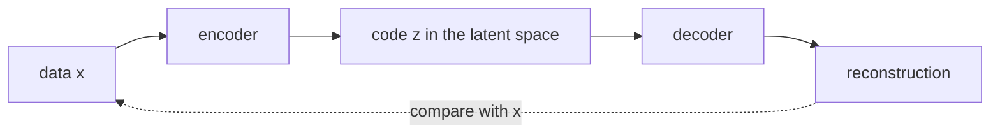

# Chapter 10 — Autoencoders and the VAE

:::tip[TL;DR]
**In short.** A VAE generates data by encoding it into a short random code that follows a known distribution. We prove the reparameterisation trick and the properties of the KL penalty.

**New words, in simple terms:**

- **Generative model**: A model that can produce new data that looks like its training data.
- **Latent variable**: A short hidden code that summarises a data point.
- **Latent space**: The space of all possible codes. If a code has 2 numbers, the latent space is a plane, and every point of it decodes into a possible data point. Points that are close should decode into similar data. (Chapter 15 calls the same idea a representation or embedding space.)
- **Autoencoder**: An encoder squeezes the data into a code, and a decoder rebuilds the data from the code.
- **VAE**: An autoencoder whose codes are pushed to follow a known distribution, so we can sample new codes and decode them.
- **Prior**: The distribution we want the codes to follow, here a standard bell curve.
- **KL divergence**: A number measuring how different one distribution is from another. It is zero when they are the same.
- **Reparameterisation trick**: Draw the random noise first, then compute the sample from it with ordinary maths, so that gradients can flow.
:::


So far our networks *recognised* things. A **generative model** learns to *produce* new data that looks like the training data. This chapter starts with the simplest idea, the autoencoder, and then fixes its main weakness with the variational autoencoder (VAE).

## The autoencoder

An **autoencoder** is two networks. The **encoder** compresses a data point $x$ into a short code $z$ (the *latent* variable); the **decoder** reconstructs $x$ from $z$. It is trained to minimise the reconstruction error $\|x - \mathrm{dec}(\mathrm{enc}(x))\|^2$. The space in which the codes live is called the **latent space** (*latent* means hidden: we never observe it, the network invents it). With a code of two numbers it is a plane, and every point of that plane decodes into one possible data point.



*An autoencoder: squeeze the data into a code, then rebuild it. The training signal is the reconstruction error.*


To *generate*, we would pick a code $z$ at random and run the decoder. The problem: nothing forces the codes of the training data to occupy a region we know how to sample from. Random codes can land where the decoder was never trained.

## The variational autoencoder

The VAE (Kingma and Welling, 2013) makes the codes sampleable by design:

1. The encoder outputs not a code but a **distribution**: a mean $\mu$ and a log-variance $\ell=\log\sigma^2$.
2. A code is **sampled**: $z = \mu + \sigma\,\varepsilon$ with $\varepsilon\sim\mathcal N(0,1)$.
3. The loss adds a penalty that pulls every posterior $\mathcal N(\mu,\sigma^2)$ towards the **prior** $\mathcal N(0,1)$:

$$ \mathcal L \;=\; \underbrace{\mathbb E\,\|x-\hat x\|^2}_{\text{reconstruction}} \;+\; \beta\;\underbrace{\tfrac12\bigl(\mu^2+e^{\ell}-1-\ell\bigr)}_{\mathrm{KL}\bigl(\mathcal N(\mu,e^\ell)\,\|\,\mathcal N(0,1)\bigr)} . $$

After training, generating is simple: draw $z\sim\mathcal N(0,1)$ and decode.

(The closed form of the KL term is a standard Gaussian integral; we take it as the definition and prove properties of it. Showing that the loss is a lower bound on the data log-likelihood needs integrals and is not formalised here.)

## The reparameterisation trick

Sampling looks like a problem for backpropagation: how do you differentiate through a random draw? The trick is to **move the randomness out**. Write $z=\mu+\sigma\varepsilon$ where $\varepsilon$ is drawn first and independently of the parameters. Then $z$ is an ordinary differentiable function of $(\mu,\sigma)$:

```lean file=Ch10/Vae.lean#reparam
```

The theorem says $\partial z/\partial\mu = 1$ and $\partial z/\partial\sigma = \varepsilon$, computed by *the verified backpropagation of Chapter 4*. This is the whole trick, and the reason a VAE can be trained by gradient descent.

## The KL penalty, proved

```lean file=Ch10/Vae.lean#kl
```

- `kl_grad`: $\partial/\partial\mu = \tfrac12(\mu+\mu)$, i.e. $\mu$, and $\partial/\partial\ell = \tfrac12(e^\ell-1)$.
- `kl_at_prior`: at $\mu=0$, $\ell=0$ (the prior itself) the penalty is $0$ and its gradient is $0$. This is exactly the pull towards the prior.

The penalty is never negative. The proof needs one fact about the exponential, the tangent-line bound $1+\ell\le e^\ell$, which we assume as a hypothesis because our `exp` is abstract (it holds for the real exponential):

```lean file=Ch10/Vae.lean#kl_nonneg
```

## A VAE in Lean

Our data is a noisy **half circle** in the plane. The latent space has a single dimension. The encoder is a 2-8-2 network, the decoder a 1-8-2 network, 76 parameters in total. The *entire* loss is an `Expr`, so its gradient comes from the verified `backprop`.

```lean file=Ch10/Model.lean#model
```

:::tip[Lean Corner: one proof, many models]
We never wrote a gradient for this model. `backprop_correct` (Chapter 4) is a theorem about *every* expression, so the gradient of this particular loss, including the sampling step and the KL term, is correct by that single theorem. The only unproved parts are Float rounding and the random-number generator.
:::

## Autoencoder against VAE

`lake exe vae` trains both models (the autoencoder is the same code with $\beta=0$) for 3000 Adam steps on fresh batches of 16 points, then evaluates on 200 held-out points and on 400 decodings of prior samples $z\sim\mathcal N(0,1)$.

| | autoencoder ($\beta=0$) | VAE ($\beta=1$) |
|---|---|---|
| reconstruction error (test) | **0.0032** | 0.0223 |
| mean KL to the prior | 5.72 | **1.25** |
| angle distribution of prior samples: distance to uniform | 0.213 | **0.102** |

The last row measures how evenly the decoded prior samples cover the half circle (the data covers it uniformly; the data's own sampling noise gives 0.052). The numbers tell the whole story:

- The **autoencoder reconstructs better**, but its codes sit far from the prior (large KL), so decoding prior samples covers the arc unevenly.
- The **VAE** pays in reconstruction quality and gets codes that follow $\mathcal N(0,1)$: its prior samples cover the arc about twice as evenly.

<Figure src="vae.svg" alt="Data on a half circle and samples generated by the VAE" caption="Grey: held-out data. Blue: the decoder applied to samples z ~ N(0,1), generated by the VAE." />

:::info A topological detour
We first tried a **full circle**. It does not work with a one-dimensional latent space: a circle cannot be mapped continuously and one-to-one onto a line, so there is always a seam. Both models failed (reconstruction error 0.16 for the autoencoder, 0.25 for the VAE, and only 69 % of the VAE's samples near the circle). Choosing a latent dimension that matches the *shape* of the data matters. One run, one seed.
:::

## Exercises

1. Show that `klE` is strictly convex in $\mu$, and find its minimum in $\ell$ for fixed $\mu$.
2. Make the KL weight $\beta$ a hyper-parameter sweep ($0$, $0.1$, $1$, $10$). How do the three numbers of the table move?
3. Use a two-dimensional latent space on the **full circle** and check that the seam disappears.
4. Prove that the reparameterised sample has mean $\mu$ when $\mathbb E[\varepsilon]=0$ (state it for a finite list of equally weighted noise values).

**Exercises in Lean.** The file `lean/LeanDL/Ch10/Exercises.lean` contains the statements below, with `sorry` for you to replace. The proved solutions are in `Solutions.lean` next to it: try first.

```lean file=Ch10/Exercises.lean#ex1
```

```lean file=Ch10/Exercises.lean#ex2
```
