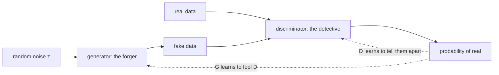

# Chapter 11 — Generative adversarial networks

:::tip[TL;DR]
**In short.** Two networks compete: a generator forges data and a discriminator detects forgeries. We prove what the best discriminator says, and see that the training is unstable.

**New words, in simple terms:**

- **GAN**: Two networks play a game: a forger makes fakes, a detective tells fake from real, and both improve.
- **Generator and discriminator**: The generator is the forger (noise in, fake data out). The discriminator is the detective (data in, probability of real out).
- **Minimax game**: One player tries to minimise what the other tries to maximise.
- **Optimal discriminator**: The best possible detective answer at a point: the share of real data among all data there.
- **Mode collapse**: The generator covers only a few of the kinds of data that exist.
- **Total variation (TV) distance**: A number from 0 to 1 saying how different two histograms are.
:::


The VAE of Chapter 10 generates by decoding random codes. A **generative adversarial network** (Goodfellow et al., 2014) takes a different route: a game between two networks.

- The **generator** $G$ turns noise $z\sim\mathcal N(0,1)$ into a fake data point $G(z)$.
- The **discriminator** $D$ looks at a point $x$ and outputs $D(x)\in(0,1)$, its belief that $x$ is real.

$D$ is trained to tell real from fake; $G$ is trained to fool $D$. The original objective is

$$ \min_G\max_D\;\; \mathbb E_{x\sim p_{\text{data}}}[\log D(x)] \;+\; \mathbb E_{z}[\log(1-D(G(z)))]. $$




*The GAN game: the two networks improve by competing.*

## What does the best discriminator say?

Fix a point $x$. Let $a=p_{\text{data}}(x)$ be the density of real data there and $b=p_G(x)$ the density of generated data. The discriminator's payoff at $x$ is $a\log d + b\log(1-d)$ with $d=D(x)$. Setting the derivative to zero, $\frac ad-\frac b{1-d}=0$, gives

<Figure src="optimal_discriminator.svg" alt="Real density, generated density and the optimal discriminator" caption="The optimal discriminator D* = a / (a + b). Where real data is dense it is near 1, where only the generator puts mass it is near 0, and where they agree it is exactly 1/2." />


$$ d^\star = \frac{a}{a+b}. $$

We prove that this is a critical point, using the *verified backpropagation* of Chapter 4 to compute the derivative:

```lean file=Ch11/Gan.lean#log_gan
```

Notice what the theorem does **not** say: it does not say $d^\star$ is a maximum. For that we use the least-squares GAN (Mao et al., 2017), whose payoff is a polynomial, so the proof needs no calculus. Completing the square shows that the loss is its minimum value plus a non-negative term:

```lean file=Ch11/Gan.lean#lsgan
```

- `lsLoss_sq` is the identity $\mathrm{loss}(d)=\mathrm{loss}(d^\star)+(a+b)(d-d^\star)^2$.
- `lsLoss_value` computes the minimum: $ab/(a+b)$.
- `dStar_equal`: when the generator is perfect ($a=b$), the best the discriminator can do is answer $\tfrac12$ everywhere, i.e. it cannot tell real from fake.
- `lsLoss_min` is the optimality theorem. It is stated over `Rat`, because the order on an abstract field would need more axioms than we want to introduce.

:::tip[Lean Corner: completing the square is a proof strategy]
Optimality proofs often become easy once you *guess the minimiser* and prove an identity of the form "loss = minimum + a square". The identity is a ring computation that `grind` finishes; positivity of the square does the rest.
:::

## Two networks, one autodiff

Both networks have one hidden layer of 8 tanh units: 50 parameters in total (the first 25 belong to $G$, the last 25 to $D$). Both losses are `Expr`s, so both gradients come from `backprop`.

```lean file=Ch11/Model.lean#gan_model
```

Training alternates: one Adam step on $D$ (with the generator's gradient masked to zero), then one on $G$ with the "non-saturating" loss $-\log D(G(z))$, which gives stronger gradients early on than $\log(1-D(G(z)))$. Batches are 32 fresh samples.

## Experiments

`lake exe gan` trains two GANs for 6000 steps (one seed each) and compares 2000 generated samples with 2000 real ones. "TV" is the total-variation distance between 16-bin histograms; two independent halves of the *real* data differ by about 0.03 to 0.05, which is the noise floor.

| real data | | mean | std | TV |
|---|---|---|---|---|
| single Gaussian $\mathcal N(2,0.5^2)$ | data / GAN | 2.01 / 1.87 | 0.51 / 0.43 | **0.09** |
| two Gaussians at $\pm2$ | data / GAN | −0.03 / 0.19 | 2.04 / 1.97 | 0.42 |

<Figure src="gan.svg" alt="Histogram of the real two-mode data and of the GAN's samples" caption="Grey: real data (two Gaussians at ±2). Blue: samples of the trained GAN." />

The honest reading:

- On a **single Gaussian** the GAN learns the right location and roughly the right width.
- On **two modes** it puts almost no mass between them (1.7 % against 0.7 % in the data), so it found both modes, but the **weights and widths of the modes are off** (TV 0.42, far above the noise floor). This is the typical weakness of GANs: there is no likelihood to tell you the mixture proportions are wrong.
- **Training is unstable.** With 4000 steps the single-Gaussian GAN had mean 2.23, with 15000 steps its width shrank to 0.29 (a partial mode collapse). More training did not help; the two networks chase each other. These are one-seed observations, not a benchmark.

:::warning What is proved here, and what is not
Proved: the optimal-discriminator formulas above, and (from Chapter 4) the gradients of both losses. Not proved: that the game converges. In general it does not, and the numbers above show it.
:::

## Exercises

1. Show that for the log objective the value at $d^\star$ is $a\log\frac{a}{a+b}+b\log\frac b{a+b}$. At $a=b$ it equals $-\log 4$ (hint: `dStar_equal`).
2. Prove `lsLoss_min` for a general ordered field using `Std.IsLinearOrder`-style hypotheses.
3. Replace the generator loss by $\log(1-D(G(z)))$ (saturating) and compare the first 500 steps.
4. Train with $D$ updated 5 times per $G$ update. Does the mixture TV improve?

**Exercises in Lean.** The file `lean/LeanDL/Ch11/Exercises.lean` contains the statements below, with `sorry` for you to replace. The proved solutions are in `Solutions.lean` next to it: try first.

```lean file=Ch11/Exercises.lean#ex1
```

```lean file=Ch11/Exercises.lean#ex2
```

<details>
<summary>Hint 1</summary>

`a + 0 = a`, so `dStar a 0 = a / a`, which is `1` because `a ≠ 0`.

</details>

<details>
<summary>Solution 1</summary>

```lean file=Ch11/Solutions.lean#sol1
```

</details>

<details>
<summary>Hint 2</summary>

Unfold `lsLoss`: `a * ((1 - 1) * (1 - 1)) + b * (1 * 1)`.

</details>

<details>
<summary>Solution 2</summary>

```lean file=Ch11/Solutions.lean#sol2
```

</details>
