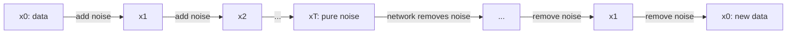

# Chapter 12 — Diffusion models

:::tip[TL;DR]
**In short.** A diffusion model learns to undo noise step by step. We prove how noise accumulates in closed form and that the denoising step is exact for a perfect network, then compare with the GAN.

**New words, in simple terms:**

- **Diffusion model**: Learn to remove noise step by step; generate by starting from pure noise and cleaning it up.
- **Forward process**: Gradually adding noise to data until nothing is left but noise.
- **Noise schedule**: How much noise is added at each step.
- **Variance preserving**: The noising steps are scaled so that the overall spread of the data stays the same.
- **Denoising network**: A network that looks at a noisy input and predicts the noise that was added.
- **DDPM and DDIM**: Two ways to run the cleaning-up steps: with fresh random noise at every step (DDPM) or fully deterministic (DDIM).
:::


Diffusion models power most modern image generators. The idea is almost embarrassingly simple:

1. **Forward process**: destroy the data by adding a little Gaussian noise, many times, until only noise is left.
2. **Reverse process**: train a network to undo one noising step, then start from pure noise and apply it repeatedly.

Unlike a GAN there is no game, and unlike a VAE no bottleneck: training is plain regression.




*Top row: the forward process destroys the data. Bottom row: the trained network undoes it, step by step, to generate new data.*

## The forward process and its closed form

One noising step is

<Figure src="noise_schedule.svg" alt="Signal factor and noise level along the noising steps" caption="The schedule used in this chapter: the signal factor fades from 1 to 0.12 while the noise level rises to 0.99. Their squares always add up to 1 (variance preserving)." />

<Figure src="forward_diffusion.svg" alt="Histograms of the two-bump data at noising steps 0, 4, 10 and 20" caption="Two-bump data being destroyed: by step 20 the histogram is almost a single bell curve, which is what lets us start sampling from pure noise." />


$$ x_{k} = a_k\,x_{k-1} + s_k\,\varepsilon_k,\qquad \varepsilon_k\sim\mathcal N(0,1),\qquad a_k^2+s_k^2=1 \quad(a_k=\sqrt{1-\beta_k}). $$

The constraint $a^2+s^2=1$ keeps the variance of the data from growing ("variance preserving"). The key fact for training is that **after $t$ steps you can jump straight to $x_t$**:

$$ x_t = \bar a_t\,x_0 + \sqrt{1-\bar a_t^{\,2}}\;\varepsilon,\qquad \bar a_t=\prod_{k\le t}a_k. $$

So to train at a random time $t$ we do not simulate $t$ steps. We prove the coefficient bookkeeping behind this: the variance after any number of steps depends only on the product $\bar a$.

```lean file=Ch12/Diffusion.lean#schedule
```

- `noiseVar_closed`: variance after the whole schedule is $\bar a^2 v+(1-\bar a^2)$. The proof is an induction over the list of steps; each step is one `grind` call, using $a^2+s^2=1$.
- `noiseVar_preserved`: unit variance in, unit variance out.
- `noiseVar_from_clean`: clean data ($v=0$) ends with noise variance $1-\bar a^2$, which tends to $1$ as $\bar a\to0$: the data is destroyed.

(We prove the *algebra of the coefficients*. That a sum of independent Gaussians is a Gaussian, which is what turns these coefficients into a statement about distributions, is not formalised.)

## The forward process is monotone, proved

A diffusion schedule is *designed* so that noise accumulates: $lpha_t$ decreases with $t$, so $arlpha_t$ decreases, so the noise variance $1-arlpha_t^2$ grows. That design choice is usually an axiom of the schedule. It is actually a theorem of the step algebra: appending one more variance-preserving step $(a,s)$ with $0\le a\le 1$ to any chain of steps can never decrease the noise variance of clean data.

```lean file=Ch12/Diffusion.lean#monotone
```

`noise_monotone` reads: signal coefficient of the whole process is `cumA l`; the new step multiplies it by $a\in[0,1]$, so the squared signal shrinks ($a^2\le 1$ on the nonnegative factor `cumA l * cumA l`, via `cumA_nonneg`), and $1-arlpha^2$ grows. No Gaussian measure theory is needed — the bookkeeping of `noiseVar_closed` plus monotone arithmetic over `Rat` is enough. What is *not* proved: that the composition of independent Gaussians is Gaussian (that lives in measure theory, outside this course's algebraic scope — same honesty boundary as Chapter 16's finite model).

## Learning to denoise

The network $\varepsilon_\theta(x_t,t)$ looks at a noisy point and the time, and predicts **the noise** $\varepsilon$ that was mixed in. The loss is the squared error, averaged over random data points, times and noise:

$$ \mathcal L(\theta)=\mathbb E_{x_0,t,\varepsilon}\;\|\varepsilon-\varepsilon_\theta(\bar a_t x_0+\sigma_t\varepsilon,\;t)\|^2 .$$

```lean file=Ch12/Model.lean#diff_model
```

:::tip[Lean Corner: reusing the generic builders]
`mlpE` is the network builder from Chapter 4. A `2 → 16 → 1` network with 65 parameters is one line; the gradient of the batch loss, with all 32 samples, comes from `backprop`, correct by `backprop_correct`.
:::

## Sampling, and why it is exact

Given $x_t$ and an estimate $\hat\varepsilon$ of the noise, we can estimate the clean point and rebuild the point at a *less noisy* level $s<t$. This is the deterministic DDIM step:

```lean file=Ch12/Diffusion.lean#denoise
```

`ddim_exact` is the soundness theorem of the sampler: **if the network were perfect, one step would land exactly on the point the forward process would have produced at the lower noise level.** `ddim_compose` says that chaining steps loses nothing, so we are free to choose how many steps to use. In practice the network is not perfect, and the sampler's error is the network's error, which is why training quality is what matters.

The stochastic sampler (DDPM) adds fresh noise at every step. Both are implemented in `Demos/Diffusion.lean`.

## Experiment

The data is the same two-Gaussian mixture as in Chapter 11 (modes at $\pm2$). We use $T=20$ steps with $\beta$ from 0.02 to 0.35 (so the signal factor at the end is $\bar a_T=0.12$), 5000 Adam steps, one seed. `lake exe diffusion` prints:

| | mean | std | mass in $\lvert x\rvert<1$ | TV to data |
|---|---|---|---|---|
| data | −0.05 | 2.05 | 0.006 | (noise floor 0.045) |
| DDPM | 0.20 | 2.00 | 0.039 | **0.086** |
| DDIM | 0.15 | 2.03 | 0.025 | **0.096** |

<Figure src="diffusion.svg" alt="Histogram of the data and of the diffusion model's samples" caption="Grey: real data (two Gaussians at ±2). Blue: DDPM samples. Orange: DDIM samples." />

On the same data, the GAN of Chapter 11 reached a TV of 0.42; the diffusion model reaches about 0.09, at 2 times the noise floor. The mode weights are close and some mass leaks into the gap between the modes. Two caveats: this is one seed on a one-dimensional toy problem, and the loss curve is noisy (it was 0.17 at step 2000 and 0.39 at step 4000; each value is a single batch). Larger models and many more steps are what the image generators use.

:::warning What is proved here
Proved: the coefficient algebra of the forward process and the exactness of the denoising step for a perfect predictor, and (Chapter 4) the gradients of the loss. Not proved: that the trained network is close to perfect, or any statement about distributions.
:::

## Exercises

1. Show `noiseVar_closed` for a *constant* schedule $(a,s)$ repeated $n$ times: $\bar a=a^n$.
2. Prove that the ε-prediction and $x_0$-prediction targets determine each other: given $x_t=\bar a x_0+\sigma\varepsilon$, express $\varepsilon$ in terms of $x_0$ and $x_t$.
3. Run `lake exe diffusion` with 20000 steps. Does the TV drop towards the noise floor?
4. Replace the schedule by a cosine schedule and compare the DDIM results with $T=5$ steps.

**Exercises in Lean.** The file `lean/LeanDL/Ch12/Exercises.lean` contains the statements below, with `sorry` for you to replace. The proved solutions are in `Solutions.lean` next to it: try first.

```lean file=Ch12/Exercises.lean#ex1
```

```lean file=Ch12/Exercises.lean#ex2
```

<details>
<summary>Hint 1</summary>

Unfold `noiseVar` once: the result is `a * a * 0 + s * s`.

</details>

<details>
<summary>Solution 1</summary>

```lean file=Ch12/Solutions.lean#sol1
```

</details>

<details>
<summary>Hint 2</summary>

Unfold `cumA` twice: `a1 * (a2 * 1)`.

</details>

<details>
<summary>Solution 2</summary>

```lean file=Ch12/Solutions.lean#sol2
```

</details>
