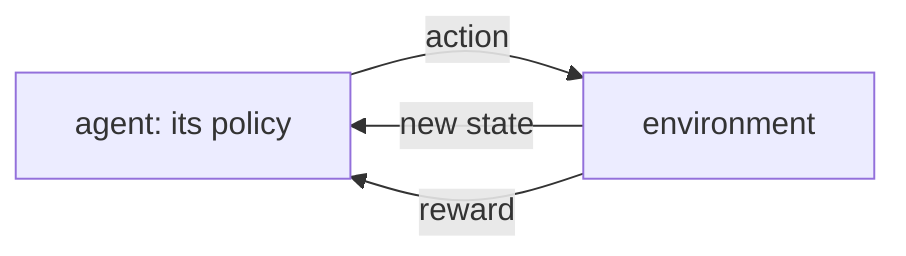

# Chapter 13 — Reinforcement learning

:::tip[TL;DR]
**In short.** An agent learns from rewards, not from examples. We prove that the Bellman and TD updates shrink errors geometrically, prove the REINFORCE gradient for a bandit, then run Q-learning and policy gradients.

**New words, in simple terms:**

- **Reinforcement learning**: Learning by trial and error from rewards.
- **Agent, environment, reward**: The agent acts, the environment reacts, and the reward is the score it gets back.
- **Policy**: The agent’s rule for choosing an action in each situation.
- **Return and discount**: The return is the sum of future rewards; the discount makes later rewards count less.
- **Q-value**: How good it is to take an action in a state, counting all the rewards that follow.
- **Bellman equation**: The value of an action equals the immediate reward plus the discounted value of the best next step.
- **TD update**: Temporal-difference update: move the current estimate a fraction of the way toward a better target.
- **Q-learning**: Learn Q-values with TD updates, acting a little at random to explore.
- **Policy gradient (REINFORCE)**: Increase the probability of actions in proportion to the reward that followed them.
- **Baseline**: A number subtracted from the rewards to reduce noise without changing the average direction of learning.
:::


In supervised learning someone tells the network the right answer. In **reinforcement learning** (RL) an **agent** acts in an **environment** and only receives a **reward**, often long after the action that deserved it. The agent must learn a **policy** $\pi(a\mid s)$ that maximises the discounted return

$$ G_t=r_{t+1}+\gamma\,r_{t+2}+\gamma^2 r_{t+3}+\cdots,\qquad 0\le\gamma<1. $$

We study two families on a tiny task, a **corridor**: states $0\dots5$, start at $1$, actions *left/right*. Reaching state $5$ gives $+1$, reaching $0$ gives $-1$; both end the episode. A random walker reaches the goal with probability $1/5$ (gambler's ruin). The best policy always goes right and needs 4 steps.




*The reinforcement-learning loop: the agent acts, the environment answers with a new state and a reward.*

<Figure src="td_bootstrap.svg" alt="TD(0) values 0.5^i along a ten-step chain approaching the true value 1: the bootstrapped estimates start pessimistic and climb geometrically" caption="TD's bargain drawn: the agent has not reached the reward yet, so V(s_i) = 0.5^i underestimates the true 1 - every state's value is the next state's value halved (the Bellman equation). The formal fix (tdIter_error) shows the error shrinking geometrically with each iteration; the picture is the same fact, one dot per state." />

<Figure src="vi_contractions.svg" alt="The error to the optimal value shrinking geometrically per sweep, faster for gamma = 0.5" caption="Value iteration is a contraction: each sweep multiplies the gap to the fixed point V* by at most gamma (the theorem of this chapter). gamma = 0.5 reaches it in a few sweeps; gamma = 0.9 needs about ten times longer - the price of caring about the far future." />

<Creators slugs="sutton" />


<Figure src="arch_rl.svg"
caption="Actor-critic: policy and value networks in the environment loop"
 />
## Value-based: Q-learning

The **action value** $Q(s,a)$ is the expected return after taking $a$ in $s$ and behaving well afterwards. It satisfies the **Bellman equation** $Q(s,a)=r+\gamma\max_{a'}Q(s',a')$. Q-learning turns this into an update towards a **target** $r+\gamma\max_{a'}Q(s',a')$.

<Figure src="value_iteration.svg" alt="Remaining error of value iteration for three discount factors" caption="The remaining error after k sweeps is gamma^k times the initial error (the theorem valueIter_error). A discount close to 1 means slow convergence." />


Two exact facts, proved for any commutative ring:

```lean file=Ch13/Rl.lean#value
```

- `valueIter_error`: repeatedly applying the Bellman update $v\leftarrow r+\gamma v$ shrinks the error by exactly $\gamma$ each sweep, so after $k$ sweeps it is $\gamma^k$ times the initial error. This is the heart of why value iteration converges (the one-state case here; the general theorem is that the Bellman operator is a $\gamma$-contraction).
- `bellman_fixed`: the fixed point is $r/(1-\gamma)$.
- `tdUpdate_error`: one update $Q\leftarrow Q+\eta(\text{target}-Q)$ multiplies the distance to the target by $1-\eta$. For $0<\eta\le1$ it moves towards the target without overshooting.

Compound a TD update $k$ times against a fixed target and the error is multiplied by $(1-\eta)^k$ — exactly:

```lean file=Ch13/Rl.lean#td_iter
```

`tdIter_error` is the compounding of `tdUpdate_error` by induction: with $0\le\eta\le 1$ the estimate converges **geometrically** to the target. This is the exact arithmetic of Q-learning's inner loop. (The full stochastic convergence theorem — moving targets, exploration, Robbins–Monro step sizes — needs a noise model and lives outside this course's algebraic scope.)

## Policy-based: REINFORCE

Instead of values we can improve the policy directly, with a neural network that outputs the probability of going right. The **policy-gradient theorem** says

$$ \nabla_\theta J(\theta)=\mathbb E\bigl[G\;\nabla_\theta\log\pi_\theta(a\mid s)\bigr]. $$

The gradient of the *expected* reward is the expectation of "return times the gradient of the log-probability of what was done". This is **REINFORCE**: run episodes, and raise the probability of actions in proportion to the returns that followed.

We prove the theorem in the simplest case, a two-armed bandit with $P(\text{arm }0)=\sigma(\theta)$, and then a second fact that explains why practitioners subtract a baseline:

```lean file=Ch13/Rl.lean#bandit
```

- `reinforce_bandit`: the gradient of $J(\theta)=\pi r_0+(1-\pi)r_1$, **computed by the verified backpropagation of Chapter 4**, equals $\pi\,r_0(1-\pi)+(1-\pi)\,r_1(-\pi)$, which is the REINFORCE expression $\sum_a\pi_a\,r_a\,\partial_\theta\log\pi_a$.
- `baseline_invariant`: replacing the rewards $r_a$ by $r_a-b$ does not change the expected gradient. A good baseline (the average return) only reduces its *variance*, and variance is what makes REINFORCE slow.

:::tip[Lean Corner: one theorem, no calculus]
There is no derivative of a softmax in the proof. `backprop_correct` reduces "gradient from `backprop`" to the symbolic derivative `Expr.deriv`, one `simp` unfolds it, and `grind` closes the remaining ring identity.
:::

## The network and the loss in Lean

The policy is a `6 → 8 → 1` tanh network fed a one-hot encoding of the state. The loss $-\sum(G-b)\log\pi(a\mid s)$ is an `Expr`; its gradient is the REINFORCE estimator, again from `backprop`:

```lean file=Ch13/Model.lean#pg_model
```

## Experiment

`lake exe rl` runs both learners (one seed each).

| method | goal reached | mean episode length |
|---|---|---|
| random policy | 20.3 % (theory: 20 %) | 4.16 |
| REINFORCE with baseline (100 iterations of 16 episodes) | 99.3 % | 4.01 |
| REINFORCE with baseline (200 iterations) | 100 % | 4.03 |
| Q-learning (2000 episodes, greedy) | 100 % | 4.00 |

For Q-learning, the learned $Q(1,\text{right})=0.857375$ matches the exact optimum $\gamma^3=0.95^3=0.857375$ to all printed digits: the goal is three discounted steps after the first move.

:::info A modest task
The corridor is deliberately easy: the state is fully observed, the best policy is "always right", and the one-hot network is essentially a table. The point is to see two algorithms run on the verified autodiff. Real problems need exploration, long delays, partial observability and function approximation that generalises; those are where RL gets hard, and where the convergence guarantees we proved above no longer apply.
:::

:::warning What is proved here
Proved: geometric convergence of the Bellman update (one state), the TD error factor, the REINFORCE identity for the two-armed bandit and baseline invariance, and (Chapter 4) the correct gradients of the loss. Not proved: convergence of Q-learning or REINFORCE in general MDPs, or that the experiments above would repeat on other seeds.
:::

## Exercises

1. Show with `valueIter_error` that for $0\le\gamma<1$ and a bounded initial error the iterates approach $v^\star$ (hint: you need $\gamma^k\to0$; state it as a hypothesis).
2. Prove that the TD update never overshoots: if $0\le\eta\le1$ and $Q\le\text{target}$ then $Q\le\mathrm{tdUpdate}\le\text{target}$ (over `Rat`).
3. Extend `reinforce_bandit` to a *three*-armed bandit with softmax probabilities (use `Expr` and `sigmoid` twice, or define softmax with `exp`).
4. Change the rewards so that each step costs $-0.05$. What does the best policy look like, and how does $Q(1,\text{right})$ change?

**Exercises in Lean.** The file `lean/LeanDL/Ch13/Exercises.lean` contains the statements below, with `sorry` for you to replace. The proved solutions are in `Solutions.lean` next to it: try first.

```lean file=Ch13/Exercises.lean#ex1
```

```lean file=Ch13/Exercises.lean#ex2
```

<details>
<summary>Hint 1</summary>

Unfold `tdUpdate`: the correction term is `eta * (q - q) = 0`.

</details>

<details>
<summary>Solution 1</summary>

```lean file=Ch13/Solutions.lean#sol1
```

</details>

<details>
<summary>Hint 2</summary>

Induction on `k`. The step reduces to `r + g * vs = vs`, which is the Bellman hypothesis read backwards.

</details>

<details>
<summary>Solution 2</summary>

```lean file=Ch13/Solutions.lean#sol2
```

</details>
