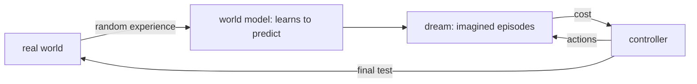

# Chapter 14 — World models

:::tip[TL;DR]
**In short.** A world model learns to predict what happens next, so an agent can practise in imagination. We prove how prediction errors compound and train a controller entirely inside the model’s dream.

**New words, in simple terms:**

- **World model**: A learned simulator: it predicts what happens next from the current situation and an action.
- **Imagination (dream)**: Practising inside the world model instead of in the real world.
- **Rollout**: A simulated sequence of steps.
- **Compounding error**: Small prediction mistakes feed into the next prediction and add up.
- **Lipschitz constant**: A limit on how much a function can amplify differences between its inputs.
- **Controller**: The small policy that chooses the actions.
- **Evolution strategy**: Optimise by trying random variations and moving toward the better ones. No gradients needed.
:::


Reinforcement learning (Chapter 13) learns by acting in the real environment, which can be slow, expensive or dangerous. A **world model** lets the agent learn from **imagination** instead: it learns to predict what happens next, then practises inside its own simulation.

The idea was popularised by Ha and Schmidhuber's *World Models* (2018), whose agent has three parts:

| part | job | in this chapter |
|---|---|---|
| **V** (vision) | compress an observation into a short state | skipped: our state $(x,v)$ is observed exactly |
| **M** (memory / model) | predict the next state from state and action | a neural network trained by regression |
| **C** (controller) | choose actions | a tiny network trained **only inside M** |

Later systems (Dreamer, and the "dreams" of modern game and driving agents) keep the same recipe. Chapter 15 will show the other half of the story: how to learn a *representation* in which such predictions are made.




*The recipe: learn a model from a little real experience, train the controller inside the model’s dream, then test it once in the real world.*

## The task

A point sits on a slope: position $x$, velocity $v$, and a push $u\in[-1,1]$ that we choose. Gravity pushes it **away** from $x=0$, so doing nothing fails. The cost per step is $x^2+0.1v^2+0.01u^2$: the controller must hold the point at $0$.

```lean file=Ch14/Model.lean#env
```

The world model never sees this formula. It only sees **transitions** $(x,v,u)\to(x',v')$ collected by acting at random.

## The model

```lean file=Ch14/Model.lean#world_model
```

This is plain supervised learning: regression of the *change* of the state from the state and action. As in Chapters 11 to 13, the loss is an `Expr`, so its gradient comes from the verified `backprop`.

<Figure src="dream_drift.svg" alt="Compounding drift over k imagined steps: a Lipschitz 1.2 model's bound explodes while a 0.5 model's bound stays under 0.2" caption="The compounding bound of compounding_error, drawn: per-step error eps piles up geometrically - with Lipschitz 1.2 the bound explodes past 6 after 10 imagined steps, with 0.5 it saturates at 2*eps. Short rollouts are safe, long dreams need contraction: that is the theorem the horizon of a world model must respect." />

<Figure src="planning_horizon.svg" alt="Two growth curves: model-based error L^k (L = 1.25) crossing model-free 0.25k near k = 20" caption="The planning horizon, drawn: model-based error compounds geometrically (0.1 x 1.25^k) while model-free error only accumulates linearly (k*eps). After the crossing near k = 17 model-free wins: plan with the model for short horizons, switch to model-free beyond - the theorem of this chapter in one picture." />

## Why imagined rollouts drift

A one-step model is accurate, but imagination feeds the model its **own predictions**. A small error at step 1 becomes part of the input at step 2, and so on. How fast the error grows depends on how much the model amplifies differences, its **Lipschitz constant** $L$:

<Figure src="rollout_drift.svg" alt="Real rollout and imagined rollout with a slightly wrong model" caption="The same actions applied in the real world and in a model whose gravity term is 10 % too strong (drawn by Lean). A small one-step error slowly pulls the imagined trajectory away; the grey curve is the difference, multiplied by 10 to be visible." />


<Figure src="compounding.svg" alt="Bound on the imagined-rollout error for three Lipschitz constants" caption="The bound of compounding_error for a one-step error of 1. With L below 1 it levels off, with L = 1 it grows linearly, with L above 1 it grows exponentially." />


```lean file=Ch14/WorldModel.lean#compounding
```

- `compounding_error`: if the model is wrong by at most $\varepsilon$ per step and is $L$-Lipschitz, then after $k$ imagined steps the error is at most $\varepsilon\,(1+L+\dots+L^{k-1})$.
- With $L=1$ this is $k\varepsilon$ (linear drift). With $L>1$ it is exponential, with $L<1$ it stays bounded: `compounding_bounded` gives $(1-L)\cdot\text{error}\le\varepsilon$ for every $k$.

The closed form of the sum is also proved:

```lean file=Ch14/WorldModel.lean#geom
```

:::tip[Lean Corner: a theorem about *any* functions]
`compounding_error` is stated for arbitrary functions `f` and `fh` on the rationals, with the two hypotheses as `∀`. The proof is an induction on $k$: split the error with the triangle inequality, apply the two hypotheses, then `grind` closes the arithmetic. The only auxiliary facts are for the absolute value (`absQ_add_le`) and for a product with a non-negative number (`Rat.mul_le_mul_of_nonneg_left`).
:::

## Training the controller in the dream

The controller is $u=\tanh(w_0x+w_1v+w_2)$. Instead of gradients through time (which would need a hand-written backward pass through the whole imagined rollout), we use an **evolution strategy**, as the original paper did (it used CMA-ES): perturb $w$ randomly, run imagined episodes with each perturbation, and move $w$ towards the ones that cost less. Every episode runs in the learned model; the real environment is never touched during this phase.

## Experiment

`lake exe worldmodel` collects 2500 transitions with random actions (2000 for training), trains the model for 4000 Adam steps, trains the controller for 80 generations in the dream, and finally tests it in the **real** environment from 100 start positions in $[-1.5,1.5]$. One seed.

**The model.** One-step RMSE on 500 held-out transitions: 0.0008 (position) and 0.0023 (velocity). With the same random actions in the real world and in the model, the position error after $k$ steps is:

| $k$ | 1 | 5 | 10 | 20 | 40 |
|---|---|---|---|---|---|
| RMS error | 0.0013 | 0.0058 | 0.0092 | 0.014 | 0.078 |

It grows with $k$, and faster at the end; this is the qualitative behaviour `compounding_error` allows. (We did not measure $L$, so this is consistent with the theorem, not a test of its constant.)

**The controller.**

| controller | trained in | average cost, 40 steps | where measured |
|---|---|---|---|
| none ($u=0$) | — | 228.5 | real |
| $w=(-6.40,-3.46,-0.03)$ | the dream only | **9.57** | real |
| same controller | the dream only | 9.46 | the dream |
| $w=(-6.63,-3.54,-0.03)$ | the real world | 9.57 | real |

The controller trained **only on imagined episodes** performs as well in the real environment as one trained directly there, and its cost in the dream (9.46) is within 1 % of its real cost. Doing nothing costs 24 times more.

:::warning Why this worked, and when it won't
- The state is observed exactly, so there is no vision part, and the dynamics are smooth and low-dimensional: an easy target for a small network, and the model is extremely accurate.
- A harder world exposes the classic failure: the controller **exploits model errors**, finding actions that look excellent in the dream and fail in reality. Remedies include training on fresh real data in a loop, penalising model uncertainty, and short imagined horizons.
- Proved: the error-propagation bound and the gradients of the regression loss (Chapter 4). Not proved: that the trained model has small $\varepsilon$ or $L$, or that a controller optimised in the dream is good in reality.
:::

## Exercises

1. Prove that for $L=1$, `geom 1 k` equals $k$ (as a rational), by induction on $k$; the induction step is the first Lean exercise below.
2. Show that the error bound is *tight*: find $f$, $\hat f$ with `absQ (fh - f) = ε` and Lipschitz constant exactly $L$ for which `compounding_error` is an equality.
3. Run the demo with only 5 training steps for the model and compare the "dream" and "real" costs of the controller.
4. Replace the one-step model by a model that takes **two** past states. Does the drift at $k=40$ change?

**Exercises in Lean.** The file `lean/LeanDL/Ch14/Exercises.lean` contains the statements below, with `sorry` for you to replace. The proved solutions are in `Solutions.lean` next to it: try first.

```lean file=Ch14/Exercises.lean#ex1
```

```lean file=Ch14/Exercises.lean#ex2
```

<details>
<summary>Hint 1</summary>

Unfold `geom`: the new term is `1 + 1 * geom 1 k`.

</details>

<details>
<summary>Solution 1</summary>

```lean file=Ch14/Solutions.lean#sol1
```

</details>

<details>
<summary>Hint 2</summary>

Apply `compounding_error` with `ε = 0`: the bound is `0 * geom L k`, which is `0`.

</details>

<details>
<summary>Solution 2</summary>

```lean file=Ch14/Solutions.lean#sol2
```

</details>
