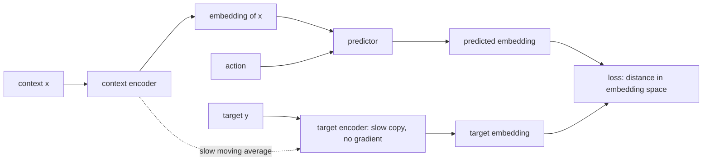

# Chapter 15 — JEPA: predicting in representation space

:::tip[TL;DR]
**In short.** JEPA predicts in a learned representation space instead of in pixels. We prove why the trivial collapsed solution has zero loss, how an EMA target and a variance penalty fight it, and test both.

**New words, in simple terms:**

- **Representation (embedding space)**: A list of numbers that captures what matters about an input.
- **JEPA**: Joint-Embedding Predictive Architecture: predict the embedding of the target from the embedding of the context, not the raw pixels.
- **Predictor**: The network that maps the context’s embedding (and an action) to the predicted target embedding.
- **Collapse**: The shortcut where every input gets the same embedding: the loss is zero but nothing is learned.
- **EMA (exponential moving average)**: A slow-moving copy: at every step it moves a small fraction toward the current weights.
- **Stop-gradient**: Treat a value as a constant during backpropagation, so no learning flows into it.
- **Variance regulariser**: A penalty that punishes embeddings for being too similar to each other.
- **Linear probe**: A simple linear model trained to read a quantity out of an embedding, used to test what the embedding contains.
:::


Chapter 14 predicted the next *state*. In the real world the state is a camera image, and predicting pixels is both expensive and the wrong goal: most of an image is unpredictable detail (the exact leaves on a tree, sensor noise) that a model wastes capacity on.

Yann LeCun's **Joint-Embedding Predictive Architecture** (JEPA; I-JEPA and V-JEPA are its image and video versions) predicts in a learned **representation space** instead:

1. an **encoder** $s_\theta$ maps a context $x$ (what we see) to an embedding;
2. a **target encoder** $s_{\bar\theta}$ maps the target $y$ (what we want to predict: a hidden patch, the next frame after action $\delta$) to an embedding;
3. a **predictor** $p_\phi$ maps the context embedding (and the action) to the *predicted target embedding*.

The loss is the distance between prediction and target **in embedding space**:

$$ \mathcal L=\bigl\|\,p_\phi\bigl(s_\theta(x),\delta\bigr)-s_{\bar\theta}(y)\,\bigr\|^2 . $$

Details that cannot be predicted need not appear in the embedding at all. When the predictor is conditioned on an action, this is a **world model in latent space** (the latent space of Chapter 10, here learned by the encoder), the form that Chapter 14's recipe takes for images.

```lean file=Ch15/Jepa.lean#jepa_loss
```




*The JEPA: the loss compares embeddings, never raw inputs. The target encoder is a slow copy of the context encoder and receives no gradient.*

<Creators slugs="lecun" />


<Figure src="arch_jepa.svg"
caption="JEPA: predict one view's representation from the other"
 />
## The catch: collapse

:::info[Read Chapter 17 first]
Collapse has an arithmetic counterpart this chapter cannot prove on its own: for the **contrastive** loss (InfoNCE), a flat embedding does not score $0$ — it scores exactly $\log (n + 1)$, the collapse floor proved in [Chapter 17](ch17-contrastive). JEPA sidesteps that floor by predicting distances instead of classifying candidates, and that is exactly why the floor *is* zero here: the sum of squares has no log to pay. The two chapters describe the same enemy from two sides — Ch17 proves what collapse costs, Ch15 proves why a plain predictor is happy to pay it.
:::

There is an obvious way to make this loss zero: let both encoders output the **same constant**. Then predicting the target embedding is trivial, and the representation carries no information.

The theorems say it precisely. `collapse_zero`: collapse has loss exactly $0$ on every pair of inputs. `collapse_is_minimal`: since a sum of squares is non-negative, **collapse is a global minimiser** (over the rationals). So gradient descent on this loss alone has a perfectly good reason to end up there, and the rest of the chapter is about the ways to prevent it.

## Remedy 1: a slowly moving target (EMA) with stop-gradient

If the target encoder is not trained by the loss but is an **exponential moving average** of the context encoder, $\bar\theta\leftarrow m\bar\theta+(1-m)\theta$, and no gradient flows into it ("stop-gradient"), the two encoders cannot collude to reach the trivial solution. This is what BYOL, DINO and I-JEPA do. The update is a contraction:

<Figure src="ema_distance.svg" alt="Distance between target and context parameters for three EMA rates" caption="The EMA target: the distance to the context parameters shrinks like m to the power k (theorem emaIter_error). A slow target (m = 0.999) follows very slowly; m = 0.9 almost copies the context encoder." />


```lean file=Ch15/Jepa.lean#ema
```

`ema_error` and `emaIter_error` are the same geometric argument as the TD update of Chapter 13: each update multiplies the distance by $m$, so after $k$ updates by $m^k$. In practice $m\approx0.99$ to $0.999$, a *slow* target. We do **not** prove that EMA prevents collapse: that is an empirical fact, which the experiment below tests.

<Figure src="spread_collapse.svg" alt="Spread penalty 2*d^2 against the embedding distance d, hitting exactly zero at the collapsed point d = 0" caption="The spread penalty is a parabola: a 2-point batch at embedding distance d has spread 2 d^2 (the pairwise-square identity the chapter proves), and the collapsed batch - every embedding equal - scores exactly zero (spread_const). The penalty does not merely discourage collapse: it is minimal precisely there, so weighting it up truly removes collapse from the optima." />

<Figure src="var_hinge.svg" alt="The hinge penalty max(0, delta - spread): falling from delta to zero at spread = delta, then flat" caption="The variance regularizer is a hinge: the batch is only penalised while its spread is under delta, and the penalty is exactly zero once the embeddings are spread enough - which is why it stops embedding collapse at the threshold of this chapter's proposition and never fights a healthy representation." />

## Remedy 2: explicitly keep the embeddings spread out

VICReg-style methods add a regulariser that penalises embeddings for being too similar: a **variance** term (each coordinate must keep a variance of at least $\gamma$) and a **covariance** term (coordinates must not be redundant). We prove the property that makes the variance term work, in the cleanest form (scalar embeddings, a "spread" that is zero exactly when all embeddings coincide):

<Figure src="collapse_penalty.svg" alt="Objective of a perfect predictor for the collapsed and an informative representation" caption="The objective of a predictor with zero prediction loss (gamma = 1): the collapsed solution costs w times gamma, an informative one with enough spread costs nothing, so collapse is no longer a minimiser (theorem collapse_not_optimal)." />


```lean file=Ch15/Jepa.lean#variance
```

- `spread_const` and `spread_pair_eq_zero`: a batch has zero spread exactly when it has collapsed.
- `collapse_not_optimal`: with penalty weight $w>0$, a representation that predicts perfectly *and* keeps spread $\ge\gamma$ scores $0$, while the collapsed one scores $w\gamma>0$. Collapse is **no longer a minimiser**.

In the model, these are the functions `meanE`, `varE`, `covE` and `regLoss`; they are expressions, so their gradients also come from `backprop`:

```lean file=Ch15/Model.lean#vicreg
```

## The model

The encoder, the predictor and the target encoder share one parameter vector. Stop-gradient is then a **mask**: after `backprop`, the gradient entries of the target encoder are replaced by zeros.

```lean file=Ch15/Model.lean#jepa_model
```

## Experiment

The data: a hidden angle $\theta$ generates a *view* $(\cos\theta,\ \sin\theta,\ 3g_1,\ 3g_2)$ with small noise on the first two coordinates, and **large unpredictable distractors** $g_1,g_2\sim\mathcal N(0,1)$ in the last two. The target is the view of $\theta+\delta$, with a random action $\delta\in[-1,1]$. The encoder is $4\to8\to2$, the predictor $(2+1)\to8\to2$.

We train for 3000 Adam steps (batches of 32) and measure, on fresh data, the standard deviation of each embedding coordinate and the $R^2$ of a **linear probe** that tries to read $\cos\theta$, $\sin\theta$ and the distractor $g_1$ from the 2-dimensional embedding. A good representation has $R^2$ near 1 for the first two and near 0 for the third. One seed each.

| training | embedding std | $R^2$ cos θ | $R^2$ sin θ | $R^2$ distractor |
|---|---|---|---|---|
| untrained encoder | 0.17, 0.37 | 0.10 | 0.60 | 0.81 |
| naive (the loss only) | **0.003, 0.002** | 0.04 | 0.03 | 0.01 |
| EMA target + stop-gradient | 1.48, 1.37 | **0.96** | **0.96** | 0.01 |
| variance + covariance, weight 1 | 1.15, 1.13 | **0.98** | **0.98** | 0.00 |
| variance + covariance, weight 5 | 1.09, 1.12 | 0.35 | 0.63 | **0.89** |

What the numbers say:

- **The naive JEPA collapses**: the loss reaches $5\times10^{-5}$, the embedding has standard deviation $0.003$, and the probe sees nothing. This is exactly the minimiser the theorem warns about.
- **EMA with stop-gradient does not collapse here**, and it learns the right thing: the angle is encoded, and the unpredictable distractor is **not**. Predicting in representation space ignored the noise because noise cannot be predicted.
- **The variance regulariser works with weight 1** (and also keeps the embedding from collapsing), but **with weight 5 it fails in an instructive way**: the embedding has the required variance, but obtains it from the *distractors*, whose variance is large and free. The regulariser removes the collapse minimiser, as the theorem says, but it does not say *which* non-collapsed solution you get. The probe shows that preventing collapse is necessary, not sufficient.

:::warning What is proved, and what is not
Proved: collapse is a global minimiser of the plain loss; the EMA update is a geometric contraction; the variance penalty excludes collapse as a minimiser; and (Chapter 4) the gradients of all losses. Not proved: that EMA prevents collapse (the literature has partial analyses in linear models only), that the regularised optimum is informative, or that the results above repeat on other seeds. The data are a toy: a two-dimensional manifold with two obvious distractors.
:::

## References

- Y. LeCun, *A Path Towards Autonomous Machine Intelligence*, OpenReview (2022) — the JEPA position paper and its collapse-avoidance motivation.
- X.-Z. Bardes, J. Garrido, J. Siméon, et al., *VL-JEPA: The Open-World Quest for Real-Time Visual Understanding*, arXiv:2404.08471 (2024) — the JEPA loss this chapter's toy theorem is about.
- T. Chen, S. Kornblith, K. Swersky, et al., *BYOL: Bootstrap Your Own Latent*, NeurIPS 2020, arXiv:2006.07791 — the EMA-target setting whose contraction this chapter formalises.

## Exercises

1. Prove that with a *vector* embedding the loss is again non-negative and that the constant encoder with the identity predictor still reaches $0$ (hint: sum the scalar statements over coordinates).
2. In `collapse_not_optimal`, replace the hypothesis $\gamma\le s$ by $s\ge\gamma/2$. What does the collapsed score $w\gamma$ need to be compared with now?
3. Run the experiment with a distractor of standard deviation $0.3$ instead of $3$. Does variance weight 5 still fail?
4. Add the action-conditioned predictor of this chapter to the controller of Chapter 14: plan by evolving actions that minimise the distance between the *predicted embedding* and a goal embedding.

**Exercises in Lean.** The file `lean/LeanDL/Ch15/Exercises.lean` contains the statements below, with `sorry` for you to replace. The proved solutions are in `Solutions.lean` next to it: try first.

```lean file=Ch15/Exercises.lean#ex1
```

```lean file=Ch15/Exercises.lean#ex2
```

<details>
<summary>Hint 1</summary>

Unfold `spread` and `sumL`: the only term is `(a - a) * (a - a)`.

</details>

<details>
<summary>Solution 1</summary>

```lean file=Ch15/Solutions.lean#sol1
```

</details>

<details>
<summary>Hint 2</summary>

Unfold `vreg`: the condition `s < γ` is false, so the `if` takes its `else` branch.

</details>

<details>
<summary>Solution 2</summary>

```lean file=Ch15/Solutions.lean#sol2
```

</details>
