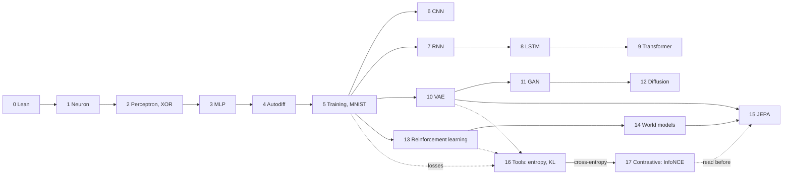

# Deep Learning in Lean 4

This course teaches **Lean 4** and **deep learning** at the same time. Every model is implemented in Lean 4 only, with no Python and no external library. Whenever a fact about the model can be stated precisely, it is **proved** in Lean.

## How the course works

- Every chapter is a Lean file in the `lean/` folder. The code shown on these pages is extracted from those files, so it is compiled and checked.
- Each chapter has a **Lean Corner**: the Lean feature you need for that chapter, introduced just in time.
- Each chapter ends with exercises (Lean files containing `sorry` for you to fill in).
- Each chapter starts with a **TL;DR** box: a short summary and the new words in simple terms. If you are lost, see the [Index of essential concepts](concepts-index) (which concepts are mandatory, and where) and the [Glossary](glossary).

## Two ways of using numbers

Lean cannot reason about floating-point numbers, so the code is written once, **generically over a scalar type** `α`:

- To **run** a model we use `α := Float`.
- To **prove** theorems we use exact numbers (`Int`, `Rat`) or abstract algebraic structures, using the algebra classes that ship with Lean's `grind` tactic.

:::info What "proof" means here
The proofs concern the exact mathematical model (for instance, a network over the rational numbers). They do not certify the rounding behaviour of `Float`. This is stated explicitly whenever it matters.
:::

*The course at a glance: a common trunk (chapters 0 to 5), then three branches (images and sequences, generative models, decision making) that meet in the last chapters. Chapter 16 collects the probability and information tools the losses of chapters 5, 10, 11 and 13 assume, and proves them; Chapter 17 spends them on contrastive learning (InfoNCE), and is the natural companion of Chapter 15 (JEPA); Chapter 18 spends them on deployment: quantization, MoE load-balance, distillation and scaling laws, proved.*

## Syllabus

| # | Chapter | You learn (Lean) | You learn (deep learning) |
|---|---------|------------------|---------------------------|
| 0 | Setup and a tour of Lean | `def`, `#eval`, `theorem` | — |
| 1 | The single neuron | structures, type classes, generic code | weighted sum, bias, activations |
| 2 | The perceptron and XOR | `grind`, proofs on ordered rings | learning rule, XOR, the first AI winter |
| 3 | The multi-layer perceptron | indexed inductive types, induction | layers, XOR solved, Boolean universality, hand-derived gradient |
| 4 | Deep networks and autodiff | inductive types, structural recursion, proofs by induction | backpropagation, forward/reverse mode, proved correct |
| 5 | Losses, optimizers, regularisation, MNIST | lists, `Fin`, proofs over fields | cross-entropy, SGD/momentum/Adam, weight decay, MNIST at 96% |
| 6 | Convolutional networks | dependent types in indices, double sums | convolution, weight sharing, equivariance, 97% CNN on MNIST |
| 7 | Recurrent networks | recursion on `Nat`, theorem hypotheses | BPTT, vanishing and exploding gradients, memory task |
| 8 | LSTM and gated memory | bounds on products, `Rat` | forget gate, additive path, honest memory experiments |
| 9 | Attention and the Transformer | abstract fields, lists and permutations | softmax, set vs sequence, causal mask, layer norm, a small Transformer |
| 10 | Autoencoders and the VAE | the reparameterisation trick as a theorem | latent variables, KL penalty, sampling |
| 11 | GANs | optimality by completing the square | the minimax game, optimal discriminator, instability |
| 12 | Diffusion models | induction over schedules, field identities | forward process in closed form, exact denoising step |
| 13 | Reinforcement learning | recursion, ring identities | Bellman updates, Q-learning, REINFORCE with a baseline |
| 14 | World models | induction with hypotheses on functions, the triangle inequality | learning dynamics, imagined rollouts, compounding error, training a controller in a dream |
| 15 | JEPA | `Prop`-level reasoning about minimisers, geometric sequences | predicting in representation space, collapse, EMA targets, variance regularisation |
| 16 | Mathematical tools: probability, entropy, KL | induction over `Nat` on dot products, abstract type classes (`LawfulLog`), inequalities over `Rat` | expectation, variance, entropy, cross-entropy = entropy + KL, Gibbs inequality KL ≥ 0 |
| 17 | Contrastive learning: InfoNCE, exactly | reusing Chapter 5's cross-entropy gradient, exact `Rat` softmax | softmax as a distribution, loss ≥ 0, collapse floor `log (n+1)`, gradient `p − onehot`, a trained embedding |

Start with [Chapter 0](ch00-setup).
