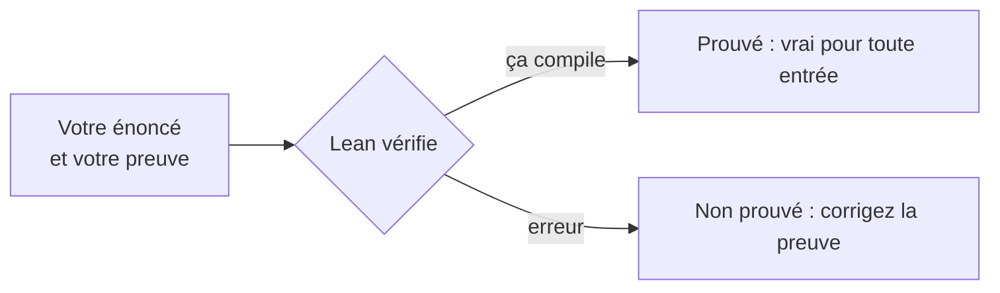

# Chapitre 0 — Installation et tour de Lean

:::tip[En bref (TL;DR)]
**En bref.** Installez Lean et VS Code, puis apprenez les quatre idées sur lesquelles repose tout le cours : des programmes qu’on exécute, des structures qui regroupent des données, des théorèmes que le compilateur vérifie, et du code générique qui marche pour tout type de nombre.

**Mots nouveaux, en termes simples:**

- **Lean**: Un langage de programmation qui sait aussi vérifier des preuves mathématiques. Si votre preuve compile, elle est correcte.
- **Type**: La sorte de chose qu’est une valeur (un nombre, une liste, un vecteur de longueur 3). Lean refuse de mélanger des types incompatibles.
- **Structure**: Une boîte étiquetée de valeurs, comme un formulaire avec des champs nommés.
- **Théorème**: Un énoncé accompagné de sa preuve. En Lean, la preuve est un programme dont le type est l’énoncé.
- **Preuve et test**: Une preuve est certaine pour toute entrée possible ; un test ne dit que ce qui se passe sur les cas essayés. Ce cours fait les deux et dit toujours lequel est lequel.
- **Tactique**: Une commande qui construit une preuve pas à pas. `grind` et `omega` sont des tactiques qui font à votre place beaucoup de raisonnement routinier.
- **Code générique (classe de types)**: Du code écrit une fois pour tout type de nombre. Des crochets comme `[Add α]` disent à Lean quelles opérations sont nécessaires, et il les trouve pour vous.
- **Float**: Les nombres décimaux de l’ordinateur. Ils arrondissent, donc nous exécutons les modèles sur des Float mais nous énonçons les preuves sur des nombres exacts.
:::


## Installation

1. Installez [VS Code](https://code.visualstudio.com/) et l'extension **Lean 4**.
2. L'extension installe `elan`, le gestionnaire de versions de Lean. Vérifiez depuis un terminal :

```bash
lean --version
lake --version
```

3. Clonez ce dépôt et compilez la bibliothèque du cours :

```bash
cd lean
lake build
```

La version de Lean est fixée dans `lean/lean-toolchain` : tout le monde utilise donc la même version.

## Programmes

Lean est un langage de programmation fonctionnel. `#eval` exécute une expression et affiche le résultat dans l'éditeur.

```lean file=Ch00/Tour.lean#hello
```

## Structures

Une `structure` regroupe des champs nommés. Nos neurones du chapitre suivant sont des structures.

```lean file=Ch00/Tour.lean#structure
```

## Théorèmes

En Lean, un théorème est un programme dont le *type* est l'énoncé. Si le fichier compile, la preuve est correcte. Des tactiques comme `omega` (arithmétique linéaire sur les entiers) et `grind` (démonstrateur automatique généraliste) construisent des preuves à votre place.



*Comment Lean traite un théorème : si le fichier compile, l’énoncé est prouvé.*


```lean file=Ch00/Tour.lean#theorem
```

## Code générique

Le code de deep learning de ce cours est écrit une seule fois pour tous les types de scalaires `α`. Les crochets `[Add α]` sont des arguments de **classe de types** : le compilateur trouve le bon `+` pour vous.

```lean file=Ch00/Tour.lean#generic
```

:::tip[Coin Lean]
Trois sortes de parenthèses apparaissent partout : `(x : α)` argument explicite, `{α : Type}` argument implicite (inféré), `[Add α]` argument d'instance (trouvé par résolution de classes de types).
:::

## Exercices

1. Écrivez `triple` et démontrez `triple (a + b) = triple a + triple b`.
2. Écrivez `sumSq` pour `Array α` au lieu de `List α`.
