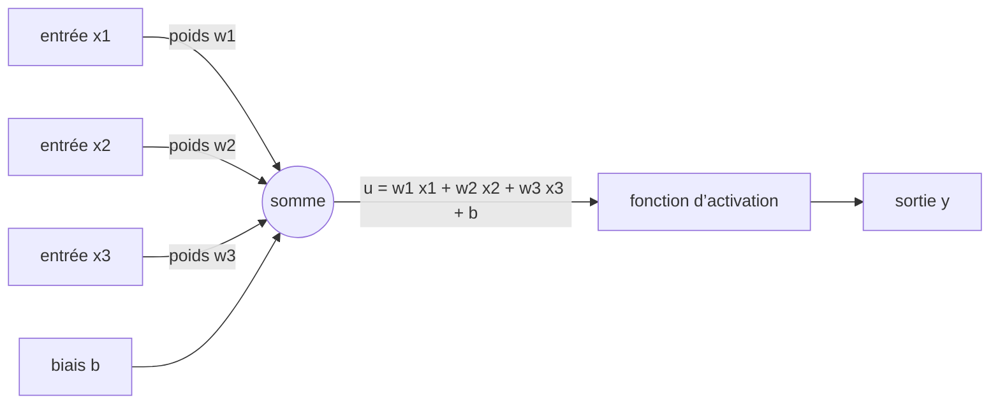

# Chapitre 1 — Le neurone seul

:::tip[En bref (TL;DR)]
**En bref.** Un neurone multiplie ses entrées par des poids, les additionne avec un biais, puis écrase le résultat avec une fonction d’activation. Nous le construisons en Lean, l’exécutons, et prouvons qu’il calcule ET, OU et NON-ET.

**Mots nouveaux, en termes simples:**

- **Neurone**: Une toute petite calculatrice : multiplier chaque entrée par un poids, tout additionner, ajouter un biais, puis écraser le résultat avec une fonction d’activation.
- **Poids**: Un nombre qui dit combien une entrée compte. Apprendre, c’est ajuster les poids.
- **Biais**: Un nombre ajouté à la fin. Il déplace le seuil à partir duquel le neurone s’allume.
- **Fonction d’activation**: L’étape d’écrasement après la somme (marche, sigmoïde, tanh, ReLU). Sans elle, empiler des neurones n’apporterait rien.
- **Sigmoïde**: Une courbe lisse en S qui transforme n’importe quel nombre en une valeur entre 0 et 1.
- **ReLU**: Garde les nombres positifs tels quels et transforme les négatifs en 0.
- **tanh**: Comme la sigmoïde, mais sa sortie est entre -1 et 1.
- **Vecteur**: Une liste ordonnée de nombres. En Lean, sa longueur fait partie de son type.
- **Produit scalaire**: Multiplier deux listes position par position et additionner les résultats. C’est la somme pondérée d’un neurone.
- **Porte logique**: Une petite règle sur des valeurs vrai/faux (ET, OU, NON-ET). Un seul neurone sait faire ET et OU.
- **Linéaire**: Qui se comporte comme de simples mises à l’échelle et additions : doublez l’entrée, la sortie double ; additionnez deux entrées, les sorties s’additionnent.
:::


<Video youtube="aircAruvnKk" title="But what is a neural network? (3Blue1Brown)" />

Un **neurone** reçoit $n$ nombres $x_1,\dots,x_n$, calcule une somme pondérée plus un biais, puis applique une **fonction d'activation** $\varphi$ :

$$ y = \varphi\Big(\sum_{i=1}^{n} w_i x_i + b\Big) = \varphi(w \cdot x + b). $$


<Figure src="arch_neuron.svg"
caption="Un neurone : une somme pondérée, puis une non-linéarité"
 />
## Des vecteurs dont la longueur est dans le type

Un vecteur de longueur $n$ est représenté par une fonction `Fin n → α`. La longueur fait partie du type : additionner un vecteur de taille 2 et un vecteur de taille 3 est une *erreur de typage*, pas un bug d'exécution.

```lean file=Core/Vec.lean#vec
```

Le produit scalaire est défini par récurrence sur la longueur :

```lean file=Core/Vec.lean#dot
```

:::tip[Coin Lean : `structure`, arguments implicites, `Fin n`]
`Fin n` est le type des nombres `0, …, n-1`. Une fonction `Fin n → α` a donc exactement `n` valeurs. Les accolades `{n : Nat}` déclarent un argument que Lean déduit des autres arguments.
:::

## Fonctions d'activation

<Figure src="activations.svg" alt="Courbes des fonctions marche, sigmoïde, tanh et ReLU" caption="Les quatre fonctions d’activation, tracées par Lean (lake exe figures). La marche est tout-ou-rien ; sigmoïde et tanh en sont des versions lisses ; ReLU garde les valeurs positives." />


```lean file=Ch01/Neuron.lean#activations
```

Elles sont écrites pour n'importe quel type de scalaires : l'échelon utilise `≤`, la sigmoïde et tanh utilisent une exponentielle `HasExp.exp`. Avec `α := Float`, `HasExp.exp` est `Float.exp`.

<Figure src="neuron_halfplane.svg" alt="Une droite frontiere w.x = b dans le plan, avec la region de declenchement au-dessus" caption="Un neurone seul est un demi-plan : l'equation w.x = b trace une droite frontiere (bleue) et le neurone s'active exactement d'un cote (orange). ET, OU et les portes logiques du chapitre ne sont que des positions de cette droite ; le XOR echoue car aucune droite unique ne le realise - la geometrie du Ch2 en une image." />

## Le neurone



*Un neurone : une somme pondérée des entrées plus un biais, puis une fonction d’activation.*


```lean file=Ch01/Neuron.lean#neuron
```

Exécutez-le (`lake exe ch01`) sur des nombres `Float` :

```text
preact  = 0.250000
step    = 1.000000
sigmoid = 0.562177
relu    = 0.250000
tanh    = 0.244919
```

## Portes logiques, démontrées

Avec l'activation échelon, un neurone calcule ET, OU et NON-ET. Le théorème est énoncé pour **toutes** les entrées booléennes et vérifié par `decide`, qui évalue les quatre cas.

```lean file=Ch01/Neuron.lean#gates
```

:::tip[Coin Lean : `cases` et `decide`]
`cases a` sépare un `Bool` en `false` et `true`. `<;>` applique la tactique suivante à tous les buts obtenus. `decide` démontre un énoncé clos en le calculant.
:::

## Linéarité avant l'activation

Avant l'activation, un neurone sans biais est une application linéaire. La preuve utilise les lois du produit scalaire (`Vec.dot_add_right`, …), valables dans tout anneau commutatif.

```lean file=Ch01/Neuron.lean#linear
```

<Figure src="sigmoid_deriv.svg" alt="Sigmoide montant de 0 a 1, et sa derivee une cloche de pic 1/4 en zero" caption="La derivee de la sigmoide est une cloche de pic 1/4 : sigma' = sigma(1 - sigma), maximale en 0 ou sigma = 1/2. Cette seule courbe est l'evanescence des gradients du Ch4 en germe - une pile de couches sigmoides multiplie des facteurs au plus egaux a 1/4, c'est exactement pourquoi la ReLU a pris la releve." />

## Une propriété de la sigmoïde

Nous n'utilisons jamais l'analyse réelle. Nous supposons seulement que `exp` vérifie $e^{x+y}=e^x e^y$ et $e^0=1$ (la classe `LawfulExp`), et `grind` fait l'algèbre de corps :

```lean file=Ch01/Neuron.lean#sigmoid_sym
```

## Références

- W. S. McCulloch et W. Pitts, *A Logical Calculus of the Ideas Immanent in Nervous Activity*, Bulletin of Mathematical Biophysics 5 (1943) — le neurone à seuil d'origine que ce chapitre calcule.

## Exercices

1. Construisez un neurone calculant NI (NOR) et démontrez-le pour toutes les entrées.
2. Démontrez que `relu` est idempotente : `relu (relu x) = relu x` sur `Int`.
3. Démontrez $\tanh(-x) = -\tanh(x)$ à partir des lois de `exp`.

**Exercices en Lean.** Le fichier `lean/LeanDL/Ch01/Exercises.lean` contient les énoncés ci-dessous, avec des `sorry` à remplacer. Les solutions démontrées sont dans `Solutions.lean`, à côté : essayez d’abord.

```lean file=Ch01/Exercises.lean#ex1
```

```lean file=Ch01/Exercises.lean#ex2
```

```lean file=Ch01/Exercises.lean#ex3
```

<details>
<summary>Indice 1</summary>

Prenez les poids (-1, -1) et le biais 0 : la pré-activation vaut 0 seulement si les deux entrées sont 0, et est négative sinon. Puis `cases a <;> cases b <;> decide`.

</details>

<details>
<summary>Corrigé 1</summary>

```lean file=Ch01/Solutions.lean#sol1
```

</details>

<details>
<summary>Indice 2</summary>

Dépliez `relu`, distinguez `0 ≤ x` avec `by_cases`, et laissez `simp` finir chaque cas.

</details>

<details>
<summary>Corrigé 2</summary>

```lean file=Ch01/Solutions.lean#sol2
```

</details>

<details>
<summary>Indice 3</summary>

Dépliez `tanh`, réécrivez `- -x = x`, et donnez à `grind` le fait que le dénominateur est non nul dans les deux ordres.

</details>

<details>
<summary>Corrigé 3</summary>

```lean file=Ch01/Solutions.lean#sol3
```

</details>
