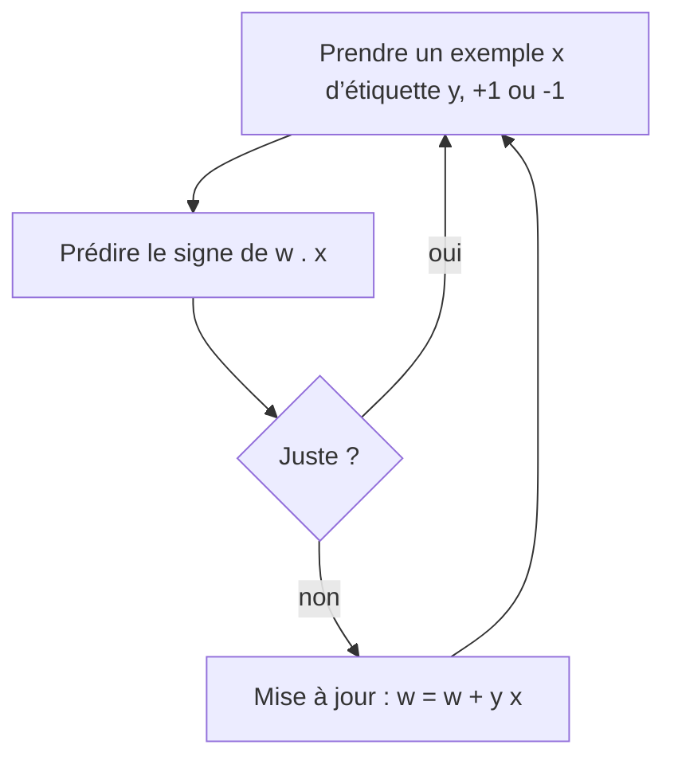

# Chapitre 2 — Le perceptron, le XOR et le premier hiver de l'IA

:::tip[En bref (TL;DR)]
**En bref.** Un neurone trace une seule droite, donc il ne peut pas calculer le XOR. Nous le prouvons, nous prouvons aussi que la règle d’apprentissage du perceptron finit toujours par s’arrêter sur des données séparables, et nous voyons pourquoi cela a mené au premier hiver de l’IA.

**Mots nouveaux, en termes simples:**

- **Perceptron**: Un neurone à sortie tout-ou-rien, avec une règle pour apprendre de ses erreurs.
- **Linéairement séparable**: Des données qu’une seule droite (ou un seul plan) peut séparer en deux groupes.
- **XOR**: Vrai quand exactement une des deux entrées est active. Aucune droite ne sépare ses deux réponses.
- **Règle d’apprentissage du perceptron**: Quand la réponse est fausse, pousser les poids vers la bonne : ajouter l’exemple s’il fallait dire oui, le retrancher s’il fallait dire non.
- **Marge**: L’écart de sécurité entre les deux groupes de données. Plus il est grand, moins il y a d’erreurs.
- **Théorème de convergence (Novikoff)**: Une preuve que sur des données séparables le perceptron fait un nombre limité d’erreurs puis s’arrête pour toujours.
- **Inégalité de Cauchy–Schwarz**: Le produit scalaire de deux vecteurs n’est jamais plus grand que le produit de leurs longueurs.
- **Hiver de l’IA**: Une période où l’argent et l’intérêt pour l’IA se sont effondrés faute de promesses tenues. Le premier a commencé dans les années 1970.
:::


<Creators fr slugs="rosenblatt" />


<Figure src="arch_perceptron.svg"
caption="Le perceptron : une seule unité à seuil qui trace une droite"
 />
## L'histoire en un paragraphe

En 1958, Frank Rosenblatt introduit le **perceptron** : un neurone à seuil accompagné d'une règle d'apprentissage. En 1969, Marvin Minsky et Seymour Papert publient *Perceptrons*, qui analyse exactement ce que les perceptrons à une couche peuvent et ne peuvent pas calculer. L'exemple le plus simple de ce qu'ils ne peuvent pas calculer est le **XOR** (ou exclusif). Ajouté aux résultats décevants d'autres programmes d'IA (par exemple le rapport Lighthill de 1973 au Royaume-Uni), cela a contribué à l'effondrement des financements du milieu des années 1970, appelé **premier hiver de l'IA**. Les historiens s'accordent sur le fait que les causes furent multiples ; le fait mathématique ci-dessous est le cœur technique de la partie « réseaux de neurones » de cette histoire.

<Figure src="xor.svg" alt="Les quatre points du XOR dans le plan" caption="Aucune droite ne sépare les deux points bleus des deux points rouges." />

<Figure src="xor_points.svg" alt="Quatre points du XOR : +1 en (0,0) et (1,1), -1 en (0,1) et (1,0), aucune droite ne separe les couleurs" caption="L'image du theoreme 1 : un neurone trace une droite, et les points du XOR ne se laissent decouper par aucune droite - les deux coins positifs sont de part et d'autre de toute droite qui separe les deux negatifs. Une couche cachee n'est pas un luxe, c'est le minimum." />

## Théorème 1 — aucun neurone ne calcule le XOR

Précisons d'abord ce que signifie « un neurone calcule le XOR », pour tout type de scalaires muni de `0`, `1`, `+`, `*` et d'un `≤` décidable :

```lean file=Ch02/Xor.lean#xor_def
```

L'énoncé est ensuite démontré pour **tout anneau commutatif totalement ordonné** `α`, donc pour `Int`, `Rat` et les nombres réels. Avec des poids $(w_1,w_2)$ et un biais $b$, les quatre contraintes donnent :

$$ b < 0,\quad w_1 + b \ge 0,\quad w_2 + b \ge 0,\quad w_1 + w_2 + b < 0. $$

En additionnant les deux inégalités du milieu, on obtient $w_1 + w_2 + 2b \ge 0$, donc $w_1+w_2+b \ge -b > 0$, ce qui contredit la dernière. La preuve en Lean est le même argument, confié à `grind` :

```lean file=Ch02/Xor.lean#xor_impossible
```

:::tip[Coin Lean : algèbre abstraite avec `grind`]
Les hypothèses `[CommRing α] [LE α] [LT α] [Std.IsLinearOrder α] …` signifient « α se comporte comme les entiers ou les réels ». `grind` sait combiner ces hypothèses (identités d'anneau, inégalités linéaires). Le même énoncé est donc valable pour tous ces types à la fois.
:::

## La règle d'apprentissage

Un perceptron prédit le signe de $w\cdot x$ (le biais est intégré à $w$ en ajoutant une coordonnée constante `1` à chaque entrée). Sur un exemple $(x,y)$ d'étiquette $y=\pm 1$ qu'il classe mal, c'est-à-dire $y\,(w\cdot x)\le 0$, il met à jour $w \leftarrow w + y\,x$.



*La boucle d’apprentissage du perceptron : les poids ne changent que lorsque la prédiction est fausse.*


```lean file=Ch02/Perceptron.lean#update
```

```lean file=Ch02/Train.lean#train
```

Exécutez-le avec `lake exe ch02`. ET et OU convergent ; le XOR fait 4 erreurs à chaque époque, indéfiniment :

```text
AND: mistakes per epoch = [2, 3, 3, 2, 2, 3, 2, 1, 0]
OR: mistakes per epoch = [3, 1, 2, 2, 1, 0]
XOR: mistakes per epoch = [4, 4, 4, 4, 4, ...]
```

<Figure src="perceptron_bound.svg" alt="La borne d'erreurs R^2/gamma^2 selon la marge : explosion hyperbolique quand gamma fond" caption="La borne de Novikoff, tracee : avec R = 1, un separateur a la marge gamma coute au plus 1/gamma^2 erreurs. Une marge epaisse (gamma = 1) apprend en une mise a jour ; une marge fine comme rasoir (gamma = 0,1) en demande cent. Le perceptron n'apprend jamais plus vite que la geometrie des donnees ne le permet." />

## Théorème 2 — le théorème de convergence de Novikoff

Si les données *sont* linéairement séparables avec une marge, le perceptron s'arrête. Précisément : supposons un vecteur $w^*$ tel que $y_t\,(w^*\cdot x_t) \ge \gamma > 0$ pour tous les exemples et $\|x_t\|^2 \le R^2$. Alors toute suite de $k$ mises à jour déclenchées par des erreurs, à partir de $w=0$, vérifie

$$ k\,\gamma^2 \;\le\; \|w^*\|^2 R^2 . $$

La preuve classique a trois ingrédients, chacun étant un lemme Lean :

1. `alignment_grows` : après $k$ mises à jour, $w^*\cdot w_k \ge k\gamma$.
2. `norm_grows` : après $k$ mises à jour, $\|w_k\|^2 \le k R^2$, car chaque mise à jour correspond à une erreur.
3. `cauchy_schwarz` : $(a\cdot b)^2 \le (a\cdot a)(b\cdot b)$. Nous la démontrons de zéro, sans racine carrée, en étudiant le trinôme $\|s a + t b\|^2 \ge 0$.

```lean file=Ch02/Perceptron.lean#cauchy_schwarz
```

```lean file=Ch02/Perceptron.lean#novikoff
```

Le théorème porte sur *toute* suite de mises à jour déclenchées par des erreurs ; il s'applique donc à la boucle d'entraînement ci-dessus. Il est démontré sur `Rat` (arithmétique exacte).

## Ce que cela dit du XOR

En mettant les deux théorèmes côte à côte : sur des données séparables, le perceptron fait un nombre borné d'erreurs ; sur le XOR, aucun vecteur de poids ne fait zéro erreur, donc le nombre d'erreurs ne peut jamais être borné. Le remède, au chapitre suivant, est d'empiler des neurones.

<Figure src="perceptron_mistakes.svg" alt="Erreurs par époque pour ET, OU et XOR" caption="Erreurs par époque (les nombres affichés par lake exe ch02). ET et OU atteignent zéro erreur et s’arrêtent pour toujours ; XOR fait 4 erreurs à chaque époque." />


## Références

- F. Rosenblatt, *The Perceptron: A Probabilistic Model for Information Storage and Organization in the Brain*, Psychological Bulletin 65 (1958) — le perceptron et sa règle d'apprentissage.
- M. L. Minsky et S. A. Papert, *Perceptrons*, MIT Press (1969) — la limitation XOR que ce chapitre prouve par construction.

## Exercices

1. Montrez qu'aucun neurone ne calcule non plus le XNOR (`exercise_xnor` dans `LeanDL/Ch02/Exercises.lean`).
2. Énoncez le théorème de Novikoff pour les entrées augmentées `Vec.cons1 x` et expliquez le rôle du biais.

**Exercices en Lean.** Le fichier `lean/LeanDL/Ch02/Exercises.lean` contient les énoncés ci-dessous, avec des `sorry` à remplacer. Les solutions démontrées sont dans `Solutions.lean`, à côté : essayez d’abord.

```lean file=Ch02/Exercises.lean#ex1
```

<details>
<summary>Indice 1</summary>

Écrivez les quatre contraintes (`b ≥ 0`, `w₁ + b < 0`, `w₂ + b < 0`, `w₁ + w₂ + b ≥ 0`) en spécialisant l’hypothèse aux quatre entrées, simplifiez avec `simp`, et terminez avec `grind` (arithmétique linéaire).

</details>

<details>
<summary>Corrigé 1</summary>

```lean file=Ch02/Solutions.lean#sol1
```

</details>
