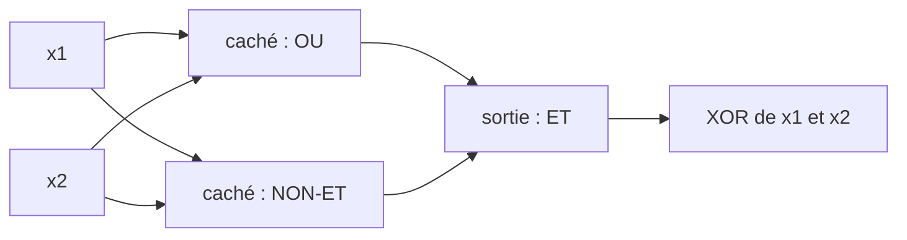

# Chapitre 3 — Le perceptron multicouche

:::tip[En bref (TL;DR)]
**En bref.** Empilez des neurones en couches et le XOR devient facile. Nous prouvons qu’une couche cachée suffit à calculer n’importe quelle fonction vrai/faux, puis nous laissons un petit réseau apprendre le XOR par descente de gradient.

**Mots nouveaux, en termes simples:**

- **Couche**: Une rangée de neurones qui lisent tous les mêmes entrées.
- **Couche cachée**: Une couche entre l’entrée et la sortie. Le réseau y invente ses propres caractéristiques intermédiaires utiles.
- **MLP (perceptron multicouche)**: Plusieurs couches empilées : les sorties de chaque couche sont les entrées de la suivante.
- **Réseau à formes vérifiées**: Un réseau dont les tailles de couches figurent dans le type : un réseau aux couches incompatibles ne compile pas.
- **Universalité**: Avec assez de neurones, une couche cachée peut calculer n’importe quelle fonction vrai/faux.
- **Perte**: Un seul nombre qui dit à quel point le réseau se trompe. Apprendre, c’est le réduire.
- **Descente de gradient**: Apprendre par petits pas : mesurer comment la perte varie avec chaque poids, puis déplacer chaque poids un peu vers le bas.
- **Taux d’apprentissage**: La taille de chaque pas de descente de gradient. Trop grand, on dépasse ; trop petit, on rampe.
- **Règle de dérivation en chaîne**: Pour obtenir l’effet d’un premier changement sur un résultat final, multiplier les effets de chaque étape intermédiaire.
- **Signal d’erreur (delta)**: La part de responsabilité d’un neurone dans l’erreur finale. Il est transmis en arrière de couche en couche.
:::


Le chapitre 2 s'est terminé sur un mur : un neurone seul ne peut pas calculer le XOR. Pour le contourner, on **empile** les neurones en couches.

<Creators fr slugs="werbos,rumelhart,hinton,lecun" />


<Figure src="arch_mlp.svg"
caption="MLP : couches denses empilées, ReLU entre les couches, softmax en sortie"
 />
## Couches et formes

Une couche à `nin` entrées et `nout` neurones contient une ligne de poids et un biais par neurone. Ses poids forment une matrice `Mat α nout nin` ; les formes apparaissent dans le type, donc on ne peut pas donner à une couche un vecteur de mauvaise taille.

```lean file=Core/Mat.lean#mat
```

```lean file=Ch03/Mlp.lean#layer
```

Le dernier théorème dit qu'une couche n'a rien de nouveau : ce sont `nout` neurones du chapitre 1 qui partagent la même entrée. Il se démontre par `rfl` : les deux membres sont le même calcul.

## Un réseau dont les formes sont vérifiées

```lean file=Ch03/Mlp.lean#mlp
```

:::tip[Coin Lean : types inductifs indexés]
`MLP α n m` est une famille de types indexée par la taille d'entrée `n` et la taille de sortie `m`. Le constructeur `cons` n'accepte qu'une couche `n → h` suivie d'un réseau `h → m` : les tailles de couches consécutives *doivent* donc coïncider. Un réseau aux couches incompatibles n'est pas une erreur d'exécution : c'est un programme qui ne passe pas le typage.
:::

## Des formes vérifiées aux tenseurs à plat

Tous les réseaux ci-dessus sont indexés par leurs tailles — `Mat α m n` connaît `m` et
`n`. Le code de production, lui, ne connaît rien : il aplatit tout dans un seul tampon
(`28*28*3` flottants pour une image, `B*T*d` pour un batch) et la disposition — les pas
en ordre ligne par ligne — est un commentaire. `Core/Tensor.lean` est la pièce manquante :
un tenseur dont la **forme vit dans le type** mais qui est **stocké à plat**, exactement
comme le vrai, avec un dictionnaire prouvé entre les deux mondes.

```lean file=Core/Tensor.lean#tensor
```

L'arithmétique des indices est le classique `i / n` et `i % n` des pas en ordre ligne par
ligne, et les deux allers-retours sont des théorèmes : aplatir une matrice puis la relire
avec `row`/`col` redonne la même entrée (`toMat_fromMat`, `fromMat_toMat` — le second
n'est que la division euclidienne avec reste, `Nat.div_add_mod`).

Tout l'intérêt est le pont vers la couche réellement exécutée :

```lean file=Core/Tensor.lean#matvec
```

`flatMulVec` est la boucle qu'une couche entièrement connectée non typée fait sur le
tampon à plat. `flatMulVec_eq` prouve que c'est **exactement** le `Mat.mulVec` formel du
chapitre 3 — entrée par entrée, sans un produit ajouté ni perdu. Le réseau à formes
vérifiées et le code aplatifié de déploiement sont le même calcul.

<Figure src="mlp_stairs.svg" alt="La sinusoidale et un reseau ReLU par morceaux qui la plie en segments droits" caption="Ce qu'achetent unites ReLU cachees : chaque unite coude un segment droit, et quelques-unes plient n'importe quelle courbe en segments d'escalier qui convergent vers elle (bleu sin, orange une ajustement a 4 unites - la decomposition exacte que la preuve d'approximation universelle construit). Le MLP est le demi-plan du Ch1 rendu lineaire par morceaux par des noeuds d'ajustement appris." />

## Le XOR, résolu

Le XOR vaut `ET (OU x₁ x₂) (NON-ET x₁ x₂)` : la couche cachée calcule OU et NON-ET, le neurone de sortie est un ET. Le théorème est vérifié sur les quatre entrées par `decide`.



*Le XOR avec une couche cachée : XOR = ET(OU, NON-ET). Chaque boîte est un neurone du chapitre 1.*


```lean file=Ch03/Mlp.lean#xornet
```

Comparez avec le chapitre 2 : mêmes neurones et même activation échelon, mais deux couches au lieu d'une.

<Figure src="depth_signal.svg" alt="log10 du gradient de la premiere couche en fonction de la profondeur L : les droites typique 0.5^L et pire cas 0.25^L plongent toutes les deux" caption="Pourquoi la profondeur est a double tranchant : le gradient de la premiere couche est un produit de L facteurs, donc sur l'echelle logarithmique il chute en ligne droite (chain_stack, Ch04). Le meme produit qui compose les features mange aussi le signal - le theme que chaque chapitre suivant adresse (connexions residuelles, LSTM, blocs residuels)." />

## Théorème — toute fonction booléenne est un réseau à une couche cachée

Le XOR n'est pas un cas isolé. Pour toute fonction booléenne `f` de `n` entrées :

1. Pour chaque motif d'entrée `c` tel que `f c = true`, on construit un neurone caché de poids $+1$ là où $c_i$ est vrai et $-1$ ailleurs, et de biais $-k$, où $k$ est le nombre de composantes vraies de $c$. Sa pré-activation vaut $\sum_i s_i x_i - k$, qui est $\le 0$ pour toute entrée 0/1 et vaut $0$ exactement quand $x = c$. Il s'active donc exactement sur $c$.
2. Le neurone de sortie s'active quand au moins un neurone caché s'active (un OU).

Le lemme clé, démontré par récurrence sur $n$ :

```lean file=Ch03/Universal.lean#detector_spec
```

et la correction de toute la construction :

```lean file=Ch03/Universal.lean#net_correct
```

```lean file=Ch03/Universal.lean#universal
```

La couche cachée a un neurone par motif d'entrée vrai, soit jusqu'à $2^n$ neurones. La profondeur permet d'avoir exponentiellement moins de neurones pour beaucoup de fonctions, mais c'est un autre théorème. Le théorème d'approximation universelle à valeurs réelles (Cybenko, Hornik) n'est *pas* démontré ici : il demande de l'analyse réelle.

## Apprendre le XOR

Après avoir montré qu'un réseau *existe*, laissons-en un **apprendre**. Nous utilisons des neurones sigmoïdes (dérivables, contrairement à l'échelon) et minimisons l'erreur quadratique $\tfrac12(\hat y - y)^2$ par descente de gradient. La règle de dérivation en chaîne, appliquée une fois à la main :

<Figure src="gradient_descent.svg" alt="Trajectoires de descente de gradient pour quatre taux d’apprentissage" caption="Descente de gradient sur L(w) = w², depuis w = 1. Un petit taux est lent mais régulier ; 0,9 oscille en rétrécissant ; 1,05 dépasse de plus en plus et diverge." />


$$ \delta_2 = (\hat y - y)\,\hat y(1-\hat y), \qquad \delta_{1,j} = \delta_2\, w_{2,j}\, a_j(1-a_j), $$

et chaque paramètre se déplace de $-\eta\,\delta\cdot(\text{son entrée})$.

```lean file=Ch03/Train.lean#net2
```

```lean file=Ch03/Train.lean#sgd
```

Lancez `lake exe ch03` : la perte passe de 0,51 à 0,0003 et le réseau sort environ 0,01 sur $(0,0)$ et $(1,1)$, et environ 0,99 sur $(0,1)$ et $(1,0)$.

:::warning Coin Lean : un piège des fonctions-vecteurs
`Vec` est une fonction. Un paramètre mis à jour par `fun i => old i - …` garde une référence à la version précédente, qui garde une référence à la précédente, et ainsi de suite : après quelques dizaines de pas, évaluer un seul poids prend un temps exponentiel. Le réseau exécutable stocke donc de simples tableaux :

```lean file=Ch03/Train.lean#net2a
```

`Net2A.toNet2` reconvertit vers la spécification `Vec`, et la démo affiche les deux prédictions : elles coïncident.
:::

## Exercices

1. Construisez un réseau à 2 couches pour le XNOR et démontrez-le par `decide`.
2. À l'aide de `universal`, montrez que pour $n = 3$ la fonction parité est calculée par un réseau à une couche cachée. Combien de neurones cachés la construction utilise-t-elle ?
3. Faites passer le nombre d'unités cachées de `Demos/Ch03.lean` de 3 à 2. L'entraînement réussit-il encore depuis toute initialisation ?

Chapitre suivant : au lieu de calculer les gradients à la main, nous laissons l'ordinateur le faire.

**Exercices en Lean.** Le fichier `lean/LeanDL/Ch03/Exercises.lean` contient les énoncés ci-dessous, avec des `sorry` à remplacer. Les solutions démontrées sont dans `Solutions.lean`, à côté : essayez d’abord.

```lean file=Ch03/Exercises.lean#ex1
```

<details>
<summary>Indice 1</summary>

XNOR = OU (ET x₁ x₂) (NON-OU x₁ x₂) : la couche cachée calcule ET et NON-OU, le neurone de sortie est un OU. Vérifiez les quatre entrées avec `decide`.

</details>

<details>
<summary>Corrigé 1</summary>

```lean file=Ch03/Solutions.lean#sol1
```

</details>
