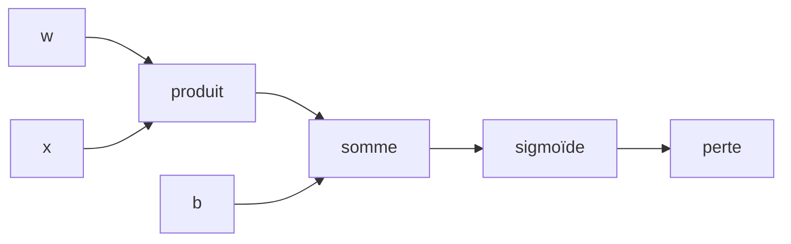
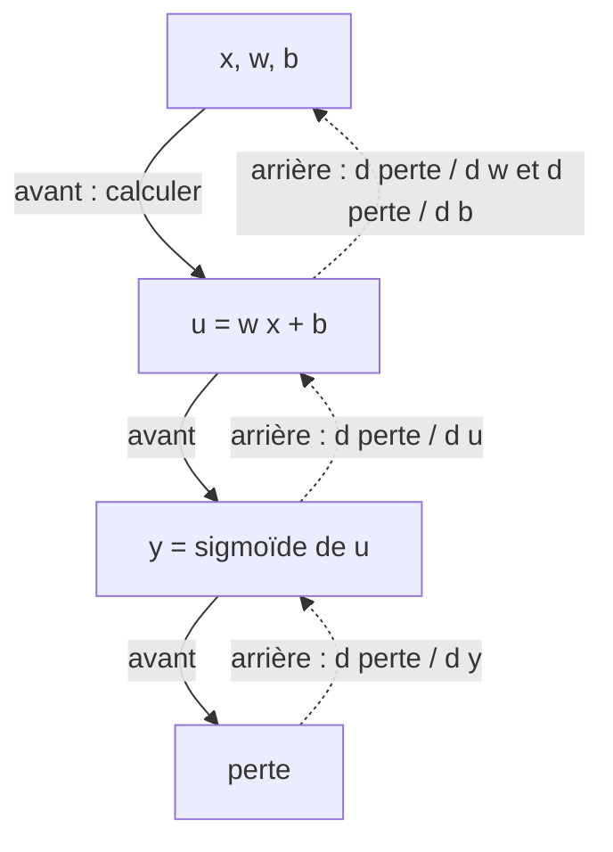

# Chapitre 4 — Réseaux profonds et différentiation automatique

:::tip[En bref (TL;DR)]
**En bref.** Au lieu de dériver les gradients à la main, un programme les calcule. Nous construisons en Lean la différentiation automatique en mode direct et en mode inverse (rétropropagation) et prouvons les deux correctes.

**Mots nouveaux, en termes simples:**

- **Dérivée**: La vitesse à laquelle une sortie change quand on pousse un peu une entrée.
- **Gradient**: La liste de toutes les dérivées par rapport à tous les poids. Il pointe vers le haut, donc on avance dans le sens opposé.
- **Différentiation automatique (autodiff)**: Un programme qui calcule les dérivées exactes de n’importe quel calcul en appliquant mécaniquement la règle en chaîne.
- **Arbre d’expression**: Un calcul écrit comme un arbre de petites opérations (addition, produit, sigmoïde…). L’autodiff parcourt cet arbre.
- **Mode direct**: Transporter une dérivée pendant qu’on calcule la valeur. Une passe donne l’effet d’une direction choisie.
- **Rétropropagation (mode inverse)**: Calculer vers l’avant, puis balayer une seule fois vers l’arrière pour obtenir la dérivée de tous les poids à la fois.
- **Adjoint**: Le message qui circule pendant le balayage arrière : de combien le résultat final change par unité de changement de ce nœud.
- **Vérification du gradient**: Vérifier un gradient en poussant un poids très légèrement et en regardant comment la perte bouge vraiment (différences finies).
- **Preuve par récurrence**: Prouver un énoncé pour le plus petit cas, puis montrer que s’il est vrai pour les petits morceaux il l’est pour le grand.
:::


Au chapitre 3, nous avons calculé à la main le gradient d'un réseau à 2 couches. Pour dix couches, ou un Transformer, personne ne le fait : l'ordinateur applique mécaniquement la règle de dérivation en chaîne. C'est la **différentiation automatique** (autodiff), le moteur de tous les frameworks de deep learning. Dans ce chapitre nous en construisons un en Lean, **et nous démontrons qu'il est correct**.

<Creators fr slugs="werbos,rumelhart" />

## Expressions

Nous décrivons un calcul comme un arbre d'expression sur $n$ variables d'entrée (les paramètres).



*Un calcul sous forme d’arbre d’expression (ici la perte d’un neurone sigmoïde). L’autodiff parcourt cet arbre.*


```lean file=Ch04/Autodiff.lean#expr
```

:::tip[Coin Lean : types inductifs et récursion structurelle]
`Expr` est un type `inductive` : une valeur est construite par l'un des constructeurs. Une fonction définie par filtrage sur chaque constructeur, qui ne s'appelle que sur des sous-expressions (comme `eval`), est *structurellement récursive* : Lean vérifie qu'elle termine, et les preuves à son sujet se font par `induction`.
:::

<Figure src="fd_drift.svg" alt="Erreur log2 de la difference centrale de sin selon l'exposant k : courbe en U en Float" caption="Pourquoi la derivee exacte, pas les differences finies en Float : la difference centrale de sin en x = 1, pas h = 2^-k - l'erreur de troncature O(h^2) fait tomber l'erreur (echelle log2) pendant la cancellation Float la fait remonter, dessinant un U au plancher vers 2^-52 : l'epsilon machine. Aucun choix de h n'echappe au mur ; la derivee symbolique du chapitre n'a pas ce plancher." />

## Qu'est-ce que « la dérivée » ?

Nous définissons la **dérivée partielle formelle** $\partial_j e$ d'une expression par rapport à la variable $j$, comme une autre expression : règle de la somme, règle du produit, et règle de dérivation en chaîne pour chaque non-linéarité ($\exp' = \exp$, $\sigma' = \sigma(1-\sigma)$, $\tanh' = 1-\tanh^2$, $\log' = 1/x$, $(1/x)' = -1/x^2$, $\sqrt{x}' = 1/(2\sqrt{x})$, et $\mathrm{relu}' = \mathrm{step}$). Ces primitives suffisent pour la suite du cours : softmax, normalisation, attention.

```lean file=Ch04/Autodiff.lean#deriv
```

C'est la spécification. Elle est lente (l'expression dérivée peut être bien plus grosse que l'originale), mais manifestement juste. Les deux algorithmes ci-dessous doivent s'y conformer.

## Mode direct (forward)

On transporte une *tangente* à côté de chaque valeur : la dérivée dans une direction `dx` choisie.

```lean file=Ch04/Autodiff.lean#fwd
```

Une passe directe donne une dérivée directionnelle. Pour le gradient complet d'une fonction de $n$ paramètres, il faut $n$ passes.

## Mode inverse (rétropropagation)

On exécute le calcul vers l'avant, puis on remonte depuis la sortie en transportant l'**adjoint** $s$ = la dérivée de la sortie finale par rapport à la valeur du nœud courant. Chaque nœud multiplie $s$ par sa dérivée locale et la transmet à ses enfants. Sur une variable, l'adjoint est ajouté à l'entrée correspondante du gradient.



*Mode inverse : une passe avant calcule les valeurs (flèches pleines), un balayage arrière renvoie la dérivée à chaque poids (flèches pointillées).*


```lean file=Ch04/Autodiff.lean#back
```

Un seul balayage arrière donne **toutes** les $n$ dérivées partielles, pour un coût comparable à une passe avant. C'est pourquoi l'entraînement de réseaux à des millions de paramètres est possible.

## Les deux modes sont corrects

D'abord, le mode direct calcule la valeur et la dérivée directionnelle $\sum_i dx_i\,\partial_i e$ :

```lean file=Ch04/Correct.lean#fwd_correct
```

Puis le théorème clé : le balayage arrière ajoute exactement $s \cdot \partial_j e$ à la coordonnée $j$. La preuve est une récurrence sur l'expression, et chaque cas est une identité d'anneau réglée par `grind`.

```lean file=Ch04/Correct.lean#back_correct
```

Le dernier théorème est le sens précis dans lequel **le mode inverse est la transposée du mode direct** : la dérivée directionnelle vaut $dx \cdot \nabla e$.

:::info Ce qui est démontré, et ce qui ne l'est pas
Les théorèmes valent dans tout anneau commutatif muni d'un `exp`, d'un `sigmoid` et d'un `tanh` ; la table des dérivées est la *définition* de `deriv`. Que cette table soit la vraie dérivée des fonctions réelles est le théorème classique d'analyse, que nous ne redémontrons pas (il faudrait de l'analyse réelle). Les arrondis flottants ne sont pas modélisés non plus. Comme filet de sécurité, la démo effectue une **vérification de gradient** par différences finies.
:::

## Retour au neurone

Avec cette machinerie, la règle delta du chapitre 3 devient un corollaire : la rétropropagation à travers un neurone sigmoïde avec erreur quadratique renvoie $\partial L/\partial w_0 = 2(\sigma(u)-y)\,\sigma(u)(1-\sigma(u))\,x_0$.

```lean file=Ch04/Network.lean#delta_rule
```

<Figure src="chain_stack.svg" alt="Le gradient à travers une pile de couches sigmoïdes décroît linéairement en L : (1/4)^L au pire, (0.5)^L en général" caption="Pourquoi la profondeur est une multiplication : chaque couche sigmoïde est un facteur au plus 1/4, donc le gradient de bout en bout décroît en ligne droite sur l'axe logarithmique. C'est le théorème de disparition du gradient en une image - et la raison pour laquelle ReLU (pente locale 1) a pris le relais." />

<Figure src="relu_dead.svg" alt="Deux courbes : la ReLU vivante y = max(0,x) qui monte depuis l'origine, et la ReLU morte plate a zero sur tout l'axe" caption="La ReLU morte, dessinee : une unite dont les poids ont pousse l'entree toujours en negatif sort exactement 0 partout - le gradient de la ReLU vaut 0 sur toute cette demi-droite, donc aucun gradient de perte ne circule et l'unite ne se remet jamais (relu_grad, Ch04). L'initialisation n'est pas cosmetique : elle decide combien d'unites restent vivantes." />

## Des réseaux de profondeur quelconque

Une couche dense et un perceptron multicouche entier ne sont que des fonctions qui construisent des expressions. Rien dans le code d'autodiff ne connaît les couches.

```lean file=Ch04/Network.lean#builders
```

## Exécution

`lake exe ch04` entraîne un réseau **2-3-3-1** (25 paramètres, deux couches cachées) sur le XOR. Le gradient n'est jamais écrit à la main.

```text
parameters: 25
max |backprop - finite difference| over 25 parameters = 0.000000
after 0 steps: loss = 1.014810
after 1000 steps: loss = 0.000666
...
(0.000000, 1.000000) -> 0.995773   target 1.000000
(1.000000, 1.000000) -> 0.005598   target 0.000000
```

Les paramètres initiaux aléatoires proviennent d'un générateur déterministe écrit en Lean (`Core/Rng.lean`) : chaque exécution est donc reproductible.

## Exercices

1. Ajoutez un constructeur `softplus` ($\log(1+e^x)$, dérivée $\sigma$) et étendez les preuves.
2. `relu` n'a pas de dérivée en 0 ; la table ci-dessus utilise `step` (qui vaut 0 en 0). Qu'est-ce qui changerait si `step 0 = 1` ? Les théorèmes restent-ils valables ?
3. Énoncez et démontrez la règle delta pour $\partial L / \partial b$.
4. Pourquoi `back` est-il quadratique en la profondeur de l'expression ? Comment mémoïser `eval` y remédierait-il ?

**Exercices en Lean.** Le fichier `lean/LeanDL/Ch04/Exercises.lean` contient les énoncés ci-dessous, avec des `sorry` à remplacer. Les solutions démontrées sont dans `Solutions.lean`, à côté : essayez d’abord.

```lean file=Ch04/Exercises.lean#ex1
```

```lean file=Ch04/Exercises.lean#ex2
```

<details>
<summary>Indice 1</summary>

Utilisez `backprop_correct` pour la coordonnée 2 afin de remplacer `backprop` par la dérivée formelle, dépliez `neuronLoss`, `sqErr`, `Expr.deriv` et `Expr.eval`, puis fermez l’identité d’anneau avec `grind`.

</details>

<details>
<summary>Corrigé 1</summary>

```lean file=Ch04/Solutions.lean#sol1
```

</details>

<details>
<summary>Indice 2</summary>

Même méthode avec la coordonnée 0 : la dérivée de `x₀ * x₁` par rapport à `x₀` vaut `1 * x₁ + x₀ * 0`.

</details>

<details>
<summary>Corrigé 2</summary>

```lean file=Ch04/Solutions.lean#sol2
```

</details>