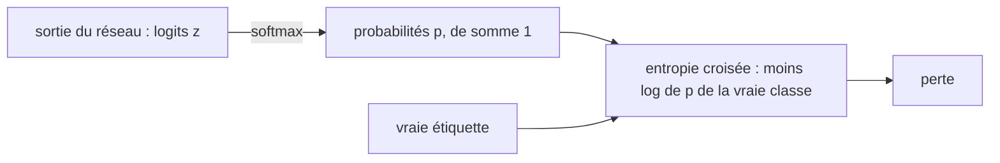

# Chapitre 5 — Pertes, optimiseurs, régularisation et MNIST

:::tip[En bref (TL;DR)]
**En bref.** Tout ce qu’il faut pour vraiment entraîner un réseau : une perte pour la classification (softmax et entropie croisée), des outils contre le surapprentissage, des optimiseurs (SGD, momentum, Adam) et un premier vrai jeu de données, les chiffres manuscrits MNIST.

**Mots nouveaux, en termes simples:**

- **Softmax**: Transforme une liste de scores en probabilités : toutes positives, de somme 1.
- **Logits**: Les scores bruts qu’un réseau produit, avant le softmax.
- **Entropie croisée**: La perte pour la classification : grande quand le réseau donne une faible probabilité à la vraie classe.
- **Surapprentissage**: Apprendre les exemples d’entraînement par cœur plutôt que la règle générale, de sorte que les nouvelles données échouent.
- **Régularisation (décroissance des poids)**: Une douce attraction qui garde les poids petits pour décourager le surapprentissage.
- **Normalisation**: Recentrer et remettre à l’échelle les nombres à l’intérieur du réseau pour qu’ils restent dans une plage confortable.
- **Optimiseur**: La règle qui transforme un gradient en mise à jour des poids.
- **SGD**: Descente de gradient stochastique : descente de gradient où chaque pas n’utilise qu’un petit lot aléatoire d’exemples.
- **Momentum**: Garder un peu de la direction du pas précédent, comme une bille qui roule.
- **Adam**: Un optimiseur qui adapte la taille du pas de chaque poids grâce à des moyennes mobiles des gradients passés.
- **Mini-lot et époque**: Un mini-lot est un petit groupe d’exemples utilisé pour un pas. Une époque est un passage sur toutes les données d’entraînement.
- **Jeu de test**: Des exemples jamais utilisés pour l’entraînement, gardés pour mesurer la vraie performance.
- **MNIST**: Un jeu de données célèbre de 70 000 chiffres manuscrits.
:::


Le chapitre 4 nous a donné les gradients. Ce chapitre les transforme en *apprentissage* : quelle fonction minimiser (la **perte**), comment suivre le gradient (l'**optimiseur**), comment éviter le surapprentissage (la **régularisation**), et un premier vrai jeu de données, **MNIST**, des chiffres manuscrits.

## Entropie croisée et softmax

Pour la classification, le réseau produit $m$ nombres $z$ (les *logits*). Le softmax les transforme en probabilités $p_k = e^{z_k} / \sum_i e^{z_i}$, et la perte pour la vraie classe $y$ vaut $-\log p_y = \log\sum_i e^{z_i} - z_y$. Sous forme d'expression :



*Des scores bruts à une perte : le softmax fabrique des probabilités, l’entropie croisée punit une faible probabilité sur la vraie classe.*


```lean file=Ch05/Loss.lean#softmax_loss
```

Le théorème est le fait classique (et un peu magique) : **le gradient de l'entropie croisée par rapport aux logits vaut $p - \text{onehot}(y)$**. Remarquez ce qu'il ne contient *pas* : ni dérivée d'un logarithme, ni division par une probabilité.

:::tip[Coin Lean : listes et `Fin`]
La somme sur les classes est une somme sur `List.finRange m`. La preuve demande un petit lemme sur les listes : sommer $f(i)\cdot[i=k]$ sur une liste sans doublons contenant $k$ donne $f(k)$ (`sumL_indicator`). Les hypothèses `Nodup` et `k ∈ l` sont exactement celles qu'il faut ; Lean ne permet pas de les oublier.
:::

:::info Stabilité numérique
Calculer $e^{z}$ déborde pour $z$ grand. Les implémentations soustraient d'abord $\max_i z_i$ (le code MNIST ci-dessous le fait). Cela ne change pas le softmax, ce qui l'autorise. Nous ne démontrons pas formellement cette identité ici, car elle demande une loi reliant `exp`, `inv` et les produits ; c'est un bon exercice dans un corps.
:::

<Figure src="weight_decay.svg" alt="Deux traces SGD sur (w-1)^2 : sans decroissance w converge vers 1, avec lam = 1 elle se stabilise a 0,5" caption="La decroissance des poids sur la perte la plus simple : avec lam = 0 le SGD marche vers le minimiseur w = 1 ; avec lam = 1 le point fixe amorti est w = 1/(1 + lam) = 0,5. La decroissance change un peu de biais contre de la variance - l'optimum vise est voluntairement une version retrecie du vrai." />

## Régularisation L2 (décroissance des poids)

Ajouter $c\sum_i w_i^2$ à la perte pénalise les grands poids. Son gradient vaut $2c\,w_k$ : chaque pas de gradient fait donc aussi rétrécir les poids, d'où le nom de *décroissance des poids*.

```lean file=Ch05/Loss.lean#l2
```

## Normalisation

La normalisation de couche commence par *centrer* les activations. Voici la partie qui se démontre sans racine carrée : les entrées centrées ont une somme nulle.

```lean file=Ch05/Norm.lean#centering
```

La normalisation de couche complète (division par l'écart-type, avec échelle et décalage appris) viendra avec le Transformer au chapitre 9.

## Optimiseurs

La descente de gradient simple met à jour $w \leftarrow w - \eta\,\nabla L(w)$. Deux raffinements dominent la pratique : le **momentum** (moyenner les gradients dans le temps) et **Adam** (qui remet aussi à l'échelle chaque coordonnée selon la taille de ses gradients récents). Les trois sont de petites fonctions pures sur des tableaux :


*La boucle d’entraînement que tous les chapitres suivants réutilisent.*


```lean file=Ch05/Optim.lean#exec
```

Que peut-on *démontrer* à leur sujet ? D'abord, la **descente de gradient sur une quadratique** $f(w) = \tfrac a2 w^2$ : l'itération est $w \leftarrow (1-\eta a)\,w$, donc $w_t = (1-\eta a)^t w_0$. Elle converge ssi $|1-\eta a|<1$ et diverge si le pas $\eta$ est trop grand.

```lean file=Ch05/Optim.lean#sgd_quadratic
```

Ensuite, la **correction de biais d'Adam**. Adam conserve des moyennes mobiles exponentielles, initialisées à $0$. Avec un gradient constant $g$, la moyenne après $t$ pas vaut $(1-\beta^t)\,g$ : biaisée vers $0$ au début.

```lean file=Ch05/Optim.lean#ema
```

```lean file=Ch05/Optim.lean#ema_laws
```

Diviser par $1-\beta^t$, ce que fait exactement Adam, supprime le biais :

```lean file=Ch05/Optim.lean#bias_correction
```

Troisième point, **ce que SGD garantit** — la spécification de l'optimiseur, sur `Rat` exact. Écrivons le pas quadratique $w' = (1-\eta a)\,w$ : tant que le pas reste dans la plage de stabilité $0 < \eta a < 2$, le facteur $1 - \eta a$ est dans $[-1,1]$ et ne peut jamais amplifier l'itéré. Un pas n'augmente jamais la perte, *chaque* itéré reste sous la perte initiale, et au pas critique $\eta = 1/a$ la trajectoire atteint le minimiseur en un seul coup. La courbe de divergence de la démo (pas trop grand) est la négation de cette condition — un fait prouvé, pas une curiosité.

```lean file=Ch05/Optim.lean#sgd_spec
```

Quatrième point, **le pont vers la virgule flottante**. Les démos tournent en `Float`, l'arithmétique machine de Lean, qui n'a aucune loi exacte. Le pont est un *budget* : exécutons l'itération avec une perturbation par pas $e_t$ de taille au plus $\varepsilon$ — ce qu'est l'arrondi, parmi d'autres perturbations — et le théorème de dérive (`Core/Algebra.lean`, `drift_bound`) prouve par récurrence que tant que la dynamique exacte est stable ($|c| \le 1$), la trajectoire perturbée ne s'écarte jamais de plus de $t\varepsilon$ de la trajectoire exacte après $t$ pas : l'erreur croît **linéairement, jamais exponentiellement**. `sgd_rounding_drift` l'instancie pour SGD dans la plage stable. Une courbe Float qui suit la courbe exacte au cheveu près devient une attente garantie par un théorème, pas un espoir.

### Comparaison

`lake exe ch05` entraîne le réseau 2-3-3-1 du chapitre 4 à partir des mêmes paramètres initiaux avec les trois optimiseurs. Perte d'entraînement après $t$ pas :

| pas | 50 | 100 | 200 | 400 | 800 | 1600 |
|-----|----|-----|-----|-----|-----|------|
| SGD (η = 0,3) | 0,992 | 0,821 | 0,674 | 0,0124 | 0,00198 | 0,00070 |
| Momentum (η = 0,05, μ = 0,9) | 0,989 | 0,739 | 0,641 | 0,0057 | 0,00119 | 0,00043 |
| Adam (η = 0,05) | 0,659 | 0,0107 | 0,0029 | 0,0010 | 0,00034 | 0,00011 |

Adam passe sous 0,011 après 100 pas ; le SGD simple en demande environ 400. C'est une petite expérience unique, pas un benchmark : les taux d'apprentissage n'ont pas été réglés.

## MNIST

MNIST contient 60 000 images d'entraînement et 10 000 images de test de chiffres manuscrits de $28\times 28$ pixels. Nous lisons les fichiers IDX standard avec un analyseur écrit en Lean :

```lean file=Ch05/Mnist.lean#idx
```

Le réseau a une couche cachée de 64 unités ReLU. Pour la vitesse, il travaille sur des `FloatArray` non encapsulés, avec une rétropropagation codée à la main (l'`Expr` générique du chapitre 4 construirait un graphe de millions de nœuds par image).

```lean file=Ch05/Mnist.lean#net
```

```lean file=Ch05/Mnist.lean#sgd
```

L'erreur de la couche de sortie `p - onehot y` est exactement le théorème `ceLoss_grad`. La couche cachée est rétropropagée à travers $W_2$ et la dérivée de ReLU, comme au chapitre 3.

Téléchargez les données une fois, puis entraînez :

```bash
pwsh scripts/get-mnist.ps1     # ou : sh scripts/get-mnist.sh
cd lean && lake exe mnist 60000 10000 3
```

```text
epoch 1: test accuracy = 0.957100
epoch 2: test accuracy = 0.965700
epoch 3: test accuracy = 0.963500
```

Environ une minute sur le processeur d'un portable, avec tout le jeu d'entraînement, trois passes, un SGD simple de taux 0,01 et aucun réglage : **96,4 % de précision en test**.

:::warning Ce que l'entraînement codé à la main n'est pas
Le code MNIST n'est pas démontré correct : seule la formule du gradient de sa couche de sortie l'est. Pour gagner en confiance, la recette du chapitre 4 s'applique : comparer avec des différences finies sur une toute petite instance.
:::

<Figure src="lr_stability.svg" alt="w absolu après 600 pas de SGD sur une quadratique : décroît vers zéro pour les petits taux, explose au-delà de la falaise vers eta = 1" caption="La falaise de l'optimiseur, mesurée. Sur L(w) = w² de courbure 2, SGD est une contraction exactement tant que le taux reste sous la falaise (eta < 1) ; au-delà, tout théorème de descente cesse de s'appliquer et |w| explose. C'est la même image que l'analyse du pas du chapitre 5 - et tout entraînement qui diverge à l'époque 3." />

## Intervalles certifiés : encadrer une exécution Float

Les démos tournent sur `Float`, et `Float` ne promet rien : l'arrondi n'est pas dans le type. Le pont honnête est un **intervalle rationnel** — des bornes `lo` et `hi` en `Rat`, le scalaire exact des preuves — avec un théorème par opération affirmant que la vraie valeur reste à l'intérieur :

```lean file=Core/Interval.lean#interval
```

Chaque opération porte son théorème d'encadrement, prouvé par `grind` à partir des seules inégalités : `add_spec`, `neg_spec`, `sub_spec`. La multiplication est la difficile — multiplier une inégalité par un nombre négatif l'inverse — d'où l'encadrement par la **règle des quatre coins** :

```lean file=Core/Interval.lean#mul
```

La règle est une inclusion, pas une égalité : avec des entrées liées (`x * x`), tous les coins ne sont pas atteignables — la surestimation classique de l'arithmétique d'intervalles, attestée dans le fichier par les deux exemples sur `sub` d'un intervalle large par lui-même. L'inversion exige une hypothèse de positivité (`invPos`, `divPos`) : un intervalle contenant 0 n'a pas d'encadrement fini, et le typechecker oblige à dire pourquoi cela ne peut pas arriver.

Une démo certifiée publie alors un fait rationnel clos — `(mul (point (1/2)) (point (1/2))).lo = 1/4` — vérifié par `grind`, le même tactic que celui qui vérifie les preuves. L'exécution Float donne le témoin ; l'intervalle donne la garantie.

<Figure src="float_drift.svg" alt="Dérive accumulée de la somme Float de dix mille 0,1 contre la réponse rationnelle exacte, oscillante et croissante avec l'exposant de la somme courante" caption="Le prix de Float, mesuré : ajouter 0,1 mille fois. La réponse exacte est l'entier 1000 - un certificat Rat - mais 0,1 n'est pas une fraction binaire, donc chaque addition arrondit. La dérive oscille avec l'exposant de la somme courante et croît : exactement le fossé que Core/Interval.lean est conçu pour encadrer." />

## Exercices

1. Démontrez que les entrées de `softmax` sont positives et de somme 1 sur `Rat`, avec les lois usuelles de `exp`.
2. Montrez que la translation $z \mapsto z - c$ ne change pas `softmax` dans un corps.
3. Implémentez le *dropout* avec `Rng` : mettre à zéro chaque unité cachée avec probabilité $q$ pendant l'entraînement et rééchelonner par $1/(1-q)$. Mesurez l'effet sur la précision en test.
4. Ajoutez une pénalité L2 à `Net.sgdStep`. Pour quelles valeurs la précision en test s'améliore-t-elle ?

**Exercices en Lean.** Le fichier `lean/LeanDL/Ch05/Exercises.lean` contient les énoncés ci-dessous, avec des `sorry` à remplacer. Les solutions démontrées sont dans `Solutions.lean`, à côté : essayez d’abord.

```lean file=Ch05/Exercises.lean#ex1
```

```lean file=Ch05/Exercises.lean#ex2
```

<details>
<summary>Indice 1</summary>

Réécrivez avec `sgdQuad_closed` pour `t = 2`, dépliez `powN`, et fermez l’identité d’anneau avec `grind`.

</details>

<details>
<summary>Corrigé 1</summary>

```lean file=Ch05/Solutions.lean#sol1
```

</details>

<details>
<summary>Indice 2</summary>

Dépliez `ema` : `ema β g 0 = 0`, donc la valeur après un pas est `β * 0 + (1 - β) * g`.

</details>

<details>
<summary>Corrigé 2</summary>

```lean file=Ch05/Solutions.lean#sol2
```

</details>
