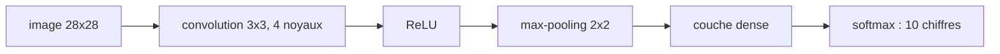

# Chapitre 6 — Réseaux convolutifs

:::tip[En bref (TL;DR)]
**En bref.** Une convolution réutilise un petit détecteur de motif à chaque position d’une image. Nous prouvons qu’elle est linéaire et équivariante par translation, puis nous entraînons un CNN qui atteint 97 % sur MNIST.

**Mots nouveaux, en termes simples:**

- **Convolution**: Faire glisser un petit détecteur de motif sur l’entrée et noter à quel point il correspond à chaque position.
- **Noyau (filtre)**: La petite grille de poids utilisée par une convolution.
- **Partage des poids**: Utiliser les mêmes poids à chaque position, ce qui réduit beaucoup le nombre de paramètres.
- **Équivariance par translation**: Décalez l’entrée et la sortie se décale pareil : un motif est trouvé où qu’il soit.
- **Canal (carte de caractéristiques)**: Une image de sortie produite par un noyau.
- **Max-pooling**: Réduire une image en ne gardant que le plus grand nombre de chaque petit bloc.
- **CNN**: Réseau de neurones convolutif : des convolutions, des non-linéarités et du pooling, suivis d’un classifieur.
:::


Une couche dense sur une image de $28\times 28$ a $784$ poids *par neurone*, et ne sait pas que deux pixels voisins sont voisins. Une **couche convolutive** intègre deux hypothèses sur les images :

- **Localité** : une sortie ne regarde qu'une petite fenêtre de l'entrée.
- **Partage des poids** : le même petit ensemble de poids (le **noyau**) est appliqué à chaque position.

<Figure src="conv.svg" alt="Un noyau de longueur 3 glissant sur une entrée de longueur 7" caption="Chaque sortie est le produit scalaire du noyau avec une fenêtre de l'entrée." />

## Convolution en dimension un, avec les formes dans le type

Commençons en dimension un, où les preuves sont courtes. Un noyau de longueur $k+1$ glisse sur une entrée de longueur $m+k$ et produit exactement $m$ sorties. En Lean, cette arithmétique fait partie du type : un noyau qui ne rentre pas ne passe tout simplement pas le typage.

```lean file=Ch06/Conv.lean#conv1d
```

(Le deep learning appelle cela *convolution* ; à proprement parler c'est une corrélation croisée, car le noyau n'est pas retourné. La distinction n'a pas d'importance pour l'apprentissage.)

:::tip[Coin Lean : des preuves à l'intérieur des termes]
L'indice `x ⟨i + j, _⟩` demande une preuve que `i + j < m + k`. Nous la fournissons par `by omega`, à partir des bornes `i < m` et `j < k + 1` données par les types `Fin`. Lean la vérifie à la compilation : il n'y a donc aucune lecture hors limites à l'exécution.
:::

## Ce que l'on peut démontrer

**1. La convolution est linéaire**, en l'entrée et en le noyau. Une couche convolutive est donc une *application linéaire de structure particulière*, suivie d'une non-linéarité.

```lean file=Ch06/Conv.lean#conv_linear
```

**2. La convolution est équivariante par translation** : décaler l'entrée d'une position décale la sortie d'une position. C'est exactement ce qu'apporte le partage des poids : un motif est détecté où qu'il apparaisse.

```lean file=Ch06/Conv.lean#equivariance
```

**3. Le gradient par rapport au noyau est une corrélation.** Soit $s$ le gradient venant de la couche suivante. La contribution à la perte est $\ell(\mathrm{ker}) = \sum_i s_i\,(\mathrm{ker}\star x)_i$. Échanger les deux sommes, seul vrai travail qui demande un lemme sur les sommes doubles (`vsum_comm`), donne $\ell(\mathrm{ker}) = \sum_j \mathrm{ker}_j\cdot\mathrm{corr}(s,x)_j$. Une forme linéaire $\sum_j \mathrm{ker}_j\,g_j$ a pour gradient $g$, donc $\partial\ell/\partial \mathrm{ker}_j = \mathrm{corr}(s,x)_j$ :

```lean file=Ch06/Conv.lean#corr
```

La passe arrière d'une convolution est donc encore une opération de type convolution : pas besoin d'une nouvelle idée pour l'entraîner.

## Un CNN pour MNIST

Passons à deux dimensions. Notre réseau : une convolution $3\times 3$ à 4 canaux (sorties $26\times 26$), ReLU, un **max-pooling** $2\times 2$ (garder le plus grand de chaque bloc $2\times2$, d'où du $13\times 13$), une couche dense vers 10 logits, entropie croisée softmax.



*Le CNN de ce chapitre, des pixels à un chiffre.*


```lean file=Ch06/Cnn.lean#net
```

La rétropropagation, par étapes :

1. L'erreur de la couche de sortie est `p - onehot y`, comme au chapitre 5.
2. Le max-pooling envoie le gradient à la seule position qui a gagné le maximum ; les trois autres reçoivent zéro.
3. ReLU ne laisse passer le gradient que là où l'unité était active.
4. Le gradient du noyau est la corrélation de l'entrée avec ce gradient : la version en deux dimensions du théorème 3.

```lean file=Ch06/Cnn.lean#backward
```

:::warning Ce qui est démontré ici, et ce qui ne l'est pas
Les théorèmes 1 à 3 portent sur la couche en dimension un. Le code en deux dimensions en est une généralisation directe mais n'est *pas* lui-même démontré. Nous le vérifions numériquement : la démo compare le gradient du noyau à une différence finie centrée de la perte.
:::

## Exécution

```bash
cd lean
lake exe cnn 60000 10000 3
```

```text
kernel gradient check: max |backprop - finite difference| = 0.000000
epoch 1: test accuracy = 0.963400
epoch 2: test accuracy = 0.955100
epoch 3: test accuracy = 0.970600
```

La vérification du gradient concorde à mieux que $10^{-6}$ (la valeur affichée s'arrondit à 0). Avec seulement **4 canaux et 3 passes de SGD simple**, le réseau atteint **97,1 %** sur les 10 000 images de test, en moins de trois minutes sur le processeur d'un portable. Le creux de l'époque 2 est du bruit ordinaire du SGD à taux d'apprentissage constant ; c'est une exécution avec une graine, pas un benchmark. À comparer aux 96,4 % du réseau à une couche cachée du chapitre 5, qui a beaucoup plus de poids.

## Exercices

1. Démontrez que `conv1d` avec le noyau canonique $(0,\dots,0,1,0,\dots,0)$ est une copie décalée de l'entrée.
2. Énoncez l'identité d'adjonction par rapport à l'*entrée* (la « convolution transposée » qui transporte le gradient vers la couche précédente) et démontrez-la.
3. Ajoutez une seconde couche convolutive à `Cnn.lean`. Combien de canaux pouvez-vous vous permettre pour le même temps d'exécution ?
4. Le max-pooling n'est pas dérivable en cas d'égalité. Que fait le code dans ce cas, et est-ce important ?

**Exercices en Lean.** Le fichier `lean/LeanDL/Ch06/Exercises.lean` contient les énoncés ci-dessous, avec des `sorry` à remplacer. Les solutions démontrées sont dans `Solutions.lean`, à côté : essayez d’abord.

```lean file=Ch06/Exercises.lean#ex1
```

```lean file=Ch06/Exercises.lean#ex2
```

<details>
<summary>Indice 1</summary>

Dépliez `conv1d` : chaque terme de la somme est `ker j * 0`. Montrez que la fonction sommande vaut `fun _ => 0` et utilisez `vsum_zero`.

</details>

<details>
<summary>Corrigé 1</summary>

```lean file=Ch06/Solutions.lean#sol1
```

</details>

<details>
<summary>Indice 2</summary>

C’est exactement `conv1d_add` appliqué à `x` et `x`.

</details>

<details>
<summary>Corrigé 2</summary>

```lean file=Ch06/Solutions.lean#sol2
```

</details>
