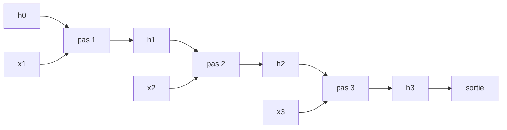

# Chapitre 7 — Réseaux récurrents

:::tip[En bref (TL;DR)]
**En bref.** Un réseau récurrent lit une séquence pas à pas et garde une mémoire. Nous prouvons pourquoi son gradient s’évanouit ou explose sur de longues séquences, et nous le voyons échouer sur une tâche de mémoire.

**Mots nouveaux, en termes simples:**

- **Réseau de neurones récurrent (RNN)**: Un réseau qui lit une séquence un élément à la fois et transporte une mémoire vers l’avant.
- **État caché**: La mémoire du réseau : un vecteur mis à jour à chaque pas.
- **Déroulement**: Écrire la boucle sous forme de nombreuses copies du même réseau, une par pas de temps.
- **Rétropropagation à travers le temps (BPTT)**: La rétropropagation sur le réseau déroulé.
- **Gradient qui s’évanouit**: Le signal d’apprentissage rétrécit à chaque pas en arrière jusqu’à disparaître, donc les causes lointaines ne sont pas apprises.
- **Gradient qui explose**: L’inverse : le signal grandit à chaque pas jusqu’à devenir énorme et instable.
- **Écrêtage du gradient**: Plafonner la taille du gradient pour dompter les explosions.
:::


Les images ont une taille fixe ; les phrases, le son et les flux de capteurs non. Un **réseau de neurones récurrent** (RNN) lit son entrée un élément à la fois et transporte un **état** $h_t$ d'un pas au suivant :

$$ h_t = \tanh(W_h\,h_{t-1} + W_x\,x_t + b), \qquad \hat y = \sigma(w_o\cdot h_T + b_o). $$

Les *mêmes* poids servent à chaque pas (l'analogue temporel du partage des poids du chapitre 6). Pour l'entraîner on le **déroule** : une récurrence de longueur $T$ est un réseau sans rebouclage de profondeur $T$ dont les couches partagent leurs poids. La rétropropagation sur le réseau déroulé s'appelle la **rétropropagation à travers le temps** (BPTT).

<Creators fr slugs="werbos,rumelhart" />

## L'état d'un réseau récurrent est un produit

Comprenons le gradient avec le réseau le plus simple possible : une unité, $h_{t+1} = \tanh(w\,h_t + c_t)$, l'entrée étant intégrée dans $c_t$. Nous construisons le réseau déroulé comme une `Expr` à une seule variable $h_0$ :



*Un RNN déroulé sur trois pas. Chaque pas utilise les mêmes poids ; l’état h est la mémoire.*


```lean file=Ch07/Gradient.lean#unroll
```

La machinerie du chapitre 4 s'applique directement. La dérivée formelle par rapport à $h_0$ obéit à une récurrence simple, et `backprop` sur le réseau déroulé renvoie exactement ce produit :

```lean file=Ch07/Gradient.lean#bptt
```

En mots :

$$ \frac{\partial h_T}{\partial h_0} \;=\; \prod_{s=1}^{T} \bigl(1-h_s^2\bigr)\,w . $$

La BPTT multiplie $T$ facteurs. Que le produit diminue, reste stable ou grandisse fait toute l'histoire de l'entraînement des RNN.

<Figure src="rnn_chain.svg" alt="log10 du gradient a travers T etapes de temps denroules : 0.5^T typique et 0.25^T pire cas tombent en lignes droites" caption="Denrouler un RNN transforme la retropropagation en produit de profondeur du Ch03, le temps remplacant les couches : log10 chute lineairement, -0.3 par pas typique, -0.6 pire cas. Dix pas en arriere ne laissent plus qu'un milliemieme du signal - l'evanescence formelle que l'autoroute du LSTM (Ch08) est construite pour fuir." />

## Gradients qui s'évanouissent

Chaque facteur $1 - h_s^2$ est compris entre $0$ et $1$ (car $|\tanh|\le 1$). Donc si $|w| < 1$ le produit vaut au plus $|w|^T$ : il **décroît exponentiellement avec la longueur de la séquence**. Le théorème ci-dessous l'énonce pour les carrés, ce qui évite les valeurs absolues ; il est démontré sur `Rat`, en arithmétique exacte.

<Figure src="vanishing.svg" alt="Taille du gradient selon le nombre de pas pour quatre poids récurrents" caption="Taille du gradient après T pas pour un poids récurrent w (échelle logarithmique, le théorème de cette section). En dessous de 1 il s’évanouit, au-dessus de 1 il explose, et seul w = 1 est stable." />


```lean file=Ch07/Gradient.lean#vanishing
```

:::info Ce qu'est « tanh² ≤ 1 »
Dans le théorème `tanh_jacobian_sq_le`, c'est une hypothèse `hb` sur l'activation, vraie pour la vraie tangente hyperbolique. Notre classe `HasAct` dit seulement qu'une fonction appelée `tanh` existe : la borne doit donc être supposée.
:::

## Gradients qui explosent

Sans activation saturante, rien ne borne les facteurs. Pour la récurrence linéaire $h_{t+1} = w\,h_t + c_t$, le gradient vaut exactement $w^T$ :

```lean file=Ch07/Gradient.lean#exploding
```

Avec $w=2$, le gradient est multiplié par un million en 20 pas ; avec $|w|<1$ il s'éteint. Entraîner un long RNN, c'est marcher sur un fil, et aucune valeur de $w$ n'est confortable. (Les praticiens écrêtent les gradients contre l'explosion ; l'évanouissement est le problème difficile, et motive le LSTM du chapitre suivant.)

<Figure src="lag_copy.svg" alt="Deux impulsions sur un axe temporel, l'entree et la cible retardees de trois pas" caption="La tache de memoire du RNN : y_t = x_(t-3) - une impulsion d'entree en t = 3 doit ressortir en t = 6. La mise a jour d'etat doit porter l'impulsion exactement trois pas : pas trop peu (elle s'evanouit), pas trop (elle bave sur les sorties suivantes). Ce fil est la ou l'analyse des gradients evanescents du chapitre mord." />

## Un RNN à $n$ unités, en Lean

Pour des vecteurs réels nous utilisons des tableaux. (L'`Expr` arborescente du chapitre 4 recopierait tout l'historique chaque fois qu'une unité lit l'état précédent, ce qui est exponentiel en $T$.) La passe avant conserve tous les états cachés :

```lean file=Ch07/Rnn.lean#forward
```

La BPTT remonte ensuite depuis le dernier pas. Remarquez la ligne qui envoie l'erreur vers l'état précédent : c'est la multiplication par $W_h^\top$ et par $(1-h_t^2)$, exactement les facteurs du théorème, maintenant sous forme de matrices.

```lean file=Ch07/Rnn.lean#bptt
```

`lossGrad` renvoie aussi $\|\partial L/\partial h_t\|$ à chaque pas, ce qui permet de regarder l'évanouissement se produire.

:::warning Ce qui est démontré, et ce qui est vérifié
Les théorèmes portent sur le réseau à une unité. Le code à $n$ unités n'est pas démontré ; la démo compare son gradient à des différences finies centrées.
:::

## Exécution

```bash
cd lean && lake exe rnn
```

```text
BPTT gradient check over 89 parameters: max error = 0.000000
‖∂L/∂h_t‖ for t = 30, 25, 20, 15, 10, 5, 1:
  0.347510, 0.069822, 0.006518, 0.000685, 0.000059, 0.000006, 0.000001
```

Le gradient arrivant au dernier état vaut $0{,}35$ ; cinq pas plus loin il vaut $0{,}07$, et au premier pas $10^{-6}$ : une perte de plus de **cinq ordres de grandeur** en 29 pas, un facteur d'environ 1,5 par pas, comme la théorie le prédit pour de petits poids.

### Peut-il se souvenir ?

La *tâche de mémoire* : l'étiquette est le **premier** bit d'une suite aléatoire de bits ; l'information doit donc survivre $T-1$ pas. Huit unités, Adam, 800 pas, 32 séquences d'entraînement, 300 séquences de test neuves :

| $T$ | perte d'entraînement | précision d'entraînement | précision en test |
|-----|---------------------|--------------------------|-------------------|
| 3 | 0,00005 | 100 % | 100 % |
| 20 | 0,00013 | 100 % | 100 % |
| 60 | 0,0022 | 100 % | **49,7 %** |
| 120 | 0,12 | 96,9 % | **45,0 %** |

Pour $T\le 20$, le réseau apprend la règle. Pour $T\ge 60$ il s'ajuste aux 32 séquences d'entraînement (il les *mémorise*) mais est au niveau du hasard sur les nouvelles : le gradient venant de l'étiquette n'a jamais atteint la première entrée, il n'a donc pas pu découvrir la règle. C'est une seule graine et une seule configuration : le seuil exact n'a pas de sens, mais la *forme* du résultat en a un. (Adam et 8 unités suffisent à repousser l'échec bien au-delà de ce qu'obtient la descente de gradient simple.)

## Exercices

1. Dans `jacRec_sq_le`, que se passe-t-il si un facteur $g_s$ peut dépasser 1 ? Trouvez le plus petit contre-exemple.
2. Démontrez `deriv_hE` pour $h_{t+1} = \tanh(w\,h_t + c_t)$ lorsque $w$ est lui-même une variable. Que vaut $\partial h_T/\partial w$ ?
3. Ajoutez l'écrêtage de gradient (remettre le gradient à l'échelle si sa norme dépasse un seuil) à la boucle d'entraînement. Cela aide-t-il sur la tâche de mémoire à $T = 60$ ?
4. Remplacez les 32 séquences d'entraînement par un nouveau lot à chaque pas. Le réseau mémorise-t-il encore à $T = 60$ ?

**Exercices en Lean.** Le fichier `lean/LeanDL/Ch07/Exercises.lean` contient les énoncés ci-dessous, avec des `sorry` à remplacer. Les solutions démontrées sont dans `Solutions.lean`, à côté : essayez d’abord.

```lean file=Ch07/Exercises.lean#ex1
```

```lean file=Ch07/Exercises.lean#ex2
```

<details>
<summary>Indice 1</summary>

Dépliez `jacRec` une fois : le nouveau facteur contient `w * jacRec w g t` avec `w = 0`. `grind` termine.

</details>

<details>
<summary>Corrigé 1</summary>

```lean file=Ch07/Solutions.lean#sol1
```

</details>

<details>
<summary>Indice 2</summary>

Récurrence sur `t`. Au pas, `simp only [jacRec, ih]` laisse `1 * (1 * 1) = 1`, que `grind` ferme.

</details>

<details>
<summary>Corrigé 2</summary>

```lean file=Ch07/Solutions.lean#sol2
```

</details>
