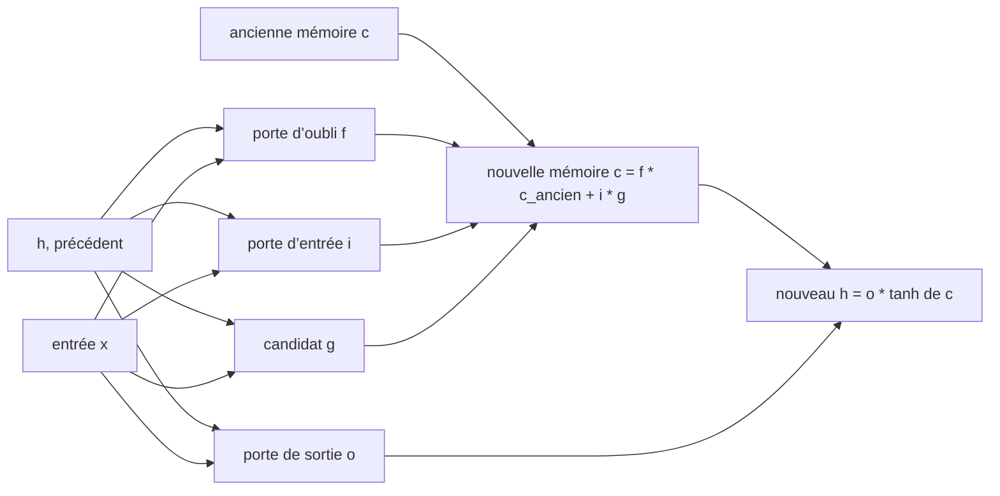

# Chapitre 8 — LSTM et mémoire à portes

:::tip[En bref (TL;DR)]
**En bref.** Le LSTM ajoute des portes et une cellule mémoire pour que le gradient puisse remonter loin. Nous prouvons cette autoroute du gradient, et nous constatons honnêtement que sur notre petite tâche il ne bat pas le RNN simple.

**Mots nouveaux, en termes simples:**

- **LSTM**: Un RNN avec des portes et une cellule mémoire séparée, conçu pour que le signal d’apprentissage puisse remonter loin.
- **Porte**: Un nombre entre 0 et 1 qui décide quelle part de quelque chose passe : 0 ferme, 1 ouvre.
- **État de cellule**: La ligne de mémoire à long terme du LSTM, mise à jour par mise à l’échelle et addition.
- **Porte d’oubli**: Décide quelle part de l’ancienne mémoire garder.
- **Carrousel d’erreur constante**: Le chemin où la mémoire est conservée avec un facteur 1, de sorte que le gradient ne rétrécit ni ne grandit.
- **GRU**: Une unité à portes plus légère, avec une porte qui mélange l’ancien état et le nouveau candidat.
- **Apprentissage par curriculum**: S’entraîner d’abord sur des versions faciles de la tâche (séquences courtes), puis la durcir.
:::


Le chapitre 7 s'est terminé sur un diagnostic : dans un RNN simple, le gradient est un produit de $T$ facteurs $(1-h_s^2)\,w$, chacun typiquement inférieur à 1. Le réseau **Long Short-Term Memory** (Hochreiter et Schmidhuber, 1997) change l'architecture pour que le gradient dispose d'un chemin dont les facteurs peuvent être fixés par le réseau lui-même proches de $1$.

<Figure src="cell_hold.svg" alt="Etat de cellule ecrit 1 en t = 0 : f = 1 le porte plat, f = 0,95 s'efface lentement, f = 0,5 s'effondre" caption="L'etat de cellule est l'autoroute : une valeur ecrite en t = 0 avec le facteur f survit t pas comme f^t. f = 1 (portees ouvertes) le porte pour toujours - le chemin de gradient exact du theoreme de l'autoroute ; f = 0,95 s'efface en 40 pas ; f = 0,5 est l'effondrement RNN du Ch7 en une ligne. Le LSTM apprend f proche de 1 pour les pas a memoriser." />

## Le LSTM

En plus de l'état caché $h_t$, le LSTM porte un **état de cellule** $c_t$. Quatre petites couches (les *portes*) lisent $h_{t-1}$ et $x_t$ :



*Un pas de LSTM. La nouvelle mémoire est l’ancienne multipliée par la porte d’oubli, plus ce que la porte d’entrée laisse passer.*


$$
\begin{aligned}
f_t &= \sigma(W_f[h_{t-1},x_t]+b_f) & &\text{porte d'oubli}\\
i_t &= \sigma(W_i[h_{t-1},x_t]+b_i) & &\text{porte d'entrée}\\
g_t &= \tanh(W_g[h_{t-1},x_t]+b_g) & &\text{candidat}\\
o_t &= \sigma(W_o[h_{t-1},x_t]+b_o) & &\text{porte de sortie}
\end{aligned}
\qquad
\begin{aligned}
c_t &= f_t\odot c_{t-1} + i_t\odot g_t\\
h_t &= o_t\odot \tanh(c_t)
\end{aligned}
$$

La ligne qui compte est $c_t = f_t\odot c_{t-1} + i_t\odot g_t$ : la mémoire est mise à jour en *multipliant et additionnant*, et non en écrasant le tout par une matrice de poids et un $\tanh$.

```lean file=Ch08/Lstm.lean#forward
```

<Figure src="lstm_gates.svg" alt="Les quatre briques de la cellule LSTM : f et i sont des sigmoides dans (0,1), le candidat tanh dans (-1,1), f fois le candidat est la mise a jour gatee" caption="Chaque porte du LSTM est une de ces quatre courbes. f = sigmoid decide du taux de conservation (0 garde la memoire, 1 la reecrit - l'autoroute qu'utilise the theoreme du gradient), i = sigmoid du taux d'ecriture, le tanh borne le candidat, et f * c~ est le multiplie-additionnel qui constitue toute la mise a jour." />

## Le gradient dispose d'une autoroute

Isolons le chemin de la cellule : $c_{t+1} = f_t\,c_t + u_t$, où la porte d'oubli $f_t$ et la mise à jour $u_t = i_t g_t$ sont considérées comme données. Déroulé comme une `Expr` en $c_0$ :

<Figure src="highway.svg" alt="Gradient le long du chemin de mémoire pour des portes d’oubli et pour un RNN simple" caption="Le gradient le long du chemin de mémoire est un produit de portes d’oubli. Avec des portes proches de 1 il survit à 100 pas ; avec un facteur de RNN simple de 0,5 il tombe à 10^-30." />


```lean file=Ch08/CellPath.lean#cell
```

```lean file=Ch08/CellPath.lean#path
```

Le gradient le long du chemin de la cellule vaut $\prod_s f_s$ : **seulement des portes d'oubli**. Pas de matrice de poids, pas de facteur $1-\tanh^2$. Si le réseau apprend $f\approx 1$, le gradient survit ; avec $f\equiv 1$ il vaut exactement $1$ quelle que soit la longueur de la séquence (le *carrousel d'erreur constante*).

Des portes dans $[0,1]$ gardent aussi ce produit *borné* : il ne s'évanouit pas à vitesse exponentielle (si $f\ge a$) et n'explose pas :

```lean file=Ch08/CellPath.lean#bounds
```

Par exemple avec $f\ge 0{,}99$, le gradient vaut encore au moins $0{,}99^{100}\approx 0{,}37$ après 100 pas. Au chapitre 7, un facteur $|w|\le 1/2$ donnait $(1/2)^{100}\approx 10^{-30}$.

:::warning Portée des théorèmes
Les théorèmes décrivent le chemin *direct* de la cellule. Le gradient complet d'un LSTM est la somme de ce chemin et des chemins passant par les portes (qui dépendent de $h_{t-1}$) ; ceux-ci peuvent encore diminuer. L'idée est que le réseau dispose d'un chemin qu'il peut garder ouvert, pas que tout gradient soit préservé.
:::

## Rétropropagation à travers le temps

La passe arrière écrite à la main suit les équations pas à pas. La ligne `dcPrev := dcj * f` est le chemin de la cellule du théorème.

```lean file=Ch08/Lstm.lean#bptt
```

Les paramètres sont initialisés avec tous les biais des portes d'oubli égaux à $1$, de sorte que les portes démarrent ouvertes (une astuce classique).

## Ce que nous avons mesuré

`lake exe lstm` commence par comparer le gradient des 329 paramètres à des différences finies centrées (erreur maximale inférieure à $10^{-6}$, affichée 0.000000). Puis il affiche la taille du gradient atteignant les pas antérieurs d'une séquence de 30 pas, avec des poids aléatoires :

```text
t = 30, 25, 20, 15, 10, 5, 1
  ‖∂L/∂h_t‖: 0.369405, 0.009537, 0.001595, 0.000542, 0.000253, 0.000144, 0.000111
  ‖∂L/∂c_t‖: 0.143721, 0.022238, 0.004261, 0.001125, 0.000462, 0.000261, 0.000211
```

À comparer au RNN du chapitre 7, qui passait de $0{,}35$ à $10^{-6}$. Ici le gradient au premier pas est environ 100 fois plus grand. (Poids aléatoires différents et une seule séquence : indicatif, pas une comparaison statistique.)

### Apprend-il mieux la tâche de mémoire ?

La même tâche qu'au chapitre 7 : l'étiquette est le premier bit d'une suite aléatoire de bits de longueur $T$. Huit unités, Adam, un **nouveau** lot de 32 séquences à chaque pas pour que rien ne puisse être mémorisé, taux d'apprentissage $0{,}005$, 2500 pas, 300 séquences de test (le hasard donne 50 %, avec environ $\pm 3\%$ de bruit) :

| $T$ | RNN | LSTM |
|-----|-----|------|
| 20 | 100 % | 100 % |
| 60 | 46,3 % | 44,7 % |
| 120 | 48,3 % | 46,7 % |

**Les deux modèles apprennent $T=20$ et aucun n'apprend $T\ge 60$.** Le LSTM n'a ici aucun avantage, malgré le meilleur flux de gradient. Deux observations de plus :

- **Les hyperparamètres comptent.** Avec le taux d'apprentissage $0{,}02$ du chapitre 7, le LSTM n'a *pas* appris $T=20$ (45,7 % après 800 pas, 54,3 % après 4000) alors que le RNN l'a appris. Un taux plus faible a corrigé cela.
- **Un curriculum aide les deux autant.** Commencer avec $T=10$ et augmenter la longueur de 10 tous les 1500 pas en conservant les paramètres : *les deux* réseaux atteignent 100 % de précision en test à chaque étape jusqu'à $T=60$ (`lake exe lstm curr rnn`, `lake exe lstm curr lstm`).

Que conclure ? Que le meilleur flux de gradient **n'est pas le seul obstacle** dans cette tâche : trouver la règle de zéro dans une longue séquence bruitée est un problème d'optimisation difficile même quand le gradient atteint le premier pas, et un petit curriculum le résout pour les deux architectures. Tout ceci est un jouet : 8 unités, une graine, de petits budgets. L'avantage du LSTM sur de vraies tâches (langage, parole, dépendances longues structurées) est bien documenté dans la littérature, mais l'expérience de ce tutoriel ne le démontre pas, et nous préférons le dire.

## Le GRU, implémenté

L'**unité récurrente à portes** (Cho et al., 2014) fusionne la cellule et l'état caché : pas de ligne mémoire séparée, l'état lui-même est mis à jour comme un *mélange convexe* de l'ancien état et d'un nouveau candidat, sous le contrôle d'une porte de mise à jour $z_t$ et d'une porte de réinitialisation $r_t$ sur le candidat :

$$
\begin{aligned}
r_t &= \sigma(W_r[h_{t-1},x_t]+b_r) & &\text{porte de réinitialisation}\\
z_t &= \sigma(W_z[h_{t-1},x_t]+b_z) & &\text{porte de mise à jour}
\end{aligned}
\qquad
\begin{aligned}
n_t &= \tanh(b_n + r_t \odot W_n h_{t-1} + W_x x_t) & &\text{candidat}\\
h_t &= (1-z_t)\odot n_t + z_t \odot h_{t-1} & &\text{état}
\end{aligned}
$$

Deux portes par unité au lieu de quatre, environ un quart de paramètres en moins que le LSTM à largeur égale — et le même truc. Le chemin direct de $h_{t-1}$ à $h_t$ a pour facteur $z_t$ : la mise à jour de l'état est *exactement* la récurrence additive $c_{t+1} = f_t c_t + u_t$ du théorème, avec $f_t := z_t$ et $u_t := (1-z_t)\,n_t$. L'autoroute est un **produit de portes de mise à jour** :

```lean file=Ch08/CellPath.lean#gru
```

L'implémentation suit les équations sur des tableaux plats, comme celle du LSTM, et la passe arrière est écrite à la main porte par porte ; `lake exe gru` vérifie toutes ses dérivées partielles contre des différences finies centrales (erreur maximale affichée 0.000000 sur `nParams nh` = 329 paramètres avec `nh = 8`) :

```lean file=Ch08/Gru.lean#forward
```

```lean file=Ch08/Gru.lean#bptt
```

Le biais de la porte de mise à jour démarre à $0.5$ (l'analogue du biais d'oubli $=1$ du LSTM) : le chemin de l'état démarre largement ouvert.

### La porte est un théorème

L'équation de définition du GRU est une **combinaison convexe** : $h_t = z_t\,h_{t-1} + (1-z_t)\,n_t$ avec $z_t \in [0,1]$ — une moyenne pondérée de l'ancien état et du candidat. Ce n'est pas un détail, c'est une garantie, et elle est prouvée sur $\mathbb{Q}$ exact :

```lean file=Ch08/Gru.lean#gru_bound
```

Si l'ancien état et le candidat vivent dans $[-M, M]$, le nouvel état reste dans $[-M, M]$ — et par récurrence, **chaque état caché de chaque séquence** porte la borne. Les hypothèses sont exactement ce que la cellule calcule : $\tanh$ est bornée par 1, le sigmoid est une probabilité. C'est le certificat de mathématiques exactes derrière l'observation de la démo — les activations cachées n'explosent jamais — et combiné à `drift_bound_seq` (Core), une exécution GRU en `Float`, où chaque mise à jour porte une perturbation d'arrondi, suit la dynamique exacte à $T\varepsilon$ près après $T$ pas.

### Ce que ça mesure

`lake exe gru` vérifie d'abord toutes les dérivées partielles du BPTT de 329 paramètres contre des différences finies centrales : **erreur maximale $2\cdot 10^{-8}$** (affichée 0.000000) — la passe arrière écrite à la main est juste. Puis, sur les tailles de gradient (30 pas, poids aléatoires), `‖∂L/∂h_t‖` décroît lentement le long du chemin d'état au lieu de s'effondrer comme le RNN simple du chapitre 7 — le carrousel en action.

Sur la **tâche mémoire** (l'étiquette est le premier bit d'une séquence aléatoire), le même protocole de curriculum que le LSTM (`lake exe gru exp` : 8 unités, Adam, taux $0.005$, 1500 pas par palier, lots renouvelés de 32, paliers $T = 10, 20, 30, 40$, 300 séquences de test) :

| $T$ | 10 | 20 | 30 | 40 |
|-----|----|----|----|----|
| GRU (curriculum) | 100 % | 100 % | 100 % | 100 % |
| LSTM (curriculum, `lake exe lstm curr`) | 100 % | 100 % | 100 % | 100 % |

**Le GRU résout la tâche à chaque palier avec deux portes de moins** — il égale le LSTM avec environ un quart de paramètres en moins par unité. Sans curriculum (entraînement simple à $T$ fixe) le GRU reste près du hasard à $T \ge 20$, exactement comme le LSTM et le RNN : sur cette tâche, c'est le curriculum, pas le nombre de portes, qui fait la différence. Tout ceci est un jouet : 8 unités, une graine, de petits budgets.

## Exercices

1. Implémentez le GRU sur des tableaux et vérifiez son gradient par différences finies. (Fait : il est dans `lean/LeanDL/Ch08/Gru.lean`.)
2. Démontrez `prodF_ge` et `prodF_le_one` pour un corps ordonné quelconque au lieu de `Rat` (indication : la preuve n'utilise que quelques lemmes d'ordre).
3. Faites de la valeur initiale du biais de la porte d'oubli un paramètre. Pour $T=60$ avec entraînement simple, $b_f = 2$ ou $b_f = 0$ changent-ils le résultat ?
4. Combinez le théorème du chemin de la cellule avec la dépendance des portes : écrivez le $\partial c_T/\partial c_0$ complet pour un LSTM à 2 pas et identifiez les termes supplémentaires.

**Exercices en Lean.** Le fichier `lean/LeanDL/Ch08/Exercises.lean` contient les énoncés ci-dessous, avec des `sorry` à remplacer. Les solutions démontrées sont dans `Solutions.lean`, à côté : essayez d'abord.

```lean file=Ch08/Exercises.lean#ex1
```

```lean file=Ch08/Exercises.lean#ex2
```

```lean file=Ch08/Exercises.lean#ex3
```

<details>
<summary>Indice 1</summary>

Dépliez `prodF` trois fois ; l’anneau est commutatif, donc `grind` ferme le but.

</details>

<details>
<summary>Corrigé 1</summary>

```lean file=Ch08/Solutions.lean#sol1
```

</details>

<details>
<summary>Indice 2</summary>

Récursion sur `t` : le cas de base est `0 ≤ 1` ; le pas est `Rat.mul_nonneg` appliqué à l’hypothèse et à l’hypothèse de récurrence.

</details>

<details>
<summary>Corrigé 2</summary>

```lean file=Ch08/Solutions.lean#sol2
```

</details>

<details>
<summary>Indice 3</summary>

Récursion sur `t` : en `0` les deux côtés valent `1` ; en `t+1` les deux côtés valent `w * (… t)`, donc on réécrit avec l'hypothèse de récurrence.

</details>

<details>
<summary>Corrigé 3</summary>

```lean file=Ch08/Solutions.lean#sol3
```

</details>
