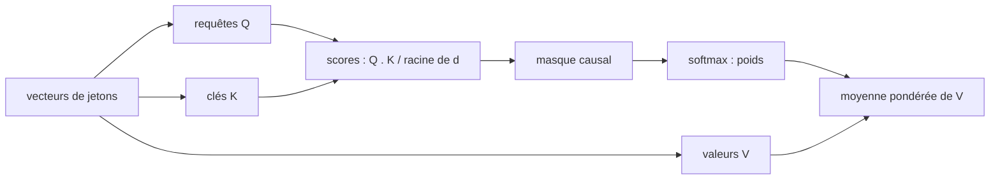
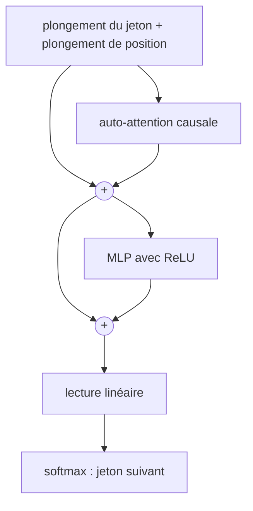

# Chapitre 9 — L'attention et le Transformer

:::tip[En bref (TL;DR)]
**En bref.** L’attention permet à chaque position de regarder directement toutes les autres. Nous prouvons cinq propriétés (poids softmax, insénsibilité à l’ordre, masque causal, invariance de la normalisation de couche par décalage, mélanges bornés) et entraînons un petit Transformer.

**Mots nouveaux, en termes simples:**

- **Jeton et plongement**: Un jeton est un morceau de texte (ici un caractère). Un plongement est la liste de nombres qui le représente.
- **Attention**: Chaque position regarde toutes les autres, évalue leur pertinence et prend une moyenne pondérée de ce qu’elles portent.
- **Requête, clé, valeur**: La requête est ce que je cherche, la clé est ce que chaque élément propose, la valeur est ce qu’il donne s’il est choisi.
- **Transformer**: Un réseau construit avec de l’attention et de petits blocs MLP, sans récurrence.
- **Connexion résiduelle**: Ajouter l’entrée d’un bloc à sa sortie, pour que l’information et les gradients aient un raccourci.
- **Encodage positionnel**: Des nombres supplémentaires qui disent au modèle où se trouve chaque jeton, car l’attention seule ignore l’ordre.
- **Masque causal**: Interdire de regarder les positions futures, pour qu’un modèle de langage ne puisse pas tricher.
- **Normalisation de couche**: Recentrer et remettre à l’échelle les nombres d’une position. Ajouter la même constante à tous ne change rien.
- **Modèle de langage**: Un modèle qui prédit le jeton suivant.
:::


Les réseaux récurrents lisent une séquence un pas à la fois : l'information lointaine doit donc survivre à de nombreux pas. Le **Transformer** (Vaswani et al., 2017) abandonne la récurrence : chaque position peut regarder directement toutes les autres, grâce à l'**attention**.

<Figure src="attn_sharp.svg" alt="Poids softmax de la cle dominante sur quatre cles selon l'ecart de logit beta, de 1/4 a 1, avec la ligne uniforme 1/4" caption="L'attention comme projecteur reglable : avec trois cles rivales, un ecart de logit beta met e^beta / (e^beta + 3) sur la gagnante - 1/4 aveugle, 98 % a l'ecart 6 (les faits softmax demontres au chapitre). La temperature est ce cadran : grand beta selectionne fort, beta = 0 degengere en moyenne uniforme." />

## L'attention par produit scalaire normalisé

Chaque position $t$ a une *requête* $q_t$, une *clé* $k_t$ et une *valeur* $v_t$ (trois applications linéaires de sa représentation $x_t$). La position $t$ compare sa requête à toutes les clés, transforme les scores en poids par un softmax, et prend la moyenne pondérée des valeurs :



*L’attention : chaque jeton compare sa requête à toutes les clés, transforme les scores en poids, et moyenne les valeurs.*


$$
a_{t,j} = \frac{\exp(q_t\cdot k_j/\sqrt d)}{\sum_{j'}\exp(q_t\cdot k_{j'}/\sqrt d)},\qquad o_t = \sum_j a_{t,j}\,v_j .
$$

Un bloc Transformer ajoute ceci à son entrée (une **connexion résiduelle**) puis applique un petit MLP, de nouveau avec une connexion résiduelle. Les vrais modèles empilent de nombreux blocs, utilisent plusieurs « têtes » d'attention en parallèle et normalisent les activations par normalisation de couche.

<Figure src="attention_causal.svg" alt="Matrice d'attention causale 6x6 a scores uniformes : la ligne t repartit 1/(t+1) sur son propre passe et zero sur le futur" caption="Le masque causal, dessine : scores uniformes, donc chaque ligne repartit sa masse a parts egales sur les positions qu'elle a le droit de voir. La ligne 0 ne voit qu'elle-meme (masse 1), la ligne 5 moyenne sur six. Tout ce qui est au-dessus de la diagonale vaut exactement zero - c'est la propriete sans fuite demontree au chapitre (causal_no_leak), visible en triangle blanc." />

## Cinq faits, démontrés

### 1. Les poids forment une distribution, et le softmax est invariant par translation

```lean file=Ch09/Attention.lean#weights
```

Le second théorème justifie l'*astuce de stabilité* utilisée au chapitre 5 : soustraire le score maximal avant d'exponentier ne change pas le résultat. (C'était un exercice là-bas ; c'est démontré ici.) Les deux théorèmes valent dans tout corps muni d'un `exp` vérifiant $e^{x+y}=e^xe^y$ et $e^0=1$. L'hypothèse « le normalisateur est non nul » est automatique pour l'exponentielle réelle, qui est positive.

### 2. L'attention ne voit pas l'ordre

L'attention traite ses entrées comme un *ensemble* : réordonner les éléments ne change pas la sortie.

```lean file=Ch09/Attention.lean#perm
```

C'est pourquoi les Transformers ont besoin d'**encodages de position** : sans eux, « le chien mord l'homme » et « l'homme mord le chien » sont indiscernables. Nous ajoutons un vecteur de position à chaque plongement de jeton (appris dans notre code ; l'article d'origine utilise des sinus et des cosinus).

### 3. Un masque causal empêche vraiment toute fuite

Un modèle de langage qui prédit le jeton suivant ne doit pas le regarder. Le *masque causal* donne un poids $0$ aux positions $j>t$. Nous démontrons que la sortie à la position $t$ ne peut dépendre de rien après $t$ :

<Figure src="causal_mask.svg" alt="Carte de chaleur des poids d’attention causale avec des scores égaux" caption="Le masque causal : la position t ne peut regarder que les positions 0 à t. Avec des scores égaux, chaque ligne est une simple moyenne des valeurs visibles." />


```lean file=Ch09/Attention.lean#mask
```

### 4. La normalisation de couche ignore un décalage constant

La normalisation de couche centre son entrée, divise par l'écart-type, puis applique une échelle et un décalage appris. Le théorème dit qu'ajouter la même constante à chaque entrée ne change rien :

```lean file=Ch09/Attention.lean#layernorm
```

(L'identité de centrage $\sum_i (x_i - \bar x) = 0$ est le théorème `centered_sum_zero` du chapitre 5.)

### 5. Un mélange de valeurs bornées reste borné

Les poids du softmax du fait 1 sont positifs et somment à 1, donc l'attention est une *moyenne pondérée* des vecteurs de valeurs. Une moyenne pondérée ne peut pas créer d'amplitude : si chaque coordonnée de chaque valeur vit dans $[-M, M]$, chaque coordonnée de la sortie aussi — prouvé sur $\mathbb{Q}$ exact au chapitre 17, là où vit le softmax :

```lean file=Ch17/Contrastive.lean#softmax_blend
```

Le même lemme est le noyau de l'histoire du GRU au chapitre 8 (la porte de mise à jour est un mélange convexe) et de la moyenne d'ensemble du chapitre 16. C'est aussi une affirmation de stabilité qui a des dents : un réseau dont les vecteurs de valeurs restent bornés ne peut pas voir sa sortie d'attention exploser, quels que soient les scores.

## Un petit Transformer causal en Lean

Notre réseau est un bloc : plongements de jetons et de positions, auto-attention causale à une tête avec connexion résiduelle, un MLP ReLU avec connexion résiduelle, une lecture linéaire et un softmax. La normalisation de couche est démontrée ci-dessus mais laissée de côté dans le code exécuté, car à cette taille le modèle s'entraîne sans elle.



*Le bloc Transformer de ce chapitre. Les deux plus encerclés sont les connexions résiduelles.*


```lean file=Ch09/Gpt.lean#forward
```

La passe arrière est écrite à la main. Ses étapes reflètent la passe avant à l'envers : la lecture donne `probs - onehot` (chapitre 5), le MLP est une couche dense (chapitre 3), la jacobienne du softmax transforme $dA$ en $dS$, et le gradient s'écoule vers les trois projections et les plongements.

```lean file=Ch09/Gpt.lean#backward
```

## L'attention multi-têtes

Une carte d'attention produit une moyenne pondérée par position — une décision de routage. Les Transformers réels exécutent $h$ cartes d'attention **en parallèle**, chacune sur son propre sous-espace du modèle, et concatènent les résultats : la tête $k$ voit le $k$-ème bloc de `dh` coordonnées des projections, et la lecture consomme la concaténation. La disposition est toute l'idée, et c'est exactement ce que les types rendent précis :

```lean file=Ch09/Attention.lean#multihead
```

`headVec` découpe une projection plate de largeur `dh * h` en ses têtes ; `concatVec` recolle les sorties des têtes en un seul vecteur. Les deux théorèmes disent que la colle et la découpe sont inverses : lire l'indice plat `k * dh + j` de la concaténation renvoie la sortie de la tête `k` à la coordonnée `j` (`concat_head`), et découper la concaténation retrouve chaque tête intacte (`head_concat`). Un bug de disposition — un décalage d'un dans l'arithmétique des indices, un pas échangé avec une largeur — est exactement la classe d'erreur numérique silencieuse qu'une preuve élimine : la division et le modulo qui implémentent la disposition sont verrouillés par les lemmes `Nat.add_div`, `Nat.mul_div_left`, `Nat.add_mul_mod_self_right`, pas par un test sur un exemple.

Le code exécutable (`lean/Demos/MHead.lean`, `lake exe mhead`) est un bloc de exactement cette forme : $h = 4$ têtes causales de largeur `dh = 4` (projections Q/K/V, scores normalisés par $1/\sqrt{dh}$, softmax causal, concaténation), une lecture linéaire et un softmax, entraînés sur la tâche de délai avec une passe arrière écrite à la main.


## Le bloc, assemblé et prouvé

Ce qui précède sont les pièces ; un Transformer réel est le **bloc** qui les assemble — normalisation par couche, attention multi-têtes causale, réseau feed-forward et les deux connexions résiduelles, dans le câblage pré-norme que toute implémentation utilise :

```
y = layerNorm (x + Attention(layerNorm x))     -- sous-couche d'attention
z = layerNorm (y + FFN(y))                     -- sous-couche feed-forward
```

`Ch09/Transformer.lean` assemble exactement cela sur une séquence de lignes (`Mat α T d` : `T` positions de `d` caractéristiques — les formes sont dans le type) et démontre les deux propriétés que l'architecture existe pour garantir, **pour le bloc entier**, pas seulement pour ses parties :

```lean file=Ch09/Transformer.lean#transformer_props
```

**`blockOut_no_leak` — le bloc ne voit jamais le futur.** Si deux séquences d'entrée coïncident sur les lignes aux positions `j ≤ t`, le bloc renvoie le même vecteur à la position `t`, quoi que contiennent les lignes cachées. La preuve est une remontée de congruence : la normalisation par ligne est congruente, la sortie de chaque tête est figée par le lemme de masque `causal_no_leak`, la concaténation et la projection de sortie sont congruentes, la résiduelle et le feed-forward sont congruents — donc le bloc entier l'est. C'est le théorème qui autorise l'entraînement en parallèle sur des séquences entières : la position `t` ne peut pas prouvablement tricher en lisant `t+1`.

**`blockOut_shift` — le bloc ignore les décalages absolus.** Ajouter une constante à chaque caractéristique de chaque ligne laisse chaque sortie inchangée. La normalisation par couche supprime le décalage dans les entrées normalisées (`layerNorm_shift`), l'attention n'est construite qu'à partir de lignes normalisées, et la résiduelle `x + attn` ne récupère la constante qu'une fois, où la seconde normalisation la supprime. Un modèle fait de ces blocs représente une structure *relative*, pas des niveaux absolus — une des raisons pour lesquelles la normalisation n'est pas une astuce d'optimisation mais un changement de ce que le réseau peut exprimer.

L'exécutable GPT (`lake exe gpt`) calcule exactement cette structure en `Float`, avec ReLU pour `σ` — les théorèmes portent sur un corps exact, la démo tourne en virgule flottante, et c'est le même bloc dans les deux cas.

## Expériences

`lake exe gpt` commence par comparer le gradient des 171 paramètres d'un minuscule modèle à des différences finies centrées (erreur maximale inférieure à $10^{-6}$, affichée 0.000000).

`lake exe mhead` fait de même pour le bloc à quatre têtes : la passe arrière écrite à la main du Transformer multi-têtes (918 paramètres plus 128 entrées d'embedding) coïncide avec les différences finies centrées à 0.000000 sur chaque coordonnée — la découpe et la concaténation des têtes de la section ci-dessus sont implémentées exactement à la disposition que les théorèmes verrouillent.

### L'attention peut-elle trouver un jeton à une distance donnée ?

La *tâche de délai* : des jetons aléatoires d'un alphabet de 8, et la cible à la position $t$ est le jeton **deux positions plus tôt**. Pour la résoudre, l'attention du modèle à la position $t$ doit pointer vers la position $t-2$. Adam, un nouveau lot de 16 séquences à chaque pas, 1500 pas, 200 séquences de test :

| modèle | précision en test |
|--------|-------------------|
| avec plongements de position | **100 %** |
| sans plongements de position | 36,2 % |

Le hasard donne $12{,}5\%$. Avec les positions, l'attention apprend à regarder exactement deux pas en arrière. Sans elles, le modèle n'y arrive pas de façon fiable, ce qui est cohérent avec le théorème 2. Mais il fait *mieux que le hasard*, et la raison est instructive : le théorème 2 porte sur l'attention sur un ensemble, alors qu'un modèle **causal** voit des préfixes différents à des positions différentes ; le *nombre* de jetons visibles laisse donc fuir un peu d'information sur la position (par exemple, les toutes premières positions se distinguent). Les modèles causaux peuvent en partie retrouver la position sans qu'on la leur donne ; la tâche de délai montre que cela ne suffit pas. Une graine, une configuration.

### Le bloc à quatre têtes

`lake exe mhead exp 1500 20` entraîne le bloc multi-têtes de ce chapitre — $h = 4$ têtes causales de largeur 8, séquences de 12 jetons sur un alphabet de 8, cible au décalage 3 — avec la même recette : Adam, lot de 16 séquences fraîches par pas, test sur 200 séquences fraîches. Taux d'apprentissage $0.02$ : précision de test **100 %** dès le premier relevé (pas 300) jusqu'au dernier. Taux $0.05$ : 100 % aussi. Les théorèmes de disposition disent que la concaténation est bien câblée ; la vérification par différences finies dit que la passe arrière l'est aussi ; la campagne d'entraînement dit que le bloc apprend.

### Un minuscule modèle de langage

`lake exe gpt lm` entraîne un modèle au niveau des caractères, de 5415 paramètres, sur un corpus de 360 caractères (quatre copies de quatre courtes phrases sur un chat et un chien). La perte passe de $2{,}70$ à environ $0{,}17$ en 1500 pas, et un échantillon du modèle donne :

```text
the mat. the dog sat on the log the cat saw the dog. the dog saw the dog the dog. sa
```

Le texte a les bons mots, espaces et ponctuation, et des formes de phrases du corpus, mais il n'est **pas** propre : il répète et mélange les phrases. Avec 360 caractères, le modèle mémorise surtout ; c'est une démonstration que la machinerie fonctionne, pas un modèle de langage au sens sérieux.

## Ce qui est couvert et ce qui ne l'est pas

- Les quatre théorèmes portent sur les *abstractions* (un softmax sur des scores, l'attention sur un ensemble, un masque, la normalisation de couche) ; le code tableau du modèle est vérifié par différences finies, pas démontré.
- L'attention multi-têtes est implémentée (disposition formelle dans `Ch09/Attention.lean`, bloc exécutable dans `Demos/MHead.lean`) ; les encodages de position sinusoïdaux et l'empilement de blocs sont décrits mais pas implémentés.

## Exercices

1. Démontrez que les poids de `weights_sum` sont positifs lorsque `exp` est positif (ajoutez une hypothèse `0 < exp x`).
2. Montrez que `attendM (causal t)` avec tous les scores égaux est la *moyenne* des valeurs visibles.
3. Ajoutez la normalisation de couche au code (passes avant et arrière) et comparez la vitesse d'apprentissage sur la tâche de délai.
4. Implémentez une seconde tête d'attention et concaténez les deux sorties. Cela aide-t-il sur une tâche qui exige deux retards différents ? (`lean/Demos/MHead.lean` est une version traitée de exactement cet exercice, à $h = 4$.)

**Exercices en Lean.** Le fichier `lean/LeanDL/Ch09/Exercises.lean` contient les énoncés ci-dessous, avec des `sorry` à remplacer. Les solutions démontrées sont dans `Solutions.lean`, à côté : essayez d’abord.

```lean file=Ch09/Exercises.lean#ex1
```

```lean file=Ch09/Exercises.lean#ex2
```

```lean file=Ch09/Exercises.lean#ex3
```

<details>
<summary>Indice 1</summary>

Dépliez `weights` et `vsum`. Sur `Fin 1` le dénominateur est `exp z0`, donc le quotient est `exp z0 / exp z0` ; utilisez l’hypothèse de non-nullité avec `grind`.

</details>

<details>
<summary>Corrigé 1</summary>

```lean file=Ch09/Solutions.lean#sol1
```

</details>

<details>
<summary>Indice 2</summary>

Dépliez `causal`. La condition `j.val ≤ t` contredit `t < j.val` ; `omega` le prouve.

</details>

<details>
<summary>Corrigé 2</summary>

```lean file=Ch09/Solutions.lean#sol2
```

</details>

<details>
<summary>Indice 3</summary>

Les deux côtés sont des fonctions `Fin dh → α` ; démontrez-les point par point avec `funext j`, puis le but est l'identité coordonnée de `concat_head` appliquée en `j`.

</details>

<details>
<summary>Corrigé 3</summary>

```lean file=Ch09/Solutions.lean#sol3
```

</details>
