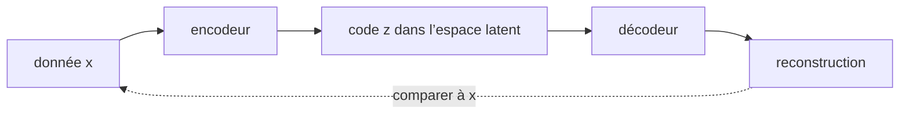

# Chapitre 10 — Autoencodeurs et VAE

:::tip[En bref (TL;DR)]
**En bref.** Un VAE génère des données en les encodant dans un court code aléatoire qui suit une loi connue. Nous prouvons l’astuce de reparamétrisation et les propriétés de la pénalité KL.

**Mots nouveaux, en termes simples:**

- **Modèle génératif** : Un modèle capable de produire de nouvelles données qui ressemblent à ses données d’entraînement.
- **Variable latente** : Un court code caché qui résume une donnée.
- **Espace latent** : L’espace de tous les codes possibles. Si un code a 2 nombres, l’espace latent est un plan, et chacun de ses points se décode en une donnée possible. Des points proches devraient donner des données semblables. (Le chapitre 15 appelle la même idée un espace de représentations ou de plongements.)
- **Autoencodeur** : Un encodeur comprime les données en un code, et un décodeur reconstruit les données à partir du code.
- **VAE** : Un autoencodeur dont les codes sont poussés à suivre une loi connue, pour qu’on puisse tirer de nouveaux codes et les décoder.
- **A priori** : La loi que l’on veut voir suivre par les codes, ici une courbe en cloche standard.
- **Divergence KL** : Un nombre qui mesure à quel point une loi diffère d’une autre. Il vaut zéro quand elles sont égales.
- **Astuce de reparamétrisation** : Tirer d’abord le bruit aléatoire, puis calculer l’échantillon avec des maths ordinaires, pour que les gradients puissent passer.
:::


Jusqu'ici, nos réseaux *reconnaissaient* des choses. Un **modèle génératif** apprend à *produire* de nouvelles données ressemblant aux données d'entraînement. Ce chapitre commence par l'idée la plus simple, l'autoencodeur, puis corrige sa principale faiblesse avec l'autoencodeur variationnel (VAE).


<Figure src="arch_ae.svg"
caption="Autoencodeur : compresser en z, reconstruire x̂"
 />
:::info[Prérequis]
L'ELBO est une inégalité entre espérances et divergences KL : **lire le [Chapitre 16](ch16-tools) d'abord** — Espérance, Entropie/entropie croisée/KL, et l'inégalité de Gibbs. La frontière `LawfulLog` (le logarithme est une opération abstraite à lois nommées) y est déclarée.
:::

## L'autoencodeur

Un **autoencodeur** est formé de deux réseaux. L'**encodeur** comprime une donnée $x$ en un court code $z$ (la variable *latente*) ; le **décodeur** reconstruit $x$ à partir de $z$. On l'entraîne à minimiser l'erreur de reconstruction $\|x - \mathrm{dec}(\mathrm{enc}(x))\|^2$. L'espace dans lequel vivent les codes s'appelle l'**espace latent** (*latent* signifie caché : on ne l'observe jamais, c'est le réseau qui l'invente). Avec un code de deux nombres, c'est un plan, et chaque point de ce plan se décode en une donnée possible.



*Un autoencodeur : comprimer les données en un code, puis les reconstruire. Le signal d’entraînement est l’erreur de reconstruction.*


Pour *générer*, on tirerait un code $z$ au hasard et on lancerait le décodeur. Le problème : rien n'oblige les codes des données d'entraînement à occuper une région dans laquelle nous savons tirer. Des codes aléatoires peuvent tomber là où le décodeur n'a jamais été entraîné.

## L'autoencodeur variationnel

<Figure src="arch_vae.svg"
caption="VAE : échantillonner la loi à posteriori via z = μ + σ·ε, astuce de reparamétrisation"
 />

Le VAE (Kingma et Welling, 2013) rend les codes échantillonnables par construction :

1. L'encodeur ne produit pas un code mais une **distribution** : une moyenne $\mu$ et un log-variance $\ell=\log\sigma^2$.
2. Un code est **tiré** : $z = \mu + \sigma\,\varepsilon$ avec $\varepsilon\sim\mathcal N(0,1)$.
3. La perte ajoute une pénalité qui tire chaque postérieure $\mathcal N(\mu,\sigma^2)$ vers l'**a priori** $\mathcal N(0,1)$ :

$$ \mathcal L \;=\; \underbrace{\mathbb E\,\|x-\hat x\|^2}_{\text{reconstruction}} \;+\; \beta\;\underbrace{\tfrac12\bigl(\mu^2+e^{\ell}-1-\ell\bigr)}_{\mathrm{KL}\bigl(\mathcal N(\mu,e^\ell)\,\|\,\mathcal N(0,1)\bigr)} . $$

Après l'entraînement, générer est simple : tirer $z\sim\mathcal N(0,1)$ et décoder.

(La forme close du terme KL est une intégrale gaussienne classique ; nous la prenons comme définition et démontrons ses propriétés. La *structure* de la perte — une borne inférieure de la log-vraisemblance des données — ne demande pas d'intégrales : c'est une identité en sommes finies, prouvée exactement sur `Rat` dans `Ch10/Elbo.lean`, ci-dessous.)

<Figure src="elbo_parts.svg" alt="Deux courbes en fonction de x : la reconstruction -log p(x) plonge dans les deux modes des données, le terme KL monte quadratiquement loin de la moyenne de q" caption="Les deux moitiés que le théorème de l'ELBO recoud : -log p(x) veut le code près d'un mode des données (les deux plongeons), KL(q||p) le veut près de la moyenne du prior (la coupe montante). L'identité exacte prouvée en Lean (evidence_bound) dit que la perte est leur somme - toute courbe d'entraînement d'un VAE est ces deux termes qui négocient, mini-batch après mini-batch." />

## L'ELBO, prouvé

L'objectif du VAE n'est pas une heuristique : c'est une **borne inférieure de la log-vraisemblance**, et le terme KL est le prix de l'approximation de l'encodeur. Pour un espace latent *fini*, avec une loi jointe $P$ (poids $p(z_i,x)>0$, non normalisée), un facteur de vraisemblance $e_i$, l'évidence $m=\sum_i p(z_i,x)\,e_i = p(x)$, et tout encodeur $q$ :

$$\mathbb{E}_q[\log e] \;-\; \mathrm{KL}(q \,\|\, P) \;\le\; \log m .$$

```lean file=Ch10/Elbo.lean#elbo
```

*Preuve, en mots.* On applique l'inégalité tangente $\log t \le t-1$ aux poids d'importance $t_i = p(z_i,x)e_i/(q_i m) > 0$ ; on développe le log ; on prend l'espérance sous $q$ ; on utilise l'annulation exacte $\sum_i q_i\cdot p(z_i,x)e_i/(q_i m) = 1$ (sur `Rat`, $q_i\cdot q_i^{-1}=1$, sans arrondi). L'espérance du membre de gauche est $\le 1-1=0$. La seule entrée analytique est l'inégalité tangente, portée par la classe `LawfulLog` — le logarithme réel y obéit, `Float` seulement en approximation.

L'écart est exactement le KL de $q$ vers la postérieure vraie $p(z\mid x) = P_i e_i / m$ ; il est donc $\ge 0$ et s'annule précisément quand l'encodeur est exact :

```lean file=Ch10/Elbo.lean#elbo_gap
```

La version gaussienne de ce chapitre est l'analogue continu de la même identité ; le théorème fini ci-dessus est ce que la perte *signifie*.

## L'astuce de reparamétrisation

Le tirage semble poser problème à la rétropropagation : comment dériver à travers un tirage aléatoire ? L'astuce consiste à **sortir l'aléa**. On écrit $z=\mu+\sigma\varepsilon$ où $\varepsilon$ est tiré d'abord, indépendamment des paramètres. Alors $z$ est une fonction ordinaire, dérivable, de $(\mu,\sigma)$ :

```lean file=Ch10/Vae.lean#reparam
```

Le théorème dit que $\partial z/\partial\mu = 1$ et $\partial z/\partial\sigma = \varepsilon$, calculés par *la rétropropagation vérifiée du chapitre 4*. C'est toute l'astuce, et la raison pour laquelle un VAE peut être entraîné par descente de gradient.

## La pénalité KL, démontrée

```lean file=Ch10/Vae.lean#kl
```

- `kl_grad` : $\partial/\partial\mu = \tfrac12(\mu+\mu)$, c'est-à-dire $\mu$, et $\partial/\partial\ell = \tfrac12(e^\ell-1)$.
- `kl_at_prior` : en $\mu=0$, $\ell=0$ (l'a priori lui-même) la pénalité vaut $0$ et son gradient aussi. C'est exactement l'attraction vers l'a priori.

La pénalité n'est jamais négative. La preuve demande un fait sur l'exponentielle, la borne de la tangente $1+\ell\le e^\ell$, que nous supposons en hypothèse car notre `exp` est abstrait (elle vaut pour l'exponentielle réelle) :

```lean file=Ch10/Vae.lean#kl_nonneg
```

## Un VAE en Lean

Nos données sont un **demi-cercle** bruité dans le plan. L'espace latent a une seule dimension. L'encodeur est un réseau 2-8-2, le décodeur un réseau 1-8-2, soit 76 paramètres au total. La perte *entière* est une `Expr` : son gradient vient donc de la `backprop` vérifiée.

```lean file=Ch10/Model.lean#model
```

:::tip[Coin Lean : une preuve, plusieurs modèles]
Nous n'avons jamais écrit de gradient pour ce modèle. `backprop_correct` (chapitre 4) est un théorème sur *toute* expression : le gradient de cette perte particulière, y compris l'étape de tirage et le terme KL, est donc correct par ce seul théorème. Les seules parties non démontrées sont les arrondis Float et le générateur de nombres aléatoires.
:::

<Figure src="beta_vae.svg" alt="Deux courbes selon beta : la distorsion 1/(1+beta) tombe, le taux beta/(1+beta) monte, croisement à beta = 1" caption="L'objectif du VAE est un cadran, rendu visible dans le jouet exécuté au chapitre : monter beta achète du taux (information serrée dans z, le terme KL) paye en distorsion (la reconstruction floue) - la paire de courbes que le beta-VAE mesure. L'autoencodeur (beta = 0) est en distorsion pure sans code du tout, exactement pourquoi son espace latent est structurellement désordonné." />

## Autoencodeur contre VAE

`lake exe vae` entraîne les deux modèles (l'autoencodeur est le même code avec $\beta=0$) pendant 3000 pas d'Adam sur de nouveaux lots de 16 points, puis évalue sur 200 points de test et sur 400 décodages d'échantillons de l'a priori $z\sim\mathcal N(0,1)$.

| | autoencodeur ($\beta=0$) | VAE ($\beta=1$) |
|---|---|---|
| erreur de reconstruction (test) | **0,0032** | 0,0223 |
| KL moyenne vers l'a priori | 5,72 | **1,25** |
| distribution des angles des échantillons de l'a priori : distance à l'uniforme | 0,213 | **0,102** |

La dernière ligne mesure l'uniformité avec laquelle les échantillons décodés de l'a priori couvrent le demi-cercle (les données le couvrent uniformément ; le bruit d'échantillonnage des données donne 0,052). Les chiffres racontent toute l'histoire :

- L'**autoencodeur reconstruit mieux**, mais ses codes sont loin de l'a priori (grande KL) : décoder des échantillons de l'a priori couvre l'arc de façon inégale.
- Le **VAE** paie en qualité de reconstruction et obtient des codes qui suivent $\mathcal N(0,1)$ : ses échantillons de l'a priori couvrent l'arc environ deux fois plus uniformément.

<Figure src="vae.svg" alt="Données sur un demi-cercle et échantillons générés par le VAE" caption="Gris : données de test. Bleu : le décodeur appliqué à des échantillons z ~ N(0,1), générés par le VAE." />

:::info Un détour topologique
Nous avons d'abord essayé un **cercle complet**. Cela ne marche pas avec un espace latent de dimension un : un cercle ne peut pas être envoyé continûment et bijectivement sur une droite, il y a donc toujours une couture. Les deux modèles ont échoué (erreur de reconstruction 0,16 pour l'autoencodeur, 0,25 pour le VAE, et seulement 69 % des échantillons du VAE près du cercle). Choisir une dimension latente adaptée à la *forme* des données est important. Une exécution, une graine.
:::

## Références

- D. P. Kingma et M. Welling, *Auto-Encoding Variational Bayes*, ICLR 2014, arXiv:1312.6114 — l'ELBO, le trick de reparamétrisation et l'encodeur gaussien que `evidence_bound` de ce chapitre formalise sur supports finis.
- R. Jaeger, *Entropy, Duality and Convex Programming*, Bulletin AMS 69 (1963) (avec le principe variationnel de Gibbs de Powell, 1964) — le principe variationnel de Gibbs derrière la structure de `evidence_bound`.

## Exercices

1. Montrez que `klE` est strictement convexe en $\mu$, et trouvez son minimum en $\ell$ à $\mu$ fixé.
2. Faites varier le poids $\beta$ de la KL ($0$, $0{,}1$, $1$, $10$). Comment les trois nombres du tableau évoluent-ils ?
3. Utilisez un espace latent de dimension deux sur le **cercle complet** et vérifiez que la couture disparaît.
4. Démontrez que l'échantillon reparamétré a pour moyenne $\mu$ lorsque $\mathbb E[\varepsilon]=0$ (énoncez-le pour une liste finie de valeurs de bruit équipondérées).

**Exercices en Lean.** Le fichier `lean/LeanDL/Ch10/Exercises.lean` contient les énoncés ci-dessous, avec des `sorry` à remplacer. Les solutions démontrées sont dans `Solutions.lean`, à côté : essayez d’abord.

```lean file=Ch10/Exercises.lean#ex1
```

```lean file=Ch10/Exercises.lean#ex2
```

<details>
<summary>Indice 1</summary>

Dépliez `reparamE` et `Expr.eval`. Avec un bruit `0`, le second terme disparaît.

</details>

<details>
<summary>Corrigé 1</summary>

```lean file=Ch10/Solutions.lean#sol1
```

</details>

<details>
<summary>Indice 2</summary>

Dépliez `klE` et `Expr.eval`, substituez `x 0 = 0`, et fermez avec `grind`.

</details>

<details>
<summary>Corrigé 2</summary>

```lean file=Ch10/Solutions.lean#sol2
```

</details>
