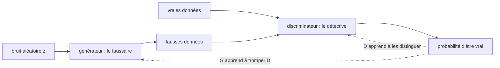

# Chapitre 11 — Réseaux antagonistes génératifs

:::tip[En bref (TL;DR)]
**En bref.** Deux réseaux s’affrontent : un générateur fabrique des données et un discriminateur détecte les faux. Nous prouvons ce que dit le meilleur discriminateur, et nous voyons que l’entraînement est instable.

**Mots nouveaux, en termes simples:**

- **GAN**: Deux réseaux jouent un jeu : un faussaire fabrique des faux, un détective distingue le faux du vrai, et les deux s’améliorent.
- **Générateur et discriminateur**: Le générateur est le faussaire (bruit en entrée, fausse donnée en sortie). Le discriminateur est le détective (donnée en entrée, probabilité d’être vraie en sortie).
- **Jeu minimax**: Un joueur essaie de minimiser ce que l’autre essaie de maximiser.
- **Discriminateur optimal**: La meilleure réponse possible du détective en un point : la part de données réelles parmi toutes les données de ce point.
- **Effondrement de modes**: Le générateur ne couvre que quelques-unes des sortes de données qui existent.
- **Distance en variation totale (TV)**: Un nombre de 0 à 1 qui dit à quel point deux histogrammes diffèrent.
:::


Le VAE du chapitre 10 génère en décodant des codes aléatoires. Un **réseau antagoniste génératif** (GAN, Goodfellow et al., 2014) emprunte une autre voie : un jeu entre deux réseaux.

- Le **générateur** $G$ transforme un bruit $z\sim\mathcal N(0,1)$ en une fausse donnée $G(z)$.
- Le **discriminateur** $D$ regarde un point $x$ et renvoie $D(x)\in(0,1)$, sa croyance que $x$ est réel.

On entraîne $D$ à distinguer le vrai du faux ; on entraîne $G$ à tromper $D$. L'objectif d'origine est

$$ \min_G\max_D\;\; \mathbb E_{x\sim p_{\text{data}}}[\log D(x)] \;+\; \mathbb E_{z}[\log(1-D(G(z)))]. $$




*Le jeu des GAN : les deux réseaux s’améliorent en s’affrontant.*

## Que dit le meilleur discriminateur ?

Fixons un point $x$. Soit $a=p_{\text{data}}(x)$ la densité des données réelles en ce point et $b=p_G(x)$ celle des données générées. Le gain du discriminateur en $x$ est $a\log d + b\log(1-d)$ avec $d=D(x)$. Annuler la dérivée, $\frac ad-\frac b{1-d}=0$, donne

<Figure src="optimal_discriminator.svg" alt="Densité réelle, densité générée et discriminateur optimal" caption="Le discriminateur optimal D* = a / (a + b). Là où les données réelles sont denses il est proche de 1, là où seul le générateur met de la masse il est proche de 0, et là où elles coïncident il vaut exactement 1/2." />


$$ d^\star = \frac{a}{a+b}. $$

Nous prouvons que c'est un point critique, en utilisant la *rétropropagation vérifiée* du chapitre 4 pour calculer la dérivée :

```lean file=Ch11/Gan.lean#log_gan
```

Remarquez ce que le théorème **ne dit pas** : il ne dit pas que $d^\star$ est un maximum. Pour cela, nous utilisons le GAN aux moindres carrés (Mao et al., 2017), dont le gain est un polynôme : la preuve n'a pas besoin d'analyse. Compléter le carré montre que la perte vaut son minimum plus un terme positif :

```lean file=Ch11/Gan.lean#lsgan
```

- `lsLoss_sq` est l'identité $\mathrm{perte}(d)=\mathrm{perte}(d^\star)+(a+b)(d-d^\star)^2$.
- `lsLoss_value` calcule le minimum : $ab/(a+b)$.
- `dStar_equal` : quand le générateur est parfait ($a=b$), le mieux que puisse faire le discriminateur est de répondre $\tfrac12$ partout, c'est-à-dire qu'il ne distingue pas le vrai du faux.
- `lsLoss_min` est le théorème d'optimalité. Il est énoncé sur `Rat`, car l'ordre d'un corps abstrait demanderait plus d'axiomes que nous ne voulons en introduire.

:::tip[Coin Lean : compléter le carré est une stratégie de preuve]
Les preuves d'optimalité deviennent souvent faciles quand on *devine le minimiseur* et qu'on prouve une identité de la forme « perte = minimum + un carré ». L'identité est un calcul d'anneau que `grind` termine ; la positivité du carré fait le reste.
:::

## L’effondrement de modes, prouvé

Les données vivent sur deux modes égaux, de masse $a$ chacun ; le générateur répartit sa masse $b$ dessus. L’analyse des moindres carrés ci-dessus (`lsLoss_value`) dit que le discriminateur optimal paie le générateur $a\,m\,(a+m)^{-1}$ sur un mode portant la masse générée $m$. Deux options :

- **Effondrement** : tout $b$ sur un seul mode — récompense $\dfrac{a\,b}{a+b}$.
- **Couverture** : $b/2$ sur chacun — récompense $\dfrac{a\,b}{a+b/2}$ (les deux appariements partiels se fusionnent en un seul produit, `cover_simplify`).

Même numérateur, et $a + b/2 < a + b$, donc le dénominateur le plus petit gagne :

```lean file=Ch11/Gan.lean#collapse
```

`mode_collapse_reward` est le mode de défaillance classique avec sa preuve attachée : dans ce jeu, couvrir bat strictement s’effondrer, pour tous $a, b > 0$ — l’antitonicité stricte de l’inverse (`Ch18.inv_antitone`) fait le travail. L’énoncé général (multi-modes, densités continues) demande l’appareil variationnel complet des GAN ; ce qui est prouvé ici est le squelette algébrique sur lequel repose tout argument d’effondrement.

## Deux réseaux, une seule différentiation automatique

Les deux réseaux ont une couche cachée de 8 unités tanh : 50 paramètres au total (les 25 premiers pour $G$, les 25 derniers pour $D$). Les deux pertes sont des `Expr` : les deux gradients viennent de `backprop`.

```lean file=Ch11/Model.lean#gan_model
```

L'entraînement alterne : un pas d'Adam sur $D$ (gradient du générateur mis à zéro), puis un sur $G$ avec la perte « non saturante » $-\log D(G(z))$, qui donne de plus forts gradients au début que $\log(1-D(G(z)))$. Les lots font 32 échantillons frais.

## Expériences

`lake exe gan` entraîne deux GAN pendant 6000 pas (une graine chacun) et compare 2000 échantillons générés à 2000 échantillons réels. « TV » est la distance en variation totale entre histogrammes à 16 classes ; deux moitiés indépendantes des données *réelles* diffèrent d'environ 0,03 à 0,05, c'est le plancher de bruit.

| données réelles | | moyenne | écart-type | TV |
|---|---|---|---|---|
| gaussienne unique $\mathcal N(2,0.5^2)$ | données / GAN | 2,01 / 1,87 | 0,51 / 0,43 | **0,09** |
| deux gaussiennes en $\pm2$ | données / GAN | −0,03 / 0,19 | 2,04 / 1,97 | 0,42 |

<Figure src="gan.svg" alt="Histogramme des données réelles à deux modes et des échantillons du GAN" caption="Gris : données réelles (deux gaussiennes en ±2). Bleu : échantillons du GAN entraîné." />

Lecture honnête :

- Sur une **gaussienne unique**, le GAN apprend la bonne position et à peu près la bonne largeur.
- Sur **deux modes**, il met presque aucune masse entre eux (1,7 % contre 0,7 % dans les données) : il a trouvé les deux modes, mais **les poids et les largeurs des modes sont faux** (TV 0,42, très au-dessus du plancher de bruit). C'est la faiblesse typique des GAN : sans vraisemblance, rien n'indique que les proportions du mélange sont fausses.
- **L'entraînement est instable.** Avec 4000 pas, le GAN à gaussienne unique avait une moyenne de 2,23 ; avec 15000 pas, sa largeur est tombée à 0,29 (un effondrement de modes partiel). Entraîner plus n'a pas aidé : les deux réseaux se poursuivent. Ce sont des observations à une graine, pas un benchmark.

:::warning Ce qui est prouvé ici, et ce qui ne l'est pas
Prouvé : les formules du discriminateur optimal ci-dessus et (par le chapitre 4) les gradients des deux pertes. Non prouvé : que le jeu converge. En général il ne converge pas, et les chiffres ci-dessus le montrent.
:::

## Exercices

1. Montrez que, pour l'objectif logarithmique, la valeur en $d^\star$ est $a\log\frac{a}{a+b}+b\log\frac b{a+b}$. Pour $a=b$, elle vaut $-\log 4$ (indice : `dStar_equal`).
2. Prouvez `lsLoss_min` pour un corps ordonné général avec des hypothèses de type `Std.IsLinearOrder`.
3. Remplacez la perte du générateur par $\log(1-D(G(z)))$ (saturante) et comparez les 500 premiers pas.
4. Entraînez avec 5 mises à jour de $D$ pour une de $G$. La TV du mélange s'améliore-t-elle ?

**Exercices en Lean.** Le fichier `lean/LeanDL/Ch11/Exercises.lean` contient les énoncés ci-dessous, avec des `sorry` à remplacer. Les solutions démontrées sont dans `Solutions.lean`, à côté : essayez d’abord.

```lean file=Ch11/Exercises.lean#ex1
```

```lean file=Ch11/Exercises.lean#ex2
```

<details>
<summary>Indice 1</summary>

`a + 0 = a`, donc `dStar a 0 = a / a`, qui vaut `1` car `a ≠ 0`.

</details>

<details>
<summary>Corrigé 1</summary>

```lean file=Ch11/Solutions.lean#sol1
```

</details>

<details>
<summary>Indice 2</summary>

Dépliez `lsLoss` : `a * ((1 - 1) * (1 - 1)) + b * (1 * 1)`.

</details>

<details>
<summary>Corrigé 2</summary>

```lean file=Ch11/Solutions.lean#sol2
```

</details>
