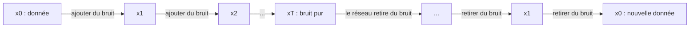

# Chapitre 12 — Modèles de diffusion

:::tip[En bref (TL;DR)]
**En bref.** Un modèle de diffusion apprend à défaire le bruit pas à pas. Nous prouvons comment le bruit s’accumule en forme close et que le pas de débruitage est exact pour un réseau parfait, puis nous comparons avec le GAN.

**Mots nouveaux, en termes simples:**

- **Modèle de diffusion**: Apprendre à retirer le bruit pas à pas ; générer en partant de bruit pur et en le nettoyant.
- **Processus direct**: Ajouter progressivement du bruit aux données jusqu’à ce qu’il ne reste que du bruit.
- **Calendrier de bruit**: La quantité de bruit ajoutée à chaque pas.
- **Préservation de la variance**: Les pas de bruitage sont dosés pour que la dispersion globale des données reste la même.
- **Réseau de débruitage**: Un réseau qui regarde une entrée bruitée et prédit le bruit qui a été ajouté.
- **DDPM et DDIM**: Deux façons de lancer les étapes de nettoyage : avec du bruit aléatoire frais à chaque pas (DDPM) ou entièrement déterministe (DDIM).
:::


Les modèles de diffusion animent la plupart des générateurs d'images modernes. L'idée est presque embarrassante de simplicité :

1. **Processus direct** : détruire les données en ajoutant un peu de bruit gaussien, de nombreuses fois, jusqu'à ne plus avoir que du bruit.
2. **Processus inverse** : entraîner un réseau à défaire un pas de bruitage, puis partir de bruit pur et l'appliquer répétitivement.

Contrairement à un GAN il n'y a pas de jeu, et contrairement à un VAE pas de goulot d'étranglement : l'entraînement est une simple régression.




*Ligne du haut : le processus direct détruit les données. Ligne du bas : le réseau entraîné le défait pas à pas pour générer de nouvelles données.*

## Le processus direct et sa forme fermée

Un pas de bruitage est

<Figure src="noise_schedule.svg" alt="Facteur de signal et niveau de bruit selon les pas de bruitage" caption="Le calendrier de ce chapitre : le facteur de signal passe de 1 à 0,12 tandis que le niveau de bruit monte à 0,99. Leurs carrés totalisent toujours 1 (préservation de la variance)." />

<Figure src="forward_diffusion.svg" alt="Histogrammes des données à deux bosses aux pas de bruitage 0, 4, 10 et 20" caption="Des données à deux bosses en train d’être détruites : au pas 20 l’histogramme est presque une seule cloche, ce qui permet de commencer l’échantillonnage à partir de bruit pur." />


$$ x_{k} = a_k\,x_{k-1} + s_k\,\varepsilon_k,\qquad \varepsilon_k\sim\mathcal N(0,1),\qquad a_k^2+s_k^2=1 \quad(a_k=\sqrt{1-\beta_k}). $$

La contrainte $a^2+s^2=1$ empêche la variance des données de croître (« préservation de la variance »). Le fait clé pour l'entraînement est qu'**après $t$ pas on peut sauter directement à $x_t$** :

$$ x_t = \bar a_t\,x_0 + \sqrt{1-\bar a_t^{\,2}}\;\varepsilon,\qquad \bar a_t=\prod_{k\le t}a_k. $$

Pour entraîner à un instant aléatoire $t$, on ne simule donc pas $t$ pas. Nous prouvons la comptabilité des coefficients qui sous-tend cela : la variance après un nombre quelconque de pas ne dépend que du produit $\bar a$.

```lean file=Ch12/Diffusion.lean#schedule
```

- `noiseVar_closed` : la variance après tout le calendrier vaut $\bar a^2 v+(1-\bar a^2)$. La preuve est une récurrence sur la liste des pas ; chaque pas est un appel à `grind`, utilisant $a^2+s^2=1$.
- `noiseVar_preserved` : variance unité en entrée, variance unité en sortie.
- `noiseVar_from_clean` : des données propres ($v=0$) finissent avec une variance de bruit $1-\bar a^2$, qui tend vers $1$ quand $\bar a\to0$ : les données sont détruites.

(Nous prouvons l'*algèbre des coefficients*. Le fait qu'une somme de gaussiennes indépendantes soit une gaussienne, qui transforme ces coefficients en énoncé sur des lois, n'est pas formalisé.)

## Le processus direct est monotone, prouvé

Un planning de diffusion est *conçu* pour que le bruit s’accumule : $lpha_t$ décroît avec $t$, donc $arlpha_t$ décroît, donc la variance de bruit $1-arlpha_t^2$ croît. Ce choix de conception est d’habitude un axiome du planning. C’est en fait un théorème de l’algèbre des pas : ajouter un pas de préservation de variance $(a,s)$ avec $0\le a\le 1$ à n’importe quelle chaîne de pas ne peut jamais diminuer la variance de bruit des données propres.

```lean file=Ch12/Diffusion.lean#monotone
```

`noise_monotone` se lit ainsi : le coefficient de signal de tout le processus est `cumA l` ; le nouveau pas le multiplie par $a\in[0,1]$, donc le signal au carré diminue ($a^2\le 1$ sur le facteur positif `cumA l * cumA l`, via `cumA_nonneg`), et $1-arlpha^2$ croît. Aucune théorie de la mesure gaussienne n’est nécessaire — la comptabilité de `noiseVar_closed` plus l’arithmétique monotone sur `Rat` suffisent. Ce qui n’est *pas* prouvé : que la composition de gaussiennes indépendantes soit gaussienne (cela vit dans la théorie de la mesure, hors du périmètre algébrique du cours — même frontière d’honnêteté qu’au chapitre 16 pour son modèle fini).

## Apprendre à débruiter

Le réseau $\varepsilon_\theta(x_t,t)$ regarde un point bruité et l'instant, et prédit **le bruit** $\varepsilon$ qui a été mélangé. La perte est l'erreur quadratique, moyennée sur des points de données, des instants et des bruits aléatoires :

$$ \mathcal L(\theta)=\mathbb E_{x_0,t,\varepsilon}\;\|\varepsilon-\varepsilon_\theta(\bar a_t x_0+\sigma_t\varepsilon,\;t)\|^2 .$$

```lean file=Ch12/Model.lean#diff_model
```

:::tip[Coin Lean : réutiliser les constructeurs génériques]
`mlpE` est le constructeur de réseaux du chapitre 4. Un réseau `2 → 16 → 1` de 65 paramètres tient en une ligne ; le gradient de la perte d'un lot de 32 échantillons vient de `backprop`, correct par `backprop_correct`.
:::

## L'échantillonnage, et pourquoi il est exact

Étant donnés $x_t$ et une estimation $\hat\varepsilon$ du bruit, on peut estimer le point propre et reconstruire le point à un niveau *moins bruité* $s<t$. C'est le pas déterministe DDIM :

```lean file=Ch12/Diffusion.lean#denoise
```

`ddim_exact` est le théorème de correction de l'échantillonneur : **si le réseau était parfait, un pas atterrirait exactement sur le point que le processus direct aurait produit au niveau de bruit inférieur.** `ddim_compose` dit qu'enchaîner des pas ne perd rien : on est libre de choisir le nombre de pas. En pratique le réseau n'est pas parfait, et l'erreur de l'échantillonneur est celle du réseau, d'où l'importance de la qualité de l'entraînement.

L'échantillonneur stochastique (DDPM) ajoute du bruit frais à chaque pas. Les deux sont implémentés dans `Demos/Diffusion.lean`.

## Expérience

Les données sont le même mélange de deux gaussiennes qu'au chapitre 11 (modes en $\pm2$). Nous utilisons $T=20$ pas avec $\beta$ de 0,02 à 0,35 (le facteur de signal final est donc $\bar a_T=0{,}12$), 5000 pas d'Adam, une graine. `lake exe diffusion` affiche :

| | moyenne | écart-type | masse dans $\lvert x\rvert<1$ | TV aux données |
|---|---|---|---|---|
| données | −0,05 | 2,05 | 0,006 | (plancher 0,045) |
| DDPM | 0,20 | 2,00 | 0,039 | **0,086** |
| DDIM | 0,15 | 2,03 | 0,025 | **0,096** |

<Figure src="diffusion.svg" alt="Histogramme des données et des échantillons du modèle de diffusion" caption="Gris : données réelles (deux gaussiennes en ±2). Bleu : échantillons DDPM. Orange : échantillons DDIM." />

Sur les mêmes données, le GAN du chapitre 11 atteignait une TV de 0,42 ; le modèle de diffusion atteint environ 0,09, soit 2 fois le plancher de bruit. Les poids des modes sont proches et un peu de masse déborde dans l'intervalle entre les modes. Deux réserves : une graine, un problème-jouet unidimensionnel, et la courbe de perte est bruitée (0,17 à l'étape 2000, 0,39 à l'étape 4000 ; chaque valeur est un seul lot). Les générateurs d'images utilisent des modèles plus grands et bien plus de pas.

:::warning Ce qui est prouvé ici
Prouvé : l'algèbre des coefficients du processus direct et l'exactitude du pas de débruitage pour un prédicteur parfait, et (chapitre 4) les gradients de la perte. Non prouvé : que le réseau entraîné soit proche d'un réseau parfait, ou tout énoncé sur des lois de probabilité.
:::

## Exercices

1. Montrez `noiseVar_closed` pour un calendrier *constant* $(a,s)$ répété $n$ fois : $\bar a=a^n$.
2. Prouvez que les cibles « prédire ε » et « prédire $x_0$ » se déterminent l'une l'autre : étant donné $x_t=\bar a x_0+\sigma\varepsilon$, exprimez $\varepsilon$ en fonction de $x_0$ et $x_t$.
3. Lancez `lake exe diffusion` avec 20000 pas. La TV se rapproche-t-elle du plancher de bruit ?
4. Remplacez le calendrier par un calendrier en cosinus et comparez les résultats DDIM avec $T=5$ pas.

**Exercices en Lean.** Le fichier `lean/LeanDL/Ch12/Exercises.lean` contient les énoncés ci-dessous, avec des `sorry` à remplacer. Les solutions démontrées sont dans `Solutions.lean`, à côté : essayez d’abord.

```lean file=Ch12/Exercises.lean#ex1
```

```lean file=Ch12/Exercises.lean#ex2
```

<details>
<summary>Indice 1</summary>

Dépliez `noiseVar` une fois : le résultat est `a * a * 0 + s * s`.

</details>

<details>
<summary>Corrigé 1</summary>

```lean file=Ch12/Solutions.lean#sol1
```

</details>

<details>
<summary>Indice 2</summary>

Dépliez `cumA` deux fois : `a1 * (a2 * 1)`.

</details>

<details>
<summary>Corrigé 2</summary>

```lean file=Ch12/Solutions.lean#sol2
```

</details>
