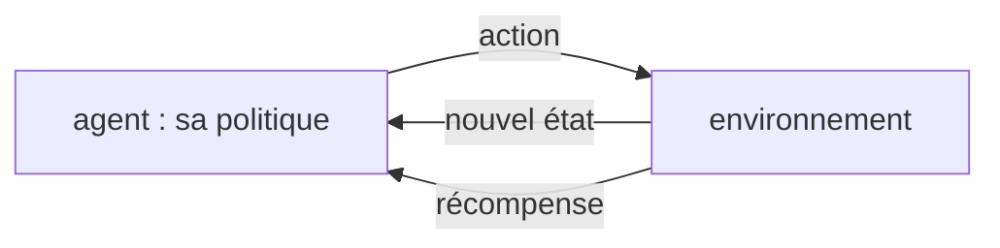

# Chapitre 13 — Apprentissage par renforcement

:::tip[En bref (TL;DR)]
**En bref.** Un agent apprend à partir de récompenses, pas d’exemples. Nous prouvons que les mises à jour de Bellman et TD réduisent l’erreur géométriquement, nous prouvons le gradient REINFORCE pour un bandit, puis nous lançons Q-learning et gradient de politique.

**Mots nouveaux, en termes simples:**

- **Apprentissage par renforcement**: Apprendre par essais et erreurs à partir de récompenses.
- **Agent, environnement, récompense**: L’agent agit, l’environnement réagit, et la récompense est le score qu’il reçoit en retour.
- **Politique**: La règle de l’agent pour choisir une action dans chaque situation.
- **Retour et actualisation**: Le retour est la somme des récompenses futures ; l’actualisation fait compter moins les récompenses lointaines.
- **Valeur Q**: À quel point il est bon de prendre une action dans un état, en comptant toutes les récompenses qui suivent.
- **Équation de Bellman**: La valeur d’une action est la récompense immédiate plus la valeur actualisée du meilleur pas suivant.
- **Mise à jour TD**: Mise à jour par différence temporelle : déplacer l’estimation actuelle d’une fraction du chemin vers une meilleure cible.
- **Q-learning**: Apprendre les valeurs Q avec des mises à jour TD, en agissant un peu au hasard pour explorer.
- **Gradient de politique (REINFORCE)**: Augmenter la probabilité des actions proportionnellement à la récompense qui les a suivies.
- **Ligne de base**: Un nombre retranché des récompenses pour réduire le bruit sans changer la direction moyenne d’apprentissage.
:::


En apprentissage supervisé, quelqu'un donne la bonne réponse au réseau. En **apprentissage par renforcement** (RL), un **agent** agit dans un **environnement** et ne reçoit qu'une **récompense**, souvent longtemps après l'action qui la méritait. L'agent doit apprendre une **politique** $\pi(a\mid s)$ qui maximise le retour actualisé

$$ G_t=r_{t+1}+\gamma\,r_{t+2}+\gamma^2 r_{t+3}+\cdots,\qquad 0\le\gamma<1. $$

Nous étudions deux familles sur une minuscule tâche, un **couloir** : états $0\dots5$, départ en $1$, actions *gauche/droite*. Atteindre l'état $5$ donne $+1$, atteindre $0$ donne $-1$ ; les deux terminent l'épisode. Un marcheur aléatoire atteint le but avec probabilité $1/5$ (ruine du joueur). La meilleure politique va toujours à droite et demande 4 pas.




*La boucle de l’apprentissage par renforcement : l’agent agit, l’environnement répond par un nouvel état et une récompense.*

## Par les valeurs : Q-learning

La **valeur d'action** $Q(s,a)$ est le retour espéré après avoir pris $a$ en $s$ puis agi au mieux. Elle satisfait l'**équation de Bellman** $Q(s,a)=r+\gamma\max_{a'}Q(s',a')$. Le Q-learning en fait une mise à jour vers une **cible** $r+\gamma\max_{a'}Q(s',a')$.

<Figure src="value_iteration.svg" alt="Erreur restante de l’itération de valeur pour trois facteurs d’actualisation" caption="L’erreur restante après k balayages vaut gamma^k fois l’erreur initiale (le théorème valueIter_error). Une actualisation proche de 1 donne une convergence lente." />


Deux faits exacts, prouvés pour tout anneau commutatif :

```lean file=Ch13/Rl.lean#value
```

- `valueIter_error` : appliquer répétitivement la mise à jour de Bellman $v\leftarrow r+\gamma v$ réduit l'erreur d'exactement $\gamma$ à chaque balayage ; après $k$ balayages elle vaut $\gamma^k$ fois l'erreur initiale. C'est le cœur de la convergence de l'itération de valeur (ici le cas d'un seul état ; le théorème général dit que l'opérateur de Bellman est une $\gamma$-contraction).
- `bellman_fixed` : le point fixe est $r/(1-\gamma)$.
- `tdUpdate_error` : une mise à jour $Q\leftarrow Q+\eta(\text{cible}-Q)$ multiplie la distance à la cible par $1-\eta$. Pour $0<\eta\le1$, elle se rapproche de la cible sans la dépasser.

Composée $k$ fois contre une cible fixe, la mise à jour TD multiplie l’erreur par $(1-\eta)^k$ — exactement :

```lean file=Ch13/Rl.lean#td_iter
```

`tdIter_error` est la composition de `tdUpdate_error` par récurrence : pour $0\le\eta\le 1$, l’estimation converge **géométriquement** vers la cible. C’est l’arithmétique exacte de la boucle interne du Q-learning. (Le théorème complet de convergence stochastique — cibles mouvantes, exploration, pas de Robbins–Monro — demande un modèle de bruit et vit hors du périmètre algébrique du cours.)

## Par la politique : REINFORCE

Au lieu des valeurs, on peut améliorer directement la politique, avec un réseau de neurones qui donne la probabilité d'aller à droite. Le **théorème du gradient de politique** dit

$$ \nabla_\theta J(\theta)=\mathbb E\bigl[G\;\nabla_\theta\log\pi_\theta(a\mid s)\bigr]. $$

Le gradient de la récompense *espérée* est l'espérance de « retour fois gradient de la log-probabilité de ce qui a été fait ». C'est **REINFORCE** : on joue des épisodes et on augmente la probabilité des actions proportionnellement aux retours qui ont suivi.

Nous prouvons le théorème dans le cas le plus simple, un bandit à deux bras avec $P(\text{bras }0)=\sigma(\theta)$, puis un second fait qui explique pourquoi l'on soustrait une ligne de base :

```lean file=Ch13/Rl.lean#bandit
```

- `reinforce_bandit` : le gradient de $J(\theta)=\pi r_0+(1-\pi)r_1$, **calculé par la rétropropagation vérifiée du chapitre 4**, vaut $\pi\,r_0(1-\pi)+(1-\pi)\,r_1(-\pi)$, c'est-à-dire l'expression REINFORCE $\sum_a\pi_a\,r_a\,\partial_\theta\log\pi_a$.
- `baseline_invariant` : remplacer les récompenses $r_a$ par $r_a-b$ ne change pas le gradient espéré. Une bonne ligne de base (le retour moyen) ne réduit que sa *variance*, et c'est la variance qui rend REINFORCE lent.

:::tip[Coin Lean : un théorème, aucun calcul différentiel]
La preuve ne contient aucune dérivée de softmax. `backprop_correct` ramène « le gradient de `backprop` » à la dérivée symbolique `Expr.deriv`, un `simp` la déplie, et `grind` ferme l'identité d'anneau restante.
:::

## Le réseau et la perte en Lean

La politique est un réseau tanh `6 → 8 → 1` alimenté par un codage one-hot de l'état. La perte $-\sum(G-b)\log\pi(a\mid s)$ est une `Expr` ; son gradient est l'estimateur REINFORCE, encore une fois grâce à `backprop` :

```lean file=Ch13/Model.lean#pg_model
```

## Expérience

`lake exe rl` lance les deux apprenants (une graine chacun).

| méthode | but atteint | longueur moyenne d'épisode |
|---|---|---|
| politique aléatoire | 20,3 % (théorie : 20 %) | 4,16 |
| REINFORCE avec ligne de base (100 itérations de 16 épisodes) | 99,3 % | 4,01 |
| REINFORCE avec ligne de base (200 itérations) | 100 % | 4,03 |
| Q-learning (2000 épisodes, politique gloutonne) | 100 % | 4,00 |

Pour le Q-learning, le $Q(1,\text{droite})=0{,}857375$ appris coïncide avec l'optimum exact $\gamma^3=0{,}95^3=0{,}857375$ sur tous les chiffres affichés : le but est à trois pas actualisés après le premier mouvement.

:::info Une tâche modeste
Le couloir est volontairement facile : l'état est entièrement observé, la meilleure politique est « toujours à droite » et le réseau one-hot est essentiellement une table. L'objectif est de voir deux algorithmes tourner sur l'autodiff vérifiée. Les vrais problèmes demandent de l'exploration, de longs délais, une observabilité partielle et une approximation de fonction qui généralise ; c'est là que le RL devient difficile, et là que les garanties de convergence prouvées ci-dessus ne s'appliquent plus.
:::

:::warning Ce qui est prouvé ici
Prouvé : la convergence géométrique de la mise à jour de Bellman (un état), le facteur d'erreur TD, l'identité REINFORCE pour le bandit à deux bras et l'invariance par ligne de base, et (chapitre 4) les gradients corrects de la perte. Non prouvé : la convergence du Q-learning ou de REINFORCE dans des MDP généraux, ou le fait que ces expériences se reproduisent avec d'autres graines.
:::

## Exercices

1. Montrez avec `valueIter_error` que pour $0\le\gamma<1$ et une erreur initiale bornée, les itérés approchent $v^\star$ (indice : il faut $\gamma^k\to0$ ; énoncez-le comme hypothèse).
2. Prouvez que la mise à jour TD ne dépasse jamais la cible : si $0\le\eta\le1$ et $Q\le\text{cible}$, alors $Q\le\mathrm{tdUpdate}\le\text{cible}$ (sur `Rat`).
3. Étendez `reinforce_bandit` à un bandit à *trois* bras avec probabilités softmax (utilisez `Expr` et `sigmoid` deux fois, ou définissez le softmax avec `exp`).
4. Changez les récompenses pour que chaque pas coûte $-0{,}05$. À quoi ressemble la meilleure politique, et comment $Q(1,\text{droite})$ change-t-il ?

**Exercices en Lean.** Le fichier `lean/LeanDL/Ch13/Exercises.lean` contient les énoncés ci-dessous, avec des `sorry` à remplacer. Les solutions démontrées sont dans `Solutions.lean`, à côté : essayez d’abord.

```lean file=Ch13/Exercises.lean#ex1
```

```lean file=Ch13/Exercises.lean#ex2
```

<details>
<summary>Indice 1</summary>

Dépliez `tdUpdate` : le terme de correction est `eta * (q - q) = 0`.

</details>

<details>
<summary>Corrigé 1</summary>

```lean file=Ch13/Solutions.lean#sol1
```

</details>

<details>
<summary>Indice 2</summary>

Récurrence sur `k`. Le pas se ramène à `r + g * vs = vs`, l’hypothèse de Bellman lue à l’envers.

</details>

<details>
<summary>Corrigé 2</summary>

```lean file=Ch13/Solutions.lean#sol2
```

</details>
