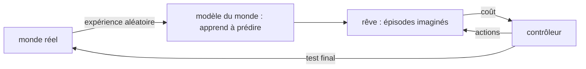

# Chapitre 14 — Modèles du monde

:::tip[En bref (TL;DR)]
**En bref.** Un modèle du monde apprend à prédire ce qui se passe ensuite, pour qu’un agent s’entraîne en imagination. Nous prouvons comment les erreurs de prédiction s’accumulent et nous entraînons un contrôleur entièrement dans le rêve du modèle.

**Mots nouveaux, en termes simples:**

- **Modèle du monde**: Un simulateur appris : il prédit ce qui se passe ensuite à partir de la situation actuelle et d’une action.
- **Imagination (rêve)**: S’entraîner dans le modèle du monde plutôt que dans le monde réel.
- **Trajectoire simulée**: Une séquence de pas simulée.
- **Accumulation d’erreur**: De petites erreurs de prédiction alimentent la prédiction suivante et s’additionnent.
- **Constante de Lipschitz**: Une limite sur la manière dont une fonction peut amplifier les différences entre ses entrées.
- **Contrôleur**: La petite politique qui choisit les actions.
- **Stratégie d’évolution**: Optimiser en essayant des variations aléatoires et en se déplaçant vers les meilleures. Aucun gradient nécessaire.
:::


L'apprentissage par renforcement (chapitre 13) apprend en agissant dans le vrai environnement, ce qui peut être lent, coûteux ou dangereux. Un **modèle du monde** permet d'apprendre par **imagination** : l'agent apprend à prédire ce qui se passe ensuite, puis s'entraîne dans sa propre simulation.

L'idée a été popularisée par *World Models* de Ha et Schmidhuber (2018), dont l'agent a trois parties :

| partie | rôle | dans ce chapitre |
|---|---|---|
| **V** (vision) | comprimer une observation en un court état | omise : notre état $(x,v)$ est observé exactement |
| **M** (mémoire / modèle) | prédire l'état suivant à partir de l'état et de l'action | un réseau entraîné par régression |
| **C** (contrôleur) | choisir les actions | un minuscule réseau entraîné **uniquement dans M** |

Les systèmes suivants (Dreamer, les « rêves » des agents modernes de jeu et de conduite) gardent la même recette. Le chapitre 15 montrera l'autre moitié de l'histoire : comment apprendre une *représentation* dans laquelle ces prédictions se font.




*La recette : apprendre un modèle à partir d’un peu d’expérience réelle, entraîner le contrôleur dans le rêve du modèle, puis le tester une fois dans le monde réel.*

## La tâche

Un point est posé sur une pente : position $x$, vitesse $v$, et une poussée $u\in[-1,1]$ que nous choisissons. La gravité le pousse **loin** de $x=0$, donc ne rien faire échoue. Le coût par pas est $x^2+0{,}1v^2+0{,}01u^2$ : le contrôleur doit maintenir le point en $0$.

```lean file=Ch14/Model.lean#env
```

Le modèle du monde ne voit jamais cette formule. Il ne voit que des **transitions** $(x,v,u)\to(x',v')$ collectées en agissant au hasard.

## Le modèle

```lean file=Ch14/Model.lean#world_model
```

C'est de l'apprentissage supervisé ordinaire : régression du *changement* d'état à partir de l'état et de l'action. Comme aux chapitres 11 à 13, la perte est une `Expr` : son gradient vient de `backprop`, vérifiée.

<Figure src="dream_drift.svg" alt="Dérive composee sur k pas imaginaires : la borne d'un modele Lipschitz 1,2 explose, celle d'un modele 0,5 reste sous 0,2" caption="La borne de composition de compounding_error, dessinee : l'erreur par pas s'empile geometriquement - avec Lipschitz 1,2 la borne explose au-dela de 6 apres 10 pas imagines, avec 0,5 elle sature a 2*eps. Les trajectoires courtes sont sures, les reves longs exigent une contraction : c'est le theoreme que l'horizon d'un modele du monde doit respecter." />

## Pourquoi les trajectoires imaginées dérivent

Un modèle à un pas est précis, mais l'imagination donne au modèle **ses propres prédictions** en entrée. Une petite erreur au pas 1 devient une partie de l'entrée au pas 2, et ainsi de suite. La vitesse de croissance de l'erreur dépend de combien le modèle amplifie les différences, sa **constante de Lipschitz** $L$ :

<Figure src="rollout_drift.svg" alt="Trajectoire réelle et trajectoire imaginée avec un modèle légèrement faux" caption="Les mêmes actions appliquées dans le monde réel et dans un modèle dont le terme de gravité est 10 % trop fort (tracé par Lean). Une petite erreur à un pas écarte lentement la trajectoire imaginée ; la courbe grise est la différence, multipliée par 10 pour être visible." />


<Figure src="compounding.svg" alt="Borne sur l’erreur des trajectoires imaginées pour trois constantes de Lipschitz" caption="La borne de compounding_error pour une erreur d’un pas égale à 1. Avec L inférieur à 1 elle plafonne, avec L = 1 elle croît linéairement, avec L supérieur à 1 elle croît exponentiellement." />


```lean file=Ch14/WorldModel.lean#compounding
```

- `compounding_error` : si le modèle se trompe d'au plus $\varepsilon$ par pas et est $L$-lipschitzien, après $k$ pas imaginés l'erreur est au plus $\varepsilon\,(1+L+\dots+L^{k-1})$.
- Avec $L=1$ cela vaut $k\varepsilon$ (dérive linéaire). Avec $L>1$ la croissance est exponentielle, avec $L<1$ elle reste bornée : `compounding_bounded` donne $(1-L)\cdot\text{erreur}\le\varepsilon$ pour tout $k$.

La forme close de la somme est aussi prouvée :

```lean file=Ch14/WorldModel.lean#geom
```

:::tip[Coin Lean : un théorème sur des fonctions *quelconques*]
`compounding_error` est énoncé pour des fonctions arbitraires `f` et `fh` sur les rationnels, avec les deux hypothèses sous forme de `∀`. La preuve est une récurrence sur $k$ : on décompose l'erreur par l'inégalité triangulaire, on applique les deux hypothèses, puis `grind` ferme l'arithmétique. Les seuls faits auxiliaires portent sur la valeur absolue (`absQ_add_le`) et sur un produit par un nombre positif (`Rat.mul_le_mul_of_nonneg_left`).
:::

## Entraîner le contrôleur dans le rêve

Le contrôleur est $u=\tanh(w_0x+w_1v+w_2)$. Au lieu de gradients à travers le temps (qui demanderaient une passe arrière écrite à la main à travers toute la trajectoire imaginée), nous utilisons une **stratégie d'évolution**, comme l'article d'origine (qui utilisait CMA-ES) : on perturbe $w$ au hasard, on joue des épisodes imaginés avec chaque perturbation, et on déplace $w$ vers celles qui coûtent moins. Tous les épisodes tournent dans le modèle appris ; le vrai environnement n'est pas touché pendant cette phase.

## Expérience

`lake exe worldmodel` collecte 2500 transitions avec des actions aléatoires (2000 pour l'entraînement), entraîne le modèle pendant 4000 pas d'Adam, entraîne le contrôleur 80 générations dans le rêve, puis le teste dans le **vrai** environnement depuis 100 positions de départ dans $[-1{,}5;1{,}5]$. Une graine.

**Le modèle.** RMSE à un pas sur 500 transitions de test : 0,0008 (position) et 0,0023 (vitesse). Avec les mêmes actions aléatoires dans le monde réel et dans le modèle, l'erreur de position après $k$ pas vaut :

| $k$ | 1 | 5 | 10 | 20 | 40 |
|---|---|---|---|---|---|
| erreur RMS | 0,0013 | 0,0058 | 0,0092 | 0,014 | 0,078 |

Elle croît avec $k$, et plus vite à la fin ; c'est le comportement qualitatif que `compounding_error` autorise. (Nous n'avons pas mesuré $L$ : c'est cohérent avec le théorème, pas un test de sa constante.)

**Le contrôleur.**

| contrôleur | entraîné dans | coût moyen, 40 pas | mesuré dans |
|---|---|---|---|
| aucun ($u=0$) | — | 228,5 | le réel |
| $w=(-6{,}40;-3{,}46;-0{,}03)$ | le rêve seul | **9,57** | le réel |
| même contrôleur | le rêve seul | 9,46 | le rêve |
| $w=(-6{,}63;-3{,}54;-0{,}03)$ | le monde réel | 9,57 | le réel |

Le contrôleur entraîné **uniquement sur des épisodes imaginés** se comporte aussi bien dans le vrai environnement que celui entraîné directement dedans, et son coût dans le rêve (9,46) est à moins de 1 % de son coût réel. Ne rien faire coûte 24 fois plus.

:::warning Pourquoi cela a marché, et quand cela ne marchera pas
- L'état est observé exactement, donc pas de partie vision, et la dynamique est lisse et de faible dimension : une cible facile pour un petit réseau, et le modèle est extrêmement précis.
- Un monde plus difficile révèle l'échec classique : le contrôleur **exploite les erreurs du modèle**, trouvant des actions excellentes dans le rêve et mauvaises dans la réalité. Remèdes : entraîner en boucle sur de nouvelles données réelles, pénaliser l'incertitude du modèle, utiliser de courts horizons imaginés.
- Prouvé : la borne de propagation d'erreur et les gradients de la perte de régression (chapitre 4). Non prouvé : que le modèle entraîné ait un $\varepsilon$ ou un $L$ petit, ou qu'un contrôleur optimisé dans le rêve soit bon dans la réalité.
:::

## Exercices

1. Prouvez que pour $L=1$, `geom 1 k` vaut $k$ (comme rationnel), par récurrence sur $k$ ; le pas de récurrence est le premier exercice Lean ci-dessous.
2. Montrez que la borne d'erreur est *atteinte* : trouvez $f$, $\hat f$ avec `absQ (fh - f) = ε` et constante de Lipschitz exactement $L$ pour lesquelles `compounding_error` est une égalité.
3. Lancez la démo avec seulement 5 pas d'entraînement du modèle et comparez les coûts « rêve » et « réel » du contrôleur.
4. Remplacez le modèle à un pas par un modèle qui prend **deux** états passés. La dérive en $k=40$ change-t-elle ?

**Exercices en Lean.** Le fichier `lean/LeanDL/Ch14/Exercises.lean` contient les énoncés ci-dessous, avec des `sorry` à remplacer. Les solutions démontrées sont dans `Solutions.lean`, à côté : essayez d’abord.

```lean file=Ch14/Exercises.lean#ex1
```

```lean file=Ch14/Exercises.lean#ex2
```

<details>
<summary>Indice 1</summary>

Dépliez `geom` : le nouveau terme est `1 + 1 * geom 1 k`.

</details>

<details>
<summary>Corrigé 1</summary>

```lean file=Ch14/Solutions.lean#sol1
```

</details>

<details>
<summary>Indice 2</summary>

Appliquez `compounding_error` avec `ε = 0` : la borne est `0 * geom L k`, qui vaut `0`.

</details>

<details>
<summary>Corrigé 2</summary>

```lean file=Ch14/Solutions.lean#sol2
```

</details>
