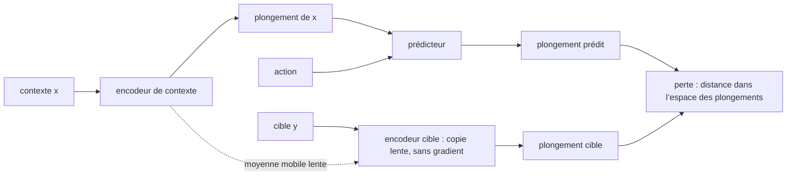

# Chapitre 15 — JEPA : prédire dans l'espace des représentations

:::tip[En bref (TL;DR)]
**En bref.** JEPA prédit dans un espace de représentations appris plutôt qu’en pixels. Nous prouvons pourquoi la solution triviale effondrée a une perte nulle, comment une cible EMA et une pénalité de variance la combattent, et nous testons les deux.

**Mots nouveaux, en termes simples:**

- **Représentation (espace des plongements)**: Une liste de nombres qui capture ce qui compte dans une entrée.
- **JEPA**: Architecture prédictive à plongement conjoint : prédire le plongement de la cible à partir du plongement du contexte, pas les pixels bruts.
- **Prédicteur**: Le réseau qui transforme le plongement du contexte (et une action) en plongement cible prédit.
- **Effondrement**: Le raccourci où toutes les entrées reçoivent le même plongement : la perte est nulle mais rien n’est appris.
- **EMA (moyenne mobile exponentielle)**: Une copie lente : à chaque pas elle se rapproche d’une petite fraction des poids actuels.
- **Arrêt du gradient (stop-gradient)**: Traiter une valeur comme une constante pendant la rétropropagation, pour qu’aucun apprentissage n’y entre.
- **Régularisateur de variance**: Une pénalité qui punit des plongements trop semblables entre eux.
- **Sonde linéaire**: Un modèle linéaire simple entraîné à lire une quantité dans un plongement, utilisé pour tester ce que le plongement contient.
:::


Le chapitre 14 prédisait l'*état* suivant. Dans le monde réel, l'état est une image de caméra, et prédire des pixels est à la fois coûteux et mal visé : l'essentiel d'une image est du détail imprévisible (les feuilles exactes d'un arbre, le bruit du capteur) sur lequel le modèle gaspille sa capacité.

L'**architecture prédictive à plongement conjoint** de Yann LeCun (JEPA ; I-JEPA et V-JEPA en sont les versions image et vidéo) prédit plutôt dans un **espace de représentations** appris :

1. un **encodeur** $s_\theta$ envoie un contexte $x$ (ce que l'on voit) vers un plongement ;
2. un **encodeur cible** $s_{\bar\theta}$ envoie la cible $y$ (ce que l'on veut prédire : un morceau caché, l'image suivante après l'action $\delta$) vers un plongement ;
3. un **prédicteur** $p_\phi$ envoie le plongement du contexte (et l'action) vers le *plongement cible prédit*.

La perte est la distance entre prédiction et cible **dans l'espace des plongements** :

$$ \mathcal L=\bigl\|\,p_\phi\bigl(s_\theta(x),\delta\bigr)-s_{\bar\theta}(y)\,\bigr\|^2 . $$

Les détails imprévisibles n'ont pas besoin d'apparaître dans le plongement. Quand le prédicteur dépend d'une action, c'est un **modèle du monde dans l'espace latent** (l'espace latent du chapitre 10, ici appris par l'encodeur), la forme que prend la recette du chapitre 14 pour des images.

```lean file=Ch15/Jepa.lean#jepa_loss
```




*Le JEPA : la perte compare des plongements, jamais des entrées brutes. L’encodeur cible est une copie lente de l’encodeur de contexte et ne reçoit aucun gradient.*

<Creators fr slugs="lecun" />

## Le piège : l'effondrement

:::info[Lire le chapitre 17 d'abord]
L'effondrement a un pendant arithmétique que ce chapitre ne peut pas prouver seul : pour la perte **contrastive** (InfoNCE), un embedding plat ne vaut pas $0$ — il vaut exactement $\log (n + 1)$, le plancher d'effondrement démontré au [chapitre 17](ch17-contrastive). JEPA contourne ce plancher en prédisant des distances plutôt qu'en classant des candidats, et c'est exactement pour cela qu'ici le plancher *est* zéro : une somme de carrés n'a pas de log à payer. Les deux chapitres décrivent le même ennemi de deux côtés — le chapitre 17 prouve ce que l'effondrement coûte, le chapitre 15 prouve pourquoi un prédicteur simple est heureux de le payer.
:::

Il y a une façon évidente d'annuler cette perte : faire en sorte que les deux encodeurs renvoient **la même constante**. Prédire le plongement cible devient trivial, et la représentation ne porte aucune information.

Les théorèmes le disent précisément. `collapse_zero` : l'effondrement a une perte exactement nulle sur toute paire d'entrées. `collapse_is_minimal` : une somme de carrés étant positive, **l'effondrement est un minimiseur global** (sur les rationnels). La descente de gradient sur cette seule perte a donc de bonnes raisons d'y aboutir, et le reste du chapitre porte sur les moyens de l'éviter.

## Remède 1 : une cible lente (EMA) avec arrêt du gradient

Si l'encodeur cible n'est pas entraîné par la perte mais est une **moyenne mobile exponentielle** de l'encodeur de contexte, $\bar\theta\leftarrow m\bar\theta+(1-m)\theta$, et qu'aucun gradient n'y entre (« stop-gradient »), les deux encodeurs ne peuvent pas s'entendre pour atteindre la solution triviale. C'est ce que font BYOL, DINO et I-JEPA. La mise à jour est une contraction :

<Figure src="ema_distance.svg" alt="Distance entre paramètres cible et contexte pour trois taux EMA" caption="La cible EMA : la distance aux paramètres du contexte rétrécit comme m puissance k (théorème emaIter_error). Une cible lente (m = 0,999) suit très lentement ; m = 0,9 copie presque l’encodeur de contexte." />


```lean file=Ch15/Jepa.lean#ema
```

`ema_error` et `emaIter_error` sont le même argument géométrique que la mise à jour TD du chapitre 13 : chaque mise à jour multiplie la distance par $m$, donc après $k$ mises à jour par $m^k$. En pratique $m\approx0{,}99$ à $0{,}999$, une cible *lente*. Nous ne prouvons **pas** que l'EMA empêche l'effondrement : c'est un fait empirique, que l'expérience ci-dessous teste.

<Figure src="spread_collapse.svg" alt="Penalite de dispersion 2*d^2 selon la distance d des plongements, annulee exactement au point effondre d = 0" caption="La penalite de dispersion est une parabole : un lot de 2 plongements a distance d a une dispersion de 2 d^2 (l'identite des paires au carre demontree au chapitre), et le lot effondre - tous les plongements egaux - vaut exactement zero (spread_const). La penalite ne decourage pas l'effondrement a la marge : elle est minimale exactement la, donc la ponderer retire reellement l'effondrement des optima." />

<Figure src="var_hinge.svg" alt="La penalisation charniere max(0, delta - dispersion) : de delta a zero a la dispersion delta, puis plate" caption="La regularisation de variance est une charniere : le batch n'est penalise que tant que sa dispersion reste sous delta, et la penalisation est exactement nulle des que les plongements sont assez disperses - pourquoi elle arrete l'effondrement au seuil de la proposition du chapitre sans jamais combattre une representation saine." />

## Remède 2 : garder explicitement les plongements dispersés

Les méthodes de type VICReg ajoutent un régularisateur qui pénalise des plongements trop semblables : un terme de **variance** (chaque coordonnée doit garder une variance d'au moins $\gamma$) et un terme de **covariance** (les coordonnées ne doivent pas être redondantes). Nous prouvons la propriété qui fait fonctionner le terme de variance, sous la forme la plus simple (plongements scalaires, une « dispersion » nulle exactement quand tous les plongements coïncident) :

<Figure src="collapse_penalty.svg" alt="Objectif d’un prédicteur parfait pour la représentation effondrée et une représentation informative" caption="L’objectif d’un prédicteur de perte de prédiction nulle (gamma = 1) : la solution effondrée coûte w fois gamma, une solution informative assez dispersée ne coûte rien, donc l’effondrement n’est plus un minimiseur (théorème collapse_not_optimal)." />


```lean file=Ch15/Jepa.lean#variance
```

- `spread_const` et `spread_pair_eq_zero` : un lot a une dispersion nulle exactement quand il s'est effondré.
- `collapse_not_optimal` : avec un poids de pénalité $w>0$, une représentation qui prédit parfaitement *et* garde une dispersion $\ge\gamma$ obtient $0$, alors que la représentation effondrée obtient $w\gamma>0$. L'effondrement **n'est plus un minimiseur**.

Dans le modèle, ce sont les fonctions `meanE`, `varE`, `covE` et `regLoss` ; ce sont des expressions, donc leurs gradients viennent aussi de `backprop` :

```lean file=Ch15/Model.lean#vicreg
```

## Le modèle

L'encodeur, le prédicteur et l'encodeur cible partagent un seul vecteur de paramètres. Le stop-gradient est alors un **masque** : après `backprop`, les entrées du gradient de l'encodeur cible sont remplacées par des zéros.

```lean file=Ch15/Model.lean#jepa_model
```

## Expérience

Les données : un angle caché $\theta$ engendre une *vue* $(\cos\theta,\ \sin\theta,\ 3g_1,\ 3g_2)$ avec un petit bruit sur les deux premières coordonnées, et de **grandes perturbations imprévisibles** $g_1,g_2\sim\mathcal N(0,1)$ sur les deux dernières. La cible est la vue de $\theta+\delta$, avec une action aléatoire $\delta\in[-1,1]$. L'encodeur est $4\to8\to2$, le prédicteur $(2+1)\to8\to2$.

Nous entraînons 3000 pas d'Adam (lots de 32) et mesurons, sur des données fraîches, l'écart-type de chaque coordonnée du plongement et le $R^2$ d'une **sonde linéaire** qui tente de lire $\cos\theta$, $\sin\theta$ et la perturbation $g_1$ dans le plongement de dimension 2. Une bonne représentation a un $R^2$ proche de 1 pour les deux premiers et proche de 0 pour le troisième. Une graine chacun.

| entraînement | écart-type du plongement | $R^2$ cos θ | $R^2$ sin θ | $R^2$ perturbation |
|---|---|---|---|---|
| encodeur non entraîné | 0,17 ; 0,37 | 0,10 | 0,60 | 0,81 |
| naïf (la perte seule) | **0,003 ; 0,002** | 0,04 | 0,03 | 0,01 |
| cible EMA + stop-gradient | 1,48 ; 1,37 | **0,96** | **0,96** | 0,01 |
| variance + covariance, poids 1 | 1,15 ; 1,13 | **0,98** | **0,98** | 0,00 |
| variance + covariance, poids 5 | 1,09 ; 1,12 | 0,35 | 0,63 | **0,89** |

Ce que disent les chiffres :

- **Le JEPA naïf s'effondre** : la perte atteint $5\times10^{-5}$, le plongement a un écart-type de $0{,}003$, et la sonde ne voit rien. C'est exactement le minimiseur contre lequel le théorème met en garde.
- **L'EMA avec stop-gradient ne s'effondre pas ici**, et apprend la bonne chose : l'angle est encodé, et la perturbation imprévisible **ne l'est pas**. Prédire dans l'espace des représentations a ignoré le bruit parce que le bruit ne se prédit pas.
- **Le régularisateur de variance fonctionne avec un poids 1** (et empêche aussi l'effondrement), mais **avec un poids 5 il échoue de façon instructive** : le plongement a la variance exigée, mais l'obtient à partir des *perturbations*, dont la variance est grande et gratuite. Le régularisateur supprime le minimiseur effondré, comme le dit le théorème, mais il ne dit pas *quelle* solution non effondrée on obtient. La sonde montre qu'éviter l'effondrement est nécessaire, pas suffisant.

:::warning Ce qui est prouvé, et ce qui ne l'est pas
Prouvé : l'effondrement est un minimiseur global de la perte simple ; la mise à jour EMA est une contraction géométrique ; la pénalité de variance exclut l'effondrement comme minimiseur ; et (chapitre 4) les gradients de toutes les pertes. Non prouvé : que l'EMA empêche l'effondrement (la littérature n'a que des analyses partielles dans des modèles linéaires), que l'optimum régularisé soit informatif, ou que ces résultats se reproduisent avec d'autres graines. Les données sont un jouet : une variété de dimension deux avec deux perturbations évidentes.
:::

## Exercices

1. Prouvez qu'avec un plongement *vectoriel* la perte est encore positive et que l'encodeur constant avec le prédicteur identité atteint encore $0$ (indice : sommez les énoncés scalaires sur les coordonnées).
2. Dans `collapse_not_optimal`, remplacez l'hypothèse $\gamma\le s$ par $s\ge\gamma/2$. À quoi le score $w\gamma$ de l'effondrement doit-il maintenant être comparé ?
3. Lancez l'expérience avec une perturbation d'écart-type $0{,}3$ au lieu de $3$. Le poids de variance 5 échoue-t-il encore ?
4. Ajoutez le prédicteur conditionné par l'action de ce chapitre au contrôleur du chapitre 14 : planifiez en faisant évoluer des actions qui minimisent la distance entre le *plongement prédit* et un plongement-but.

**Exercices en Lean.** Le fichier `lean/LeanDL/Ch15/Exercises.lean` contient les énoncés ci-dessous, avec des `sorry` à remplacer. Les solutions démontrées sont dans `Solutions.lean`, à côté : essayez d’abord.

```lean file=Ch15/Exercises.lean#ex1
```

```lean file=Ch15/Exercises.lean#ex2
```

<details>
<summary>Indice 1</summary>

Dépliez `spread` et `sumL` : le seul terme est `(a - a) * (a - a)`.

</details>

<details>
<summary>Corrigé 1</summary>

```lean file=Ch15/Solutions.lean#sol1
```

</details>

<details>
<summary>Indice 2</summary>

Dépliez `vreg` : la condition `s < γ` est fausse, donc le `if` prend sa branche `else`.

</details>

<details>
<summary>Corrigé 2</summary>

```lean file=Ch15/Solutions.lean#sol2
```

</details>
