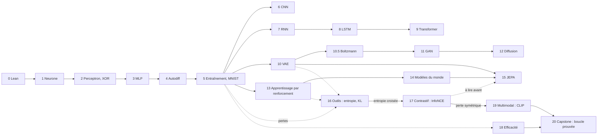

# Le Deep Learning en Lean 4

Ce cours enseigne **Lean 4** et **le deep learning** en même temps. Chaque modèle est implémenté uniquement en Lean 4, sans Python ni bibliothèque externe. Chaque fois qu'une propriété du modèle peut être énoncée précisément, elle est **démontrée** en Lean.

## Fonctionnement du cours

- Chaque chapitre correspond à un fichier Lean du dossier `lean/`. Le code affiché sur ces pages est extrait de ces fichiers : il est donc compilé et vérifié.
- Chaque chapitre contient un **Coin Lean** : la fonctionnalité de Lean nécessaire pour ce chapitre, présentée au moment utile.
- Chaque chapitre se termine par des exercices (fichiers Lean contenant des `sorry` à remplacer).
- Chaque chapitre commence par un encadré **En bref (TL;DR)** : un court résumé et les mots nouveaux en termes simples. Si vous êtes perdu, consultez l’[Index des concepts essentiels](concepts-index) (quels concepts sont indispensables, et où) et le [Glossaire](glossary).
- Avant le chapitre 5, lisez la [Carte des prérequis et des dépendances](prerequisites) : les six blocs mathématiques, et quel chapitre a besoin de quoi.
- Le cours se termine par trois [projets de synthèse](projects) avec cahier des charges, critères de réussite et grille d'évaluation séparant les garanties prouvées des objectifs empiriques.

## Deux manières d'utiliser les nombres

Lean peut calculer sur les nombres flottants, mais ce cours ne certifie pas les effets d'arrondi IEEE-754 ; les théorèmes exacts sont énoncés sur `Rat` ou sur des structures abstraites. Le code est donc écrit une seule fois, **de façon générique sur un type de scalaires** `α` :

- Pour **exécuter** un modèle, on prend `α := Float`.
- Pour **démontrer** des théorèmes, on prend des nombres exacts (`Int`, `Rat`) ou des structures algébriques abstraites, grâce aux classes d'algèbre fournies avec la tactique `grind` de Lean.

:::info Ce que signifie « démonstration » ici
Les preuves portent sur le modèle mathématique exact (par exemple un réseau sur les rationnels). Elles ne certifient pas les arrondis de `Float`. Cela est précisé chaque fois que c'est important.
:::

*Le cours en un coup d'œil : un tronc commun (chapitres 0 à 5), puis trois branches (images et séquences, modèles génératifs, prise de décision) qui se rejoignent dans les derniers chapitres. Le chapitre 16 rassemble et démontre les outils de probabilité et d'information que les pertes des chapitres 5, 10, 11 et 13 supposent ; le chapitre 17 les dépense sur l'apprentissage contrastif (InfoNCE) et est le compagnon naturel du chapitre 15 (JEPA) ; le chapitre 18 les dépense sur le déploiement : quantification, équilibrage MoE, distillation et lois d'échelle, démontrés.*

## Programme

| # | Chapitre | Vous apprenez (Lean) | Vous apprenez (deep learning) |
|---|----------|----------------------|-------------------------------|
| 0 | Installation et tour de Lean | `def`, `#eval`, `theorem` | — |
| 1 | Le neurone seul | structures, classes de types, code générique | somme pondérée, biais, activations |
| 2 | Le perceptron et le XOR | `grind`, preuves sur les anneaux ordonnés | règle d'apprentissage, XOR, premier hiver de l'IA |
| 3 | Le perceptron multicouche | types inductifs indexés, récurrence | couches, XOR résolu, universalité booléenne, gradient à la main |
| 4 | Réseaux profonds et autodiff | types inductifs, récursion structurelle, preuves par induction | rétropropagation, mode direct/inverse, correction démontrée |
| 5 | Pertes, optimiseurs, régularisation, MNIST | listes, Fin, preuves sur les corps | entropie croisée, SGD/momentum/Adam, décroissance des poids, MNIST à 96 % |
| 6 | Réseaux convolutifs | types dépendants dans les indices, sommes doubles | convolution, partage des poids, équivariance, CNN à 97 % sur MNIST |
| 7 | Réseaux récurrents | récurrence sur Nat, hypothèses de théorème | BPTT, gradients qui s'évanouissent et explosent, tâche de mémoire |
| 8 | LSTM et mémoire à portes | bornes sur les produits, Rat | porte d'oubli, chemin additif, expériences honnêtes sur la mémoire |
| 9 | L'attention et le Transformer | corps abstraits, listes et permutations | softmax, ensemble vs séquence, masque causal, normalisation de couche, mini-Transformer |
| 10 | Autoencodeurs et VAE | l'astuce de reparamétrisation comme théorème | variables latentes, pénalité KL, échantillonnage |
| 10.5 | Machines de Boltzmann | algèbre de Gibbs exacte sur `Rat` | modèles à base d'énergie, fonction de partition, invariance par balayage Gibbs, divergence contrastive |
| 11 | GAN | optimalité par complétion du carré | jeu minimax, discriminateur optimal, instabilité |
| 12 | Modèles de diffusion | récurrence sur les calendriers, identités de corps | processus direct en forme fermée, pas de débruitage exact |
| 13 | Apprentissage par renforcement | récursion, identités d'anneau | mises à jour de Bellman, Q-learning, REINFORCE avec ligne de base |
| 14 | Modèles du monde | récurrence avec hypothèses sur des fonctions, inégalité triangulaire | apprendre la dynamique, trajectoires imaginées, accumulation d'erreur, entraîner un contrôleur dans un rêve |
| 15 | JEPA | raisonnement sur les minimiseurs, suites géométriques | prédire dans l'espace des représentations, effondrement, cibles EMA, régularisation de variance |
| 16 | Outils mathématiques : probabilité, entropie, KL | récursion sur `Nat` pour les produits scalaires, classes de types abstraites (`LawfulLog`), inégalités sur `Rat` | espérance, variance, entropie, entropie croisée = entropie + KL, inégalité de Gibbs KL ≥ 0 |
| 17 | Apprentissage contrastif : InfoNCE, exactement | réemploi du gradient d'entropie croisée du chapitre 5, softmax exact sur `Rat` | softmax comme distribution, perte ≥ 0, plancher d'effondrement `log (n+1)`, gradient `p − onehot`, un plongement entraîné |
| 18 | Efficacité : quantification, MoE, distillation, lois d'échelle | bornes sur `Rat`, sommes de carrés, héritage en une ligne du chapitre 16 | erreur de quantification < un pas, pénalité de concentration MoE `Somme p^2 >= 1/E`, distillation `CE = H + KL`, forme du modèle d'échelle, démontrée |
| 19 | Apprentissage multimodal : la perte symétrique de CLIP | composition de la machine du chapitre 17 dans les deux directions | InfoNCE symétrique, positif partagé, plancher d'effondrement `log B` dans chaque direction, forme close du batch 2x2 |
| 20 | Capstone : toute la boucle d'entraînement, prouvée | composition du kit du chapitre 5 : décroissance + clipping + schedule en une recette | pas invisible dans la boîte, forme close `(1-lr(2+wd))^t w0`, perte jamais croissante à aucun itéré, budget de schedule fini, MNIST 90 % en 3 époques |

Commencez par le [chapitre 0](ch00-setup).
